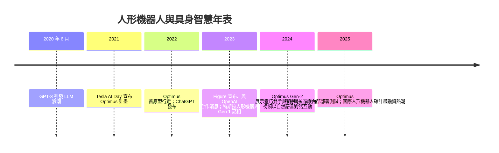

# 節標題：Tesla Optimus 與具身智慧

## 2021 年 8 月：一句話創造一個產業

2021 年 8 月的特斯拉 AI Day，舞台上出現的卻是一位穿著機器人連身服跳舞的人類。伊隆・馬斯克宣布 Tesla 將建造人形機器人「Tesla Bot」（後命名 Optimus）：身高 1.72 公尺、目標載重 20 公斤、步行時速 8 公里，「消除危險、重複、無聊的工作」。此言一出，業界一半人當作行銷噱頭，一半人立刻調整了融資策略——因為過去三十年人形機器人一直是學院項目或日本形象工程，從來沒有一家市值最高的製造公司把它寫進商業計畫。

2022 年 9 月的第二届 AI Day 上，真正的 Optimus 原型在台上緩慢行走（當時僅能以未裝背板的工程機展示）；2024 年第二季的股東會與年底的第一代發布影片，Gen 2 已能以更流暢步態行走、用兩指精密夾持雞蛋不碎、跟隨人動作做摺衣。特斯拉把造車與火箭式的快速迭代文化直接移植過來：電池、無框永磁馬達、行星滾柱絲槓關節、鑄造工藝、自研晶片，每一件都信手拈來自家汽車供應鏈。更關鍵的，是腦袋——它宣稱直接沿用 Tesla FSD 的視覺神經網路。

## FSD 帶來的「外溢」：感知、資料與自動標註

特斯拉自我標榜的優勢，除了造車供應鏈之外，另有三點：

1. **純視覺方案**：以 8 攝取像機和端到端神經網路取代雷射雷達（2021 年北美車型移除雷達、2023 年移除超音波），訓練其在城市街頭辨識行人、路緣、遮蔽物；機器人的手臂/身體控制與任務規劃亦採用端到端神經網路做決策，2024 年的示範影片宣稱大規模以神經網路生成全身運動。
2. **自動標註流水線**：特斯拉以數百章程 GPU 進行 4D 自動標註——不為每一幀人工畫框，而是讓模型在世界座標系下重構 3D 情境，一套理念可無縫遷移到機器人攝影機的物體識別與抓取位姿估計。FSD 的 Dojo 超級電腦因此不只是「轉身做機器人的算力基地」，更是它的出生證明。
3. **資料循環宇航**（AI as Data Flywheel）：汽車每天產生上億公里駕駛資料；機器人工廠若達量產，將以類似集體方式收集操作資料，以「在真實環境中不斷訓練」作為護城河。

## 大語言模型：具身智慧的語言層

同期 AI 領域的劇變——大語言模型與多模態大模型（OpenAI 的 GPT-4V、Google 的 Gemini）——徹底改變了機器人的「大腦架構」。傳統機器人必須由工程師預先編寫任務規劃樹；如今可以把自然語言指令（「把桌上的杯子放回架子的第二層」）輸入 LLM，由它拆解成子任務、調用技能庫、根據語義理解找尋未知物件。**VLA（Vision-Language-Action）**架構成為 2023-2025 年的顯學：視覺與語言模型提供語義層，底下接編碼世界狀態的動作策略（由強化學習、模擬訓練或模仿學習訓練而成）。

## 競賽與資本路線之爭

Optimus 宣告後，人形機器人融資在硅谷條紋化爆發：

- **Figure AI（美國）**：2023 年 Brett Adcock 創立，2024 年與 OpenAI 簽署合作（Figure-01 能理解對話式指令）、獲微軟、OpenAI、NVIDIA、貝索斯級別投資人支持，並以寶馬工廠部署為情境訓練夥伴；
- **1X Technologies（挪威，後搬美國）**：OpenAI 投資，其 NEO 家用人形主打安全柔軟機構；
- **Apptronik（美國）**：Appotonik Apollo，出 NASA JSC 技術之門；
- **Unitree（宇樹，中國杭州）**：以四足機器狗起家、隨後以 1/10 價格的人形平台 G1 撼動全場；
- **Agility Robotics**、**Fourier（傅利葉）、Sanctuary AI** 緊隨其後。

資本路線分成兩個陣營：一派堅信「機就是本體」，要積累 360 度硬體能力；另一派押注「模型即本體」，認為世界模型和任務規劃足夠強大時，任何身體皆可通用。骨幹 VC 之間的 (~ $1B 為門檻) ABS 階段大賭注，以及 Tesla 動員整體產業的人型機器人期待，都指向 2024-2025 年（「首個量產規模的人形機器人雇用於生產線」）的競速節點。

更重要的是**經濟學**：機器人若要在工廠鋪開，必須換算成「替代一個勞工一天多少小時的單位經濟性」。特斯拉目標是年產百萬台、並以自有工廠作為首批客戶——垂直整合策略讓它可以先用自家場景規訓機器人，再外銷到其他產業，這正是 Optimus 與其他新創最大的差異：它有一條「自家需求導向」的低成本驗證鏈。

## 退一步看

Optimus 的故事還在進行時，本書無法預言結局。但值得記錄的是結構性改變：人形機器人在 2021 年之前，幾乎沒有一家世界級公司All In；到 Tisch 過去四年間，它已成為資本市場的通用話語（「物理世界的 AI」）。遠端操作的數據館、密集場景的真實資料、大模型的語言腦、量產的關節成本——這些過去各自隔絕的環節，第一次被一條主線串起。下一節，我們回到人的位置，問那個從 Asimov 以來就該被問的問題：若這些真的成真，我們準備好如何與它們共處了嗎？
