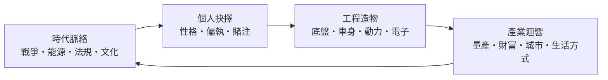

# 前言：陸地上的自由延伸

> 「我要為大眾打造一種誰都買得起的汽車。」——亨利·福特
> 「我設計的不是汽車，是讓人們遺忘機械的存在。」——（賓尼法利納設計哲學）

## 一部由「人」寫成的汽車史

沒有任何一種人造物，像汽車一樣徹底重塑了地球的面貌與人類的生活節奏。公路網切割了大陸，郊區在車輪上蔓延，城市為它讓出車道與停車格，約會、通勤、公路旅行與交通堵塞，共同構成了二十世紀的日常。而這一切，始於 1886 年 1 月 29 日一份編號 DRP 37435 的德國專利。

本書要講的，不是機器的編年史，而是**機器的塑造者**：

- 卡爾·本茨，那個窮到靠未婚妻嫁妝才保住股份的固執工程師，造出了人類第一輛汽油汽車——卻不敢把它開上街。
- 貝爾塔·本茨，人類史上第一位長途駕駛者，用一趟瞞著丈夫的百公里試駕，替汽車贏得了公眾。
- 亨利·福特，把裝配線的靈感從芝加哥肉品包裝廠搬進汽車廠，讓底盤組裝從十二小時縮到九十三分鐘。
- 阿爾弗雷德·斯隆與哈利·厄爾，一個用「年度改款」發明了消費主義，一個讓汽車設計師第一次成為藝術家。
- 費迪南德·保時捷，在獨裁者的委託下造出甲蟲車，卻在戰後淪為戰俘。
- 喬治亞羅、甘迪尼、賓尼法利納，三個義大利人用鉛筆與楔形，畫出了人類對速度的集體幻想。
- 本田宗一郎，鐵匠之子，用一顆不需要觸媒轉化器的引擎，贏下了美國最嚴苛的環保法案。
- 貝拉·巴倫伊與尼爾斯·博林，一個讓車身學會「犧牲自己」保護乘客，一個發明了三點式安全帶並無償放棄專利——拯救了上百萬條生命。
- 馮·霍茲豪森與馬斯克，取消了百年不變的水箱護罩，用滑板底盤與巨型壓鑄，把汽車變成了裝著輪子的電腦。

## 為什麼要讀「設計者的故事」？

因為**汽車從來不只是一台機器，它是時代矛盾的金屬結晶**。

T 型車的黑色，是快乾漆對流水線速度的讓步；火箭尾翼，是冷戰航空時代投射在公路上的圖騰；甲蟲車的重生，是英國佔領軍少校在廢墟裡點亮的一盞燈；三點式安全帶的無償開放，是商業利益與人命之間的一次偉大讓渡；Gigacasting 的一體壓鑄，則是對福特「愈少零件愈好」哲學跨越百年的遙遠呼應。

本書的每一節，都沿著同一條線索展開：

工程與底盤、製造與工藝、美學與氣動、安全與電子——四大技術維度互相交織，而「設計者」正是它們交會的支點。

## 閱讀路線

本書共五篇十章、三十節，依時間軸推進：

1. **馬車終結者與流水線創世紀**（1880s–1920s）：本茨夫婦與福特。
2. **車身美學崛起與底盤革命**（1930s–1950s）：斯隆、厄爾、保時捷、蘭吉亞與雪鐵龍。
3. **流線美學、超跑與日系革命**（1960s–1980s）：義大利設計三巨頭與本田、豐田。
4. **安全革命與平台化整合**（1990s–2010s）：巴倫伊、博林、MQB 平台與普銳斯。
5. **純電重構與 AI 智慧座艙**（2010s–至今）：特斯拉、自動駕駛與第三生活空間。

所有故事皆取材於真實歷史事件——專利文件、法院判決、公司檔案、論文與當事人回憶。有趣，但絕不虛構。

讓我們從一個不敢自己開車上街的曼海姆工程師說起。
