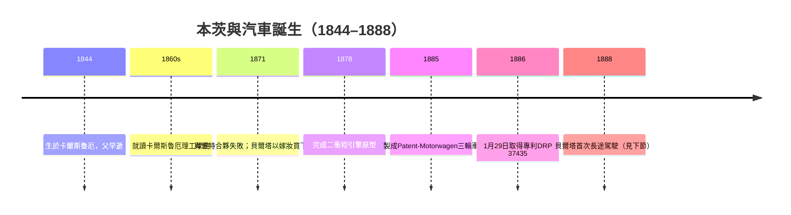

# 三輪車的歷史破曉：1886年Benz Patent-Motorwagen

## 貧困中長大的機械師

卡爾·本茨（Karl Benz，1844–1929）出生於德國巴登的卡爾斯魯厄（Karlsruhe），父親是一位火車頭司機，在本茨兩歲時因工傷去世。寡母約瑟芬娜靠著微薄的積蓄咬牙供兒子讀書——這在當時的德國並非理所當然。本茨不負母望，考入卡爾斯魯厄理工學院（Polytechnikum），師從著名的費迪南德·雷登巴赫（Ferdinand Redtenbacher），後者被視為德國機械工程學科的奠基人之一。正是這段教育經歷，讓本茨不只學會了車鉗銃磨的手藝，更學會了「用理論指導製造」的思維方式——他日後區別於絕大多數修車匠的關鍵，正在於此。

畢業後的本茨過著典型的德國工匠式漂泊生活：先在機械廠當學徒式職工，做過秤桿廠，也在橋樑工地上畫過圖。他後來回憶，那段日子「工資微薄，工作繁重」，但每一份工作都在他的腦子裡積累了「動力機械」的想像。1871年，二十七歲的本茨與機械技師奧古斯特·里特（August Ritter）在曼海姆合夥開設了一家「機械工場」。這個合夥從一開始就注定不穩：里特既缺乏資金也缺乏遠見，工不到一年就鬧著退夥，索價甚高，工場幾乎被拖入破產。

## 一位用嫁妝下注的女性

就在本茨財務崩潰邊緣，出現了他一生中最關鍵的投資人——不是銀行家，而是他的未婚妻貝爾塔·林格（Bertha Ringer）。這位鐵匠之家的女兒眼光極準：她看出本茨的價值不在工場的破舊設備，而在那顆「一定要造出無馬之車」的固執腦袋。她毅然拿出自己的嫁妝，買下了里特退出的股份。用今天的話說，貝爾塔以私人資本收購了合夥人的「抗議性退出」，保住了公司的控制權。1872年7月，兩人結婚。此後數十年，貝爾塔始終是本茨公司的實際經濟支柱與精神支柱——這在十九世紀的德國商界，是一樁近乎離經叛道的事。

兩人婚後本茨進入人生最黑暗也最專注的歲月：為了還債，他替別人設計與製造金屬製品、甚至造過文具與水平儀，而在自家工場的角落，他偷偷設計他的二衝程引擎。1878年除夕夜，本茨完成了他的第一台二衝程臥式引擎，接著在1880年前後取得多項專利（包括點電火裝置、化油器構造與水管冷卻等核心技術）。可世俗的資本依舊不看好「汽車」概念，本茨被迫與多個投資人合作又分道，公司名稱與股權幾度更替，他的個人控制權時常被稀釋——他一生最大的恐懼，就是被金主趕出自己的事業。

## 1885年：三輪車在曼海姆誕生

1885年冬，本茨在曼海姆的工場中造出了那台改變世界的機器：**Benz Patent-Motorwagen**。它的心臟是一台單缸四行程汽油引擎，排氣量954 cc，額定功率僅約0.75馬力（後期版本提升至1.5–2.5馬力），引擎水平地安裝在後軸之上，用皮帶與鏈條把動力傳到後輪；冷卻採蒸發式水箱；車架是本茨為這台機器專門設計的鋼管環形結構——它不是馬車，而是為機器而生的車體。因為後輪左右各一、前輪單獨一只，加上當時轉向機構的工程難度，本茨選擇了三輪佈局：這是工程折衷，不是審美選擇。

1886年1月29日，帝國專利局核准了本茨的專利 **DRP 37435**——「以汽油引擎驅動的車輛」。這份文件被後世公認為汽車的出生證明。同年7月3日，本茨在曼海姆當眾試車，人們看到的不是奇蹟，而是一台哐噹作響、屢屢熄火的女巫座騎；報紙幾乎無人理會，市民有人報警投訴這台「發出噪音的馬車」。本茨後來自嘲：「我信賴的是我的引擎，我的引擎卻幾乎不信任我。」

## 同時代的另一條路：戴姆勒與邁巴赫

幾乎在同一時間，斯圖加特附近的坎斯塔特（Cannstatt），戈特利布·戴姆勒（Gottlieb Daimler）與威廉·邁巴赫（Wilhelm Maybach）走著另一條技術路線。兩人1883–85年研製出轉速遠高於同代的直立式高速汽油引擎（著名的「老座鐘」，Grandfather Clock，轉速可達約600–700 rpm，而本茨早期引擎轉速僅約300多rpm），1886年把它裝上一輛改裝的四輪馬車，製成了「機動馬車」（Motorkutsche）。本茨是「為引擎造車」，車體全新設計；戴姆勒與邁巴赫則是「把引擎塞進馬車」，先證明動力可移植，再談車身。這兩條路線在日後半個世紀，分別化為賓士的嚴謹整體設計傳統，與戴姆勒（梅賽德斯）的高轉速、輕量、性能傳統——邁巴赫正是後世高性能引擎設計師的祖師。

## 時代的橡皮筋：法律、燃料與人才

這台車的誕生，被制度與社會的橡皮筋拉著。當時德意志帝國的規例把此類機動車輛視同馬車，城郊最高車速不得超過6 km/h——汽車在天性上想要奔跑，法律卻要求它散步。燃料更是荒謬的難題：汽油並非日用品，本茨要向**藥房**購買作為清潔溶劑的石油醚（ligroin）；日後貝爾塔長途試駕時，中途補給的地點正是維斯洛赫的一家藥房。製造另一方面，德國當時並無「汽車工程師」這個職業，本茨只能靠自學的機械師與觀察馬車匠的方式拼湊出一條生產線。

1886年的破曉之所以屬於本茨，不在於他造出了最快的車，而在於他是第一個把「引擎＋底盤＋點火＋化油＋冷卻」整合成一台**能合法申請專利、能行駛、能銷售**的整體機器的工程師。專利DRP 37435的意義是制度性的：它把「無馬之車」從作坊幻想，轉成了十九世紀末德國最擅長的東西——受法律保護的技術資產。汽車產業，從一張專利證書上站立了起來。

