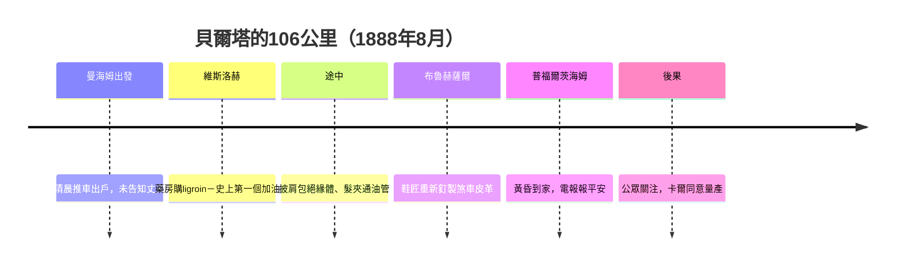

# 貝爾塔本茨的百公里勇氣試駕

## 丈夫不敢出的事，妻子替他出

1888年8月初的一個清晨，曼海姆的本茨家中，貝爾塔·本茨（Bertha Benz，1849–1944）寫了一張留給丈夫的字條，帶著兩個兒子——十五歲的歐根（Eugen）與十三歲的理查（Richard）——把那台躲藏在工棚裡的Benz Patent-Motorwagen推出門外，搖著曲柄發動了它，朝著西南方約106公里外的普福爾茨海姆（Pforzheim）她的娘家出發。她**沒有告知丈夫**。卡爾·本茨花費十餘年心血造出汽車，卻在公眾的嘲笑與報警投訴面前退縮了；他認為這台僅0.75–1.5馬力的機器還需要打磨，不願在工程完善前丟臉。貝爾塔判斷：等下去，機器永遠不會「完善」——它需要的是被人們看見。

這趟駕駛在技術與社會雙重意義上史無前例：此前從沒有人駕駛汽車走過這麼長的鄉間道路，從沒有人替這台只有三個輪子的機器在途中買過燃料、修過零件、對付過山路。貝爾塔等於是把一台工程原型，變成了一次**公開的、有婦孺見證的可靠性實驗**。

## 一路的故障清單，就是第一份汽車售後手冊

從曼海姆到普福爾茨海姆的路上，貝爾塔母子三人遭遇的故障，幾乎構成了一份手抄的早期汽車故障手冊：

- **燃料耗盡**：汽車不是馬，不能吃路邊的草。行至維斯洛赫（Wiesloch）時燃料告急，貝爾塔走進當地的城市藥房，購買了作為清潔溶劑出售的石油醚（ligroin）——這家藥房因此被後世追認為「世界上第一個加油站」。今天的Wiesloch藥房牆上，還掛著這段歷史的紀念銘牌。
- **電氣絕緣開裂**：點火線圈的絕緣層在路上破裂，導致不跳火。貝爾塔取下身上的手織披肩（一說為毛線織物），纏裹絕緣體，硬是把電氣問題「用衣著修復」了。
- **燃料管堵塞**：油路被雜質堵住，車子毫無辦法地熄火。貝爾塔拔下髮髻上的**髮夾**，用它疏通了燃油管。汽車史上第一根「通針」，是一根女人頭上的鋼針。
- **煞車皮革磨光**：木質煞車塊上的皮革被磨得失去摩擦力。母子三人推車下山之餘，貝爾塔在布魯赫薩爾（Bruchsal）附近請一位鞋匠把皮革重新釘上——這被視為汽車史上第一次「煞車皮維修」，也促使本茨日後把煞車皮革改進為更耐用的設計。
- **上坡動力不足**：0.75馬力與齒比設計對付不了山丘，兩位少年下車推車、貝爾塔掌舵；因此她也順手「發明」了低檔的概念——建議丈夫增設更低的齒比檔位，以應付坡道。

他們於黃昏抵達普福爾茨海姆，把電報發回曼海姆。卡爾·本茨讀到電報時，第一反應是恐慌：他的機器還在路上趴窩三次，丟臉了嗎？但三天的喧騰很快證明：路人圍觀、報紙跟蹤、藥房与市鎮的談論，把「本茨汽車」第一次推進了公眾意識。貝爾塔用一次駕駛完成的行銷，勝過丈夫十年來的一切技術說明書。

## 一位女性的工程判斷

必須強調，這趟旅程遠不止「勇氣」二字。它是一次工程路試與產品意見回饋：油路清理、絕緣加強、齒比增加低速檔、煞車皮革加耐久、後來車身加寬輪距——多項改進都能追蹤到這104公里路途上的教訓。貝爾塔對產品的理解，來自她自1871年就深度參與公司財務與經營的經驗：她清楚知道，工程師的完善主義在市場面前等於死亡，而「用它、修它、讓人看見它」才是技術商業化的唯一道路。

晚年，她的角色從不只是一位賢內助。公司早期的資金困局，多次由貝爾塔以個人財產與娘家信用周轉；她主持管家、照顧五個子女，同時參與與投資人的談判。1903年，當卡爾·本茨因被資本方排擠而一度退出公司經營時，穩住家庭與事業的重擔也主要落在她肩上。1944年，貝爾塔以九十五歲高齡過世；兩年後的1946年（一說2008年，德國官方正式追授其於1994/2008年代進行的高級承認——德國政府在2008年為她專門設置了紀念路線「Bertha Benz Memorial Route」，並追認其為汽車交通史上最重要的先驅之一）。

**一言以蔽之**：汽車的誕生是一張專利證書的事，汽車的**流行**卻是一位女性敢於把丈夫的機器開上大路的事。若說1886年的專利賦予了汽車法律上的生命，1888年8月的這趟百公里，便賦予了它在社會中的呼吸。
