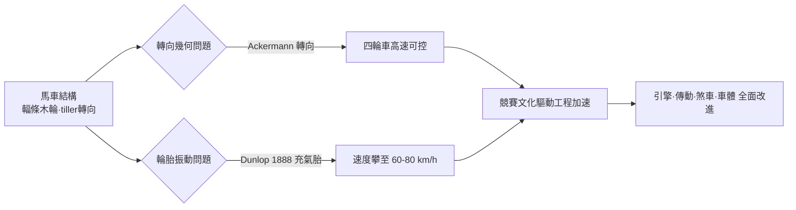

# 從馬車結構中脫胎的早期汽車幾何

## 一個尷尬的事實：最早的汽車是「裝了引擎的馬車」

汽車誕生時，工程師面前沒有任何「汽車」的範本。於是最自然的做法，就是把大約已演化了數千年的馬車結構搬過來：彎曲的鋼彈簧、輻條木輪、實心橡膠或金屬輪胎、以及由馬拉動時代累積的軸與軸承。1886年戴姆勒把引擎裝進馬車的作品（Motorkutsche）便是明證——車身、座位、轉軸、轂與輪，全是原封不動的馬車件，只多了個火盒般的引擎與皮帶傳動。早期的美國造車者如杜里埃（Duryea）兄弟、後來的福特（Quadricycle時代），也無不在馬車骨架上彎折自己的第一輛車。

這種「脫胎」造成的問題，絕大多數出在**轉向**上。最早的操縱方式沿用了船舵般的**舵杆式轉向（tiller）**：握著一根直接槓桿，如同操舟。對一臺低速、窄輪距的三輪車（如本茨Motorwagen），tiller勉強可用；但一旦車速超過12–15 km/h，轉向前輪的物理性噩夢就開始顯現。

## 轉向幾何的物理學：Ackermann 的恩賜

汽車轉向的根本難題是：**內外側前輪在轉彎時必須有不同的轉角**，否則輪胎就會在地面上橫向摩擦。這個幾何學的解，早在1818年就由英國專利代理人魯道夫·阿克曼（Rudolph Ackermann）以專利形式提出（其技術歸功於德國製造師蘭根斯佩格 Georg Lankensperger）。核心是一個梯形連桿：左右轉向節由橫拉桿連成一個梯形，與軸距、主銷距離相配合，使內輪側的轉角自然大於外輪側。

本茨与同代造車家很快領會到Ackermann轉向的價值。用現代公式表達這個幾何：

$$\cot\alpha - \cot\beta = \frac{w}{L}$$

其中 $\alpha$ 是外前輪轉角、$\beta$ 為內前輪轉角、$w$ 為兩主銷中心距、$L$ 為軸距。一條短短的公式，把「輪胎為何不撕裂」從玄學變成幾何。到1890年代末的四輪車上，Ackermann式轉向加上後來的轉向節主銷後傾與端傾，使汽車第一次在高速下可以「被信任」——工程師從此能談操控品質，而不只是能不能動。

## 引擎端的精密化：本茨的震盪線圈與浮筒汽化器

車體粗糙，機械卻不斷精密化。本茨1885年為他的水平單缸引擎設計了一套**震盪線圈點火系統**（trembler coil）：初級電路持續通電，讓鐵芯與簧片振動反覆切斷電路，在次級線圈中連續感應出高壓，火花塞的火花因而「持續顫動」。這套系統的妙處在於對轉速與接觸點時機不那麼敏感，非常適合早期粗糙的發動——直到1910年代，這種點火器仍在美國農用車（如福特T型初期的線圈盒）上可見。

化油器方面，本茨設計了**浮筒式汽化器**（float carburetor），讓燃油液面儘量維持穩定，以為引擎提供近似的正確油氣比。這個小裝置看似不起眼，卻是引擎從「玩具」邁向「機器」的關鍵一步——沒有穩定的汽化，任何高速引擎都會隨振動與油面晃動而忽強忽弱。

## 輪胎的解放：1888年Dunlop 與速度的新紀元

實心橡膠胎上的顛簸，是早期汽車速度的第一道天花板：它不僅損耗車體、令乘客嘔吐，更在高速時讓轉向與煞車性能急劇劣化。1888年，蘇格蘭獸醫約翰·鄧祿普（John Boyd Dunlop）為了讓兒子的三輪車騎得舒服，重新發明並取得專利的充氣輪胎——其技術先驅，其實是羅伯特·湯姆森1845年的專利，但把充氣胎推向**產業現實**的是鄧祿普。充氣胎讓輪子從木輻條＋實心橡膠，變成一個可以「變形溢震」的系統：

- 振動以下的舒適性大幅改善；
- 抓地力提升，煞車、轉向.Strings 與引擎輸出的傳遞都更加有效；
- 軸承、輪輻承受的衝擊負荷下降——車身可以更輕、更快。

1890年代末，賽車已能跑出時速60–80公里；這在實心胎時代，是物理上不可想像的數字。

## 競賽文化：一台看不見的發動機

1894年巴黎—魯昂（Paris–Rouen）賽事——世界上第一場公認的汽車競賽——由《Le Petit Journal》主辦，冠軍歸屬Panhard et Levassor等車隊；次年1895年的巴黎—波爾多—巴黎賽，速度已達平均約24 km/h，Panhard在賽中率先驗證了大功率引擎配重與直列多缸的優勢。競賽創造了一個殘酷的反饋迴路：**公開失敗＝當眾工程教訓**。輻條斷了是羞辱，剎車失靈是醜聞，於是工程的每個弱點都成為下一次改進的公開戰場。Panhard與其技術靈魂萊瓦索爾遵循的格言「把引擎放在前面，直接驅動後輪」，正是在這個競賽生態中被淬鍊為此後半世紀汽車的主流骨架。

## 制度的另一半：紅旗法與1896年解放

英國1865年的《地方貧民救濟院法》附則——即俗稱的**紅旗法（Locomotive Act）**——規定機動車在鄉間限速4英里/小時、在城鎮2英里/小時，且車前必須**有一名步行者揮舞紅旗**警示行人與馬匹。這條法例在功效上，等於用立法扼殺了汽車在英國的誕生。直到1896年新法（the Emancipation Act）把限速提升到14英里/小時，並廢除了步行前導者，英國的汽車工程界才真正獲得物理上的許可；當年11月舉行的「解放日遊行」，被英國汽車界視為本產業的第二次生日。

**一言以蔽之**：早期汽車的歷史，是「工程與制度互相拉扯」的歷史——Ackermann的梯形幾何、鄧祿普的空氣、Panhard的賽道、與英國議會的一紙廢除令，共同把一台哐噹作響的三輪車，拉向了二十世紀。
