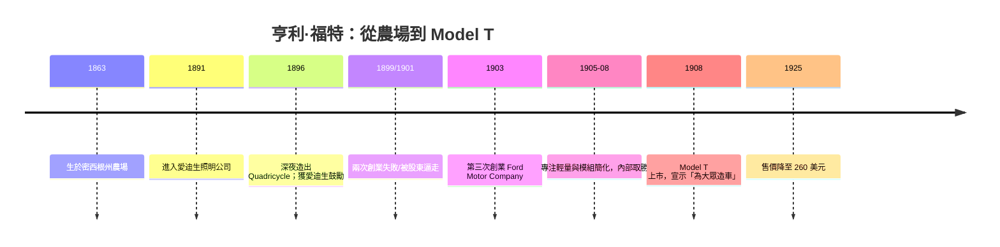

# 亨利福特：為大眾造車的偏執大願

## 農場上的少年，聽見機器的心跳

1863年7月30日，亨利·福特（Henry Ford）生於密西根州春田鎮（Springwells，今迪爾伯恩）的農場。他討厭農活——後來他說自己「從未真正喜歡農場，那裡的工作沒完沒了像是懲罰」——但他迷戀農場上唯一的機器：父親從西屋買回的蒸汽脫粒機，以及少年時獲得的那隻手錶。十二歲那年，他親眼看見一臺路上行駛的自走式蒸汽機車，那一刻他後來自述「生命從此被一臺機器定向」。他把鄰居家的錶拆了又裝，十足是個青年自學工程師，靠修錶與機械掙起了零用錢；這也是最早的跡象——他喜歡的不是農場的收成，而是機器可被重複拆解、重新組合的那種秩序。

1891年，他进入底特律的愛迪生照明公司（Edison Illuminating Company）當工程師，1893年升任總工程師。正是這份2200美元年薪＋权限的工作，給了他深夜車間與工具：下班後，他在自家磚房的棚子裡打造「馬車中的馬車」——四輪自行車（Quadricycle）。1896年6月4日凌晨，他把那臺配著兩缸四衝程引擎、四個自行車輪的機器推出去，發現車棚門太窄，索性用斧頭把磚牆敲掉一塊，開出一條路。

有兩件事在此期間深刻塑造了他。第一，1896年他在紐約的愛迪生年會上見到了偶像托馬斯·愛迪生；愛迪生聽完他談汽油引擎後敲桌說：「年輕人，那就干吧，繼續干。」——這句話成為一生的護身符。第二，他從愛迪生的公司文化中學到了「為普通家庭服務」的願景：電力不是富人的奢侈品，而是每家的日用。這個信念後來被他完整移植到汽車上：**汽車也該是每家的日用，不是馬車般的有錢人玩具。**

## 創業的教訓：兩次被股東拉走的偏執

福特的第一家公司，「底特律汽車公司」（Detroit Automobile Company，1899）在1901年即告失敗——他造車太慢、太追求完美，沒有一臺像樣的量產車。接著他與股東組織了「亨利·福特公司」（Henry Ford Company，1901），卻在1902年被股東們逼走——因為他拒絕打造賽車與高價車，只想造便宜車。這家公司後來改名為Cadillac；而被逼走的福特，帶著他的賽車手資助人，二次創業。

第三次的福特汽車公司（Ford Motor Company，1903年6月成立）最終誕生，但前四年依然是多產品線策略：Model A、B、C、F、K等，一高一低錯落——投資人屬意的是利潤豐厚的Model K高價六缸車。福特在董事會裡不斷被股東質疑「為何要造那種薄利多銷的破車」。1906年，他聯合少数股東逐步買下多數股權，並在賽車場上以Model K與Navajo六缸車無人能敵的One-mile海灘賽事（其實福特的賽車夥伴Barney Oldfield在1903年就已打出名聲）證明了技術實力。到1906–07年，他基本把公司金融控制權納入自己手中；接下來，他要造的是他心中那臺車。

## 1908年：Model T 與那句宣言

1908年10月1日，Model T上市。福特多年後在自傳《我的生活與工作》（My Life and Work, 1922）中，把這個理念寫成一句名言：

> **「I will build a car for the great multitude. It will be large enough for the family, but small enough for the individual to run and care for. It will be constructed of the best materials, by the best men to be hired, after the simplest designs that modern engineering can devise. But it will be low in price that no man making a good salary will be unable to own one.»**
>
> （「我要為大眾造一輛車：它大到足以容納全家，小到個人能自己駕駛與照料；用最好的材質、由最好的工匠、以現代工程所能設計的最簡單結構來鑄造；但它的價格要低到任何領好薪水的人都不會買不起。」）

1909年，Model T（Runabout型）的售價約**850美元**（Touring型更高），而當時一般車價約為2000–4000美元——已經足夠驚人；但福特要的不是「比較便宜」，而是「所有人都買得起」。到1920年代，經過生產線革命與規模經濟，價格一路降至**260–300美元**（1925年Runabout型甚至降到260美元），折合勞動者的薪资，已接近若干個月的工資。

## 關鍵的三年：1905–1908 的偏執與取捨

把Model T從「另一款便宜車」變成「汽車史的奇跡」的，是福特1905–1908年不為人知的工程偏執。他親自主持三種「執念」：

1. **輕**：底盤越輕，同樣馬力跑得越遠，售價才能低。他大量採用新式材料（釩鋼，見後文），並要求「一切不必要的東西都不要」；
2. **模組簡化**：零件不能是手工配作的。他要求設計師把零件標準化，任何一顆螺釘、一段軸，都必須「可互換」。這在當時的製造業近乎理想主義——工匠文化尚未散場，他就是要求機器造機器；
3. **單一車型**：一旦退入高價市場、開多產品線，量產的工程優勢就會瓦解。他視多產品線為「工程上的花痴病」，只要他掌控公司，就不許再走。

他的名言「History is bunk」（歷史是胡扯）常被斷章取義，但在這個脈絡下是統一的：他不相信靠著前人做法慢慢修修補補，他要「回到第一原理」重新設計一切——從材料到工法，從價格到工資。

1908年發布的那個秋天，美國正處在20世紀第一次大眾消費社會的黎明：電力、電話、百貨與報紙廣告已把「中產階級」這一概念鑄造成形。福特的成功，工程上是 Joyce 的「簡化」，商業上是「規模」，思想上是對一種當時還不存在的大市場的信仰——**他要造的不是一輛車，而是一個「人人都能擁有一點交通工具的世界」的預言。**

