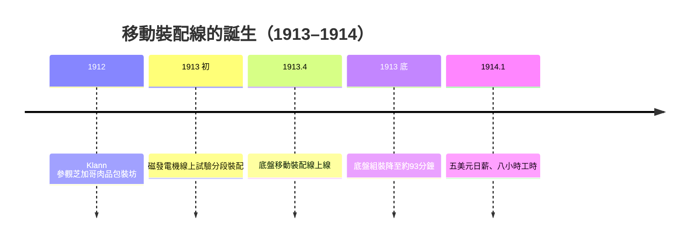

# 移動裝配線：從12小時到93分鐘的工業神話

## 靈感來自屠宰場的「卸解」

1913年4月，密西根州海蘭帕克（Highland Park）工廠，福特汽車公司完成了二十世紀最重要的一場組織實驗：**移動裝配線（moving assembly line）**。它的誕生故事令許多教科書為難——因為它的靈感並非來自機械工程的天才閃電，而是來自芝加哥的**肉類包裝工場**。

公司的工程師威廉·克蘭（William "Big Bill" Klann）到芝加哥參觀肉類加工場，看到的是一種奇特的生產組織：整隻牛被吊上軌道，向著一個方向的工人隊列移動；每個工人不動，只重複做一件事——割下一塊固定的部位。將一頭完整的牛「卸解（disassembly line）」成塊。克蘭望著這條「倒序生產線」心想：**如果反過來，把一堆零件往一個方向喂、讓它們逐漸「聚集成」一臺車呢？**他把這個想法帶回底特律，告訴了同為工程師的查爾斯·索倫森（Charles Sorensen，人稱「Cast Iron Charlie」，丹麥裔美國人，福特的中堅工程總管）。索倫森與福特的機工主管們把這個來自屠宰場的「逆向邏輯」與運鍊（conveyor chain）技術結合，在Highland Park的引擎裝配線上先試驗，再推到整車底盤。

那一年發生的數字變化，是二十世紀工業的代表性神話之一：

| 項目 | 之前 | 之後 |
|---|---|---|
| 一臺Model T底盤組裝時間 | 約 **12 小時 28 分** | 約 **93 分鐘** |
| 一輛汽車生產速度 | 一臺約需半天 | 數分鐘即出一臺 |
| 公司生產節奏 | 手工批次 | 連續流動 |

## 制度、勞動與社會的另一半鏡面

然而，嘗到甜頭的是福特的帳本，付出代價的是工人的身體與心。移動裝配線把工作切成了無限細的重複動作：一個工人整日只做「擰一個螺母」或「插一根銷」，與機器的節奏共生死——沒有對話、沒有偶爾的思考、沒有工匠式的自豪。以前的組裝工是「師傅」，現在他是「機器的附件」。其結果，是1913年前後福特工廠**離職率暴增至約357%**（一說370%），公司每天要新僱的人，幾乎相當於已有人數的一部分。這是高強度流水線的第一份真實社會帳單。

1914年1月5日，福特宣布把最低日薪由2.34美元提高到 **5美元**，並把工時從9小時降為8小時。這就是震驚世界的「五美元日薪」。它常被浪漫化為工業慈善；真實的邏輯更冷靜：**加薪是為了留住被機器逼瘋的工人**——正如索倫森多年後坦率回憶，這不是福利，而是把「用金錢換取人格的完整性被消磨掉」的代價內生化。同時它也是把工人變成消費者的一步：你買得起你造的車。這兩面——一半是殘忍的生產革命、一半是劃時代的分配實驗——才是1914年1月的完整剪影。

## 福特與索倫森的個性張力

流傳甚廣的敘事宣稱「屏幕上有了裝配線的一天，福特坐在那裡指揮一切」。史實複雜得多：**福特的思想領袖角色**（他規定「單一車型、輕量、可互換」）與**索倫森、克蘭、加爾文（Galamb）、范登博世（Vandervoort）、崔姆博（Trevor）、波爾卡（Pollard）、勒魯瓦（Le Roux）等工程師的具體工法創新**相互咬合。索倫森後來自述，裝配線的最初試驗包括把曲軸連桿的加工組織成連續流、引擎與磁發電機的裝配分段——這些都是他與團隊在工場裡一寸一寸試出來的。福特本人極擅於在不確定中拍板與命名；但這場革命是**集體工程的傑作**，只是歷史打算記住更聰明的那個名字。

克蘭的思想貢獻因此特別值得記住：他是那個把「外科手術手術室的自然規律」與「牛的卸解」聯想到「汽車的祂 dressing」的工程師。屠宰場與汽車工廠之間約三百年（Chicago Union Stock Yards 1865–；Highland Park 1913），距離不到三百公里，而「流動的生產組織」這一想法，竟跨過了鋼鐵工程機制與動物解剖的天塹而相會。

## 五美元日薪的政治意義

人們常忘記1914年1月的另一層意義：這是把美國的泰勒科學管理（Taylorism）推向極致的同時，對自身的一種**社會自洽**。泰勒制把工人的思想拿走，把動作留下；福特的裝配線把工人的腳步拿走，把身體留下；五美元日薪，則是把工人變成消費者。此後美國資本主義的基本邏輯——**大規模生產 ⇄ 大規模消費**——在一次加薪裡完成了它的第一次閉環。二十世紀後半的「中產階級消費社會」、工會談判的「生產力–薪資掛鉤」、日本戰後的模範經濟模型，都能在Highland Park工廠那條緩慢移動的鍊條上，找到最初的刻度。

