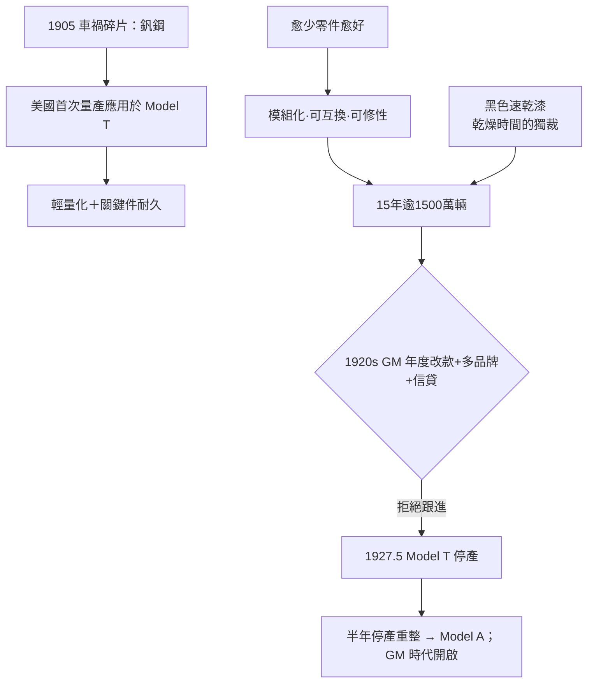

# 釩鋼與黑色T型車：耐久度與模組化製造

## 一場賽事中的金屬啟示：1905 年與釩鋼

1905年，亨利·福特在佛羅里達的賽車現場（Palm Beach／Ormond-Daytona賽事一帶）目睹了一場車禍：一輛競賽車的車輪撞碎，散落一地的金屬碎片引人注目。福特撿起一片碎裂的軸，發現它的斷口結晶細密得出奇——這塊金屬的強韌度遠超他公司裡任何一種鋼。他追問之下得知，這是一種含**釩（vanadium）**的法國賽車用鋼。法國工程師早在1890年代末於賽車上試用釩鋼，因為釩在鋼中形成細小碳化物，能同時提升強度與韌性（簡化的合金邏輯：$\text{Fe}+\text{C}+\text{V} \rightarrow\ \text{微細 VC 析出強化}$）。

福特立刻把這種材料導入自己還在孕育中的新車計畫。在福特汽車1906–1908年間的工程桌上，這是**釩鋼第一次在美國汽車量產中的系統性應用**。T型車的後軸、前軸、傳動軸、轉向系與關鍵懸吊件，都以三種不同釩鋼規格製造。結果是殘酷的反差：車身更輕（整車約1200磅級，比同級車輕了數百磅），但關鍵受力件卻更耐用——這正是「便宜而且不易壞」這個Model T神話的材料學根基。

福特自己多年後在《我的生活與工作》中記錄甚至誇張地寫道（大意）：釩鋼帶來的強度–重量比，讓工程團隊「第一次感到材料這個世界終於夠用了」。這塊從賽車場撿回的金屬，塑造了一個商業帝國的地基。

## 「愈少零件愈好」：福特的第一工程原則

T型車的設計哲學只有一句話：**任何東西都要「愈少愈好」**。零件少，裝配步驟少，錯裝機率低，備件種類少，生產線兩邊的工人動作少。福特對工程師們的反覆指令是近乎偏執的簡化要求：能不能兩件合成一件？能不能不用鉚釘而用焊接？能不能一臺機器同時加工多個部位？他有一個常被引用的执着——**「把最好的當成處女作，不修，就是被過去的老自己留住」**，即最終確認的設計，就該被生產線忠實複製，不能在車間隨意改動；反過來，一旦車型穩定，也不要輕易為了新穎而改款。他是大規模標準化的信徒，也是「年度改款」這一消費主義美學的死敵。

這套哲學的正面成果驚人：Model T的可靠性、可修性與農民對它的迷戀（甚至有人拆下後輪帶動皮帶來鋸木、抽水泵）。負面成果在1920年代顯化：通用汽車的阿爾弗雷德·斯隆（Alfred Sloan）推行「汽車為消費而生、為時尚而生」的**年度改款（annual model year）**策略，把汽車變成一種身份象徵的可換季商品，令福特「唯一車型」的哲學開始被市場所懲罰。

## 「任何顏色，只要它是黑色」

引述最廣的福特語錄，來自《我的生活與工作》：

> **"Any customer can have a car painted any colour that he wants so long as it is black."**
> （「顧客可以把他要的車漆成任何顏色，只要那顏色是黑色。」）

這句話常被誤讀為專制與吝嗇，真正的原因卻是**生產線節奏的化學**。當時福特採用的是一種**含瀝青（bitumen）的速乾底漆黑漆**（日本的類似速乾漆配方在遠東早有應用）。這種漆在常溫下乾得比其他顏色系統快得多，能趕上移動裝配線的節拍：車身出線槽後，若用其他顏色，得讓汽車在漆房裡多停數日——這樣一來，生產線連續性就被破壞，而連續性才是量產的命脈。黑色的独裁，本質上是**乾燥時間的獨裁**。福特曾親自說過，他們試過多種顏色，最終選定含日本的「日本黑漆（Japan black）」配方的系統，是因為它乾得最快。

「黑色」因此成為二十世紀工業史最著名的一則隱喻：**當效率被神化時，自由（顏色＝個性）就在乾燥流程裡被犧牲。**

## 兩面性與最後的清算：1927 年的停產重整

整個1920年代，Model T幾乎在工程上原地踏步（引擎在1920年代末才被迫加裝冷卻、稍前改了踏板與外觀小件，但整體架構未換代）。同時，通用汽車在斯隆與工程主管的協作下，用「多品牌、價格階梯、年度改款、信貸（GMAC 1919年成立）」的策略，把汽車市場從「交通工具」重構為「身份消費」。雪佛蘭（Chevrolet）在1920年代末以新款、顏色與封閉式車身——以及1927年關鍵的**一款更便宜的新車型**——在銷量上真正對Model T取而代之。

福特的內部反應卻近乎一場悲劇：他拒絕親兒子埃茲爾（Edsel Ford）多年來要求更新車型的呼聲，甚至一度把主張改革的高層逼走。直到1927年5月，福特公司才被迫宣布Model T停產——**15年共產逾1500萬輛**的神話就此終結。工廠關閉約六個月（部分說法為近半年），生產線被徹底拆除重整，為全新車型Model A（1927年底上市）騰出生產系統。這場「半年停產」是福特哲學的一次慘烈清算：**耐久而單純的機器贏得了十五年的市場，但拒絕了產品心理學的汽車公司，最終要把整座工廠拆掉重建。**

而此後通用汽車在二十世紀中超越福特的時代，被汽車史稱為「GM時代的開端」——這個開端的第一塊磚，其實是在福特自己「任何顏色，只要它是黑色」的那句話上鋪下的。

