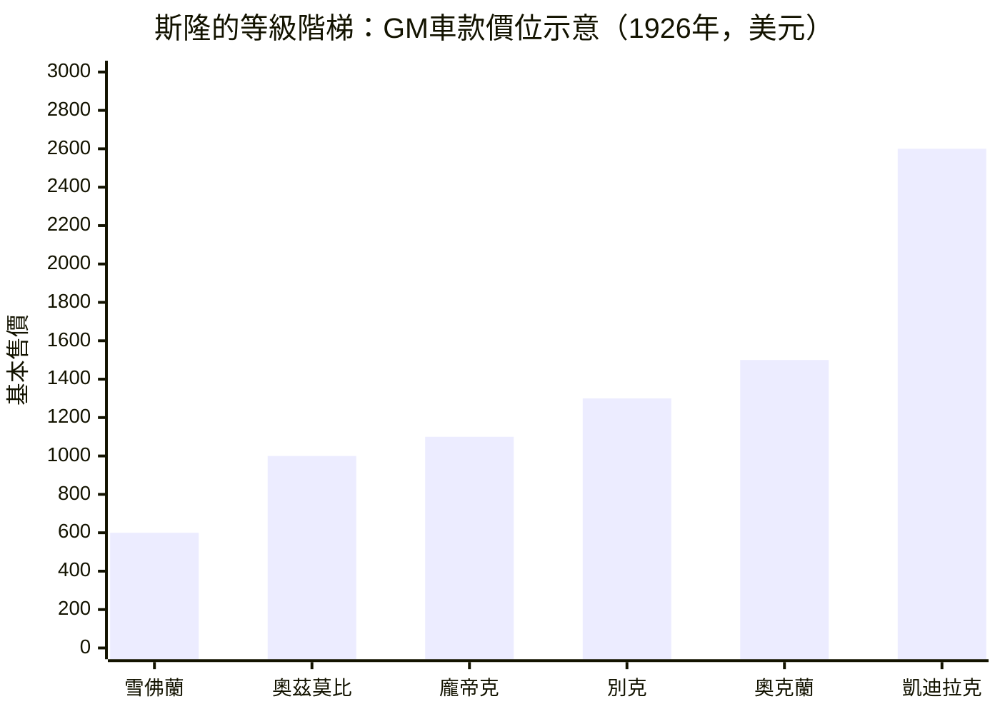
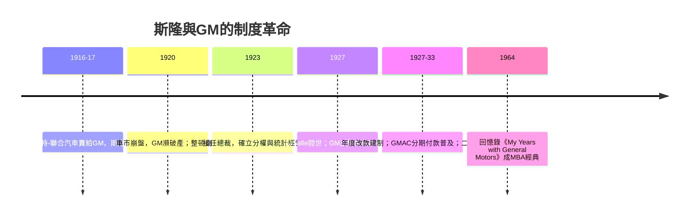

# 斯隆的等級階梯與年度改款戰略

## 從賣軸承的年輕人到管理思想家

阿爾弗雷德·斯隆（Alfred P. Sloan，1875–1966）出生於康乃狄克州紐哈文，父親做咖啡、雪茄批發生意，家境殷實。1895年，他從麻省理工學院（MIT）電機工程系畢業——MIT當時正是美國工程教育與「科學管理」思想的心臟。這段教育塑造了他一生的底色：他把工廠當作可以被量測、被分解、被設計的系統，而不是老闆的個人意志延伸。

畢業後斯隆進入新澤西一家瀕臨倒閉的小公司：海厄特滾軸軸承公司（Hyatt Roller Bearing）。他才二十多歲，卻敢拍電報向公司要求接掌經營權，並剃掉鬍子裝老成去見客戶。他的軸承賣給福特與通用——當時福特T型車       的引擎全靠海厄特的滾柱軸承活得順暢。1916年，他把海厄特與多家零件廠合併成聯合汽車公司（United Motors），次年整體賣給通用汽車（GM），自己隨併購進入GM高層。這一步讓他從零件商變成集團肱骨，也讓他親眼看到GM最大的病：創辦人威廉·杜兰特       激進擴張、重複投資、各品牌互相殘殺，公司帳面混亂到連 **1919–1920年**的存貨與成本都算不清。

1920年汽車市場崩盤，GM瀕臨破產，欠杜邦家族與銀行團巨債。杜邦皮埃爾·杜邦        出任總裁救火，斯隆成為副手，把他在零件廠練出的「統計式經營」推上全公司：生產、存貨、現金全部納入統一報表，每月比對「每輛車的投資額」。 冰凍的資產負債表救活了GM，也確立了斯隆的權威。1923年他接任總裁，1924年起又當上董事長，此後半個世紀GM的政策，幾乎都打著他的思想的鋼印。

## 「一車一級、總有一款適合你」

斯隆看清一件事：福特把汽車賣成「標準化的必需品」，而斯隆要把汽車賣成「階梯上的地位」。

他在內部備忘錄與後來的《我在通用的歲月》（*My Years with General Motors*，1964）中一以貫之地主張：**「一部車款一級、一部車給每一個錢包與用途」**。GM旗下的品牌本身就是一支攀升的階梯——雪佛蘭        给初入職場的年輕人，奧茲莫比、龐帝克、別克往上各佔一級，最頂端是凱迪拉克。顧客的一生，幾乎可以沿著GM的車型年表走完：第一部雪佛蘭是通勤，別克是當上主管的獎賞，凱迪拉克是成功的旋轉木馬。

這個階梯不是抽象理論，它是1930年前后GM價格委員會的日常作業：各品牌訂出價格區間，不許互相越界蠶食；年度改款時向上的「升級動線」要留得寬敞。斯隆的偏執在於「一以貫之」——各車系必須年年被檢查是否還站在自己的那級梯子上。

## 與福特哲學對決：「一車到底」vs.「梯子」

亨利·福特       是斯隆的鏡像敵人。福特的信條是工程師式的整體簡化：T型車從1908到1927年生產了**1516萬輛以上**，價格一降再降，車型幾乎不變，他鄙視「為賣而改」。斯隆的哲學是市場向的分化：車不是機器，是**消費者自我敘事的道具**。

兩人的決策內幕極其戲劇化。1920年代中期，福特拒絕改型的代價開始顯現：他的右臂、銷售天才與少數明確警告「舊車已死」的高級主管     一一掛冠而去。T型車銷量自1926年起雪崩；福特在1927年太晚倉促推出A型車。同一年，GM的年度營收首次壓過福特，登上全球第一大車廠，此後餘生再沒讓出王座。這場對決的結局不是「更好的車」打敗了「便宜的車」，而是**一套市場制度打敗了一固執念**。

## 年度改款與 GMAC：让舊車「心理報廢」

斯隆制度的支柱之一，被後人稱為「**動態報廢**」（dynamic obsolescence），也就是**年度改款**（annual model change）：每個車年在造型、車名、鍍鉻件上明顯刷新，配合廣告把「舊款＝過時」打進消費者腦海。它不要求車壞，只要求車「不體面」。斯隆本人較為謹慎，他知道「報廢」一詞在社會觀感上醜陋，因此把矛頭指向美學與色彩——1927年聘入哈利·厄爾（見下節），推出色彩繽紛的LaSalle，證明「造型」是一種可以量產的引擎。「年份＋車型」的組合，成為汽車產業第一個**穩定的消費時鐘**。

另一根支柱是金融制度。1919年GM成立通用汽車承兌公司（**GMAC**），率先在量產車上大規模實施分期付款（installment credit）。它把一筆數百美元的購車決策，拆成消費者都算得清的每月數字，等於親手給「階梯」灌入流動性。分期付款把車主綁回經銷商體系、把舊車淘汰到二手市場，與年度改款咬合成一台完整的**需求再生產機器**。

## 雪花預算與分權管理

斯隆的第三大發明是組織制度。GM由多個歷史不同的品牌合併而成，直接集權必然失靈。他把它制訂成日後被商學院稱為「**多分部結構**（M-form）」的範本：各品牌保留自己的工廠與日常經營權，透過「雪花式」預算制度——分部自編產銷預算，總部用統計、財務與市場情報審查，而非越權指揮——進行協調。他著名的原則是「**決策下放在資訊充分的那一層；協調由總部把關**」。

斯隆性格保守、寡言、精於計算，但更能說明他的是一種制度想像力：他相信**掌舵者不必每次都自駕**。他把工程、銷售、造型、財務想成一圈微生物培養器，各部下面是活的觀察箱；而他只做一件事——建立讓這些微生物互相驅動的溫度與營養制度。

## 後繼者的世紀傳承

斯隆1964年出版的回憶錄，成為後世**商學院教科書的元點**：奇異（GE）的企業重建、彼期管理思潮與哈佛商學院的案例分析，把「分權管理、多分部結構、財務管控、依市場情報制訂策略」敘述成20世紀下半美式企業治理的原型。大規模企業的「產品經理制」「策略規劃部」，幾乎都踩在斯隆的地基上。1930至1960年代，汽車產業全面進入規模經濟與消費社會的時代：汽車不再只是產品，而成為「由時尚、信貸與地位焦慮共同驅動的消費文化」。這一整套，都寫在斯隆的等級階梯上——在福特時代，汽車把農民變成司機；在斯隆時代，汽車把司機變成**地位階梯上的終身顧客**。

