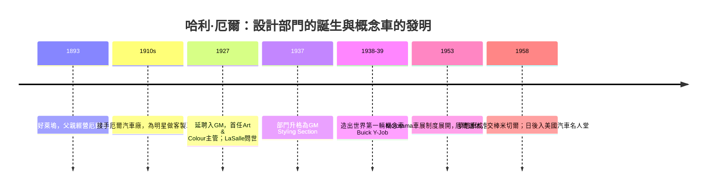

# 哈利厄爾與 Y-Job：造型藝術家的誕生

## 好萊塢馬車行出身的男孩

哈利·厄爾（Harley J. Earl，1893–1969）生於加州好萊塢，父親傑科布·厄爾經營「厄爾馬車行」（Earl Carriage Works）。這不是作坊童話——當時的好萊塢正蛻變為世界電影首都，明星與製片人需要的不只是交通工具，而是**舞台**：客製車身、誇張的弧線、與角色人設相配的行頭。小厄爾在鐵皮、油漆與聚光燈之間長大，學到的是「車身即人設」的直覺。他後來進入南加州大學與史丹佛研習工程，卻始終把重心放在車身設計上。1910年代末，他接班改組為「厄爾汽車廠」（Earl Automobile Works），專做影視圈的客製車身。

在1910–20年代，車廠（chassis maker）與車身坊（coachbuilder）是分家的：GM、福特只賣底盤，讓車主到車身廠去「打扮」。厄爾的本事，是替好萊塢明星把底盤包成劇中人物。其中最重要的客戶是西岸最大的凱迪拉克經銷商唐·李        ，厄爾為其打造了一批曾是「明星同款」的展間作品。

## 唐尼店的遭遇與 LaSalle 的延聘

1926年前後，GM高層諾曼·德·威克斯——尼爾斯·沃倫貝里的重要推手——造訪加州，在唐·李的展間看到厄爾的車身，驚為天人。因為當時GM總裁斯隆正面臨一道制度難題：他要把「造型」變成企業常設職能，但全美卻沒有車廠養得起這種部門——車身廠各自為政，色卡毫無統一。厄爾被緊急召到底特律，1927年起出任GM首任「**藝術與色彩部**」（Art & Colour Section）主管。

這一步在產業史上的意義，是把**美感納入企業體**。厄爾上任不久即交出代表作：**凱迪拉克 LaSalle（1927）**。它低而修長、可自由選色（提供多種漆色），車身與底盤首次呈現一體工藝的感覺。LaSalle 是美國車廠第一次由專業造型師主導設計的量產車，被汽車媒體譽為「美國車的文藝復興」。厄爾曾回憶老闆斯隆的原則：**誰最亮眼、誰就賣出。**從此「年度改款」在造型上有了最強的執行者——斯隆供給需求引擎，厄爾供給燃料。

## 地下室裡的設計「軍隊」

厄爾把部門擴建為「**GM Styling Section**」（1937年正武升格，直接向總裁報告）。他建起了全尺寸**黏土雕塑**車身模型與隸屬設計部門的樣車工坊——設計不再是工程師圖板上的一張草圖，而是一個可以摸、可以開、可以在主管面前轉圈的實體。他的管理風格帶著好萊塢導演味：極端保密，新車型用帆布罩住，樣車從暗門運出入廠，主管沒看過實體之前不許說三道四。設計師從「地下室的工程附屬品」被推上企業核心：到1950年代，GM Styling 已是全美最大的造型組織，厄爾本人成為公眾偶像，《生活》（Life）等雜誌長篇報導這位「讓底特律學會美」的加州人。

**鍍鉻爵士樂時代**：1930年代的美國車被厄爾們放上銀亮的量產舞台——凸起的引擎蓋裝飾（hood ornament）、鍍鉻格柵、流線的腰線、兩種車色的拼色（two-tone paint）。這是一種把爵士樂的即興與閃亮移植到鋼鐵上的美學：鍍鉻不只防腐，更是「**資本主義的發光合金**」。而厄爾，就是它的第一代指揮。

## Y-Job：第一輛夢之車

1938年末至1939年初，厄爾完成了他一生最偏執的實驗：**Buick Y-Job**。這不是為量產的車，而是**為了試探十年後的市場**：低矮的敞篷車造型、隱藏式頭燈、電動操作的軟頂敞篷、加長的鍍鉻飾條、無外露門把、電動升降車窗——這些在當年幾乎全是「未來元素」。GM官方稱之為世界第一輛由車廠自建的 **concept car**（夢想車）。厄爾拿它當「試水溫」的工具：高層看了 Y-Job 的反應，就是造型next十年該往哪走的情報。

Y-Job 的意義在十餘年後爆發：它開創了「**概念車**」這個制度，並衍生出1950年代GM的「Motorama」巡迴車展（1953年起，夢想車隊在全美登台，總統候選人也去看）。概念車成為車廠的預售預告片、廣告的鍍鉻招牌、公關的移動秀場。厄爾把設計從工坊牽到大街上，廣告部門再把它放大成人人可見的想像力商品。

## 離開舞台之後

厄爾1958年末從GM退休，交棒給比爾·米切爾（Bill Mitchell）。他留下的是一整套「造型經營的制度與政治學」：獨立的造型部門、黏土模型、概念車制度、年度鍍鉻語彙，以及一個後果——美國車從此有了「**時尚器官**」。批評者（後世許多工程師與歐洲流派）認為他把底特律推向低效的視覺軍備競賽；但從另一面看，斯隆的市場階梯需要一雙眼睛，厄爾正是那雙眼睛：他證明**消費需求可以被造型「編導」出來**——好萊塢的觀眾心理，被搬進了汽車的品牌命名、車尾線條與營銷文案之中。汽車從此不僅是一台機器，而是一年一度的性格重拍。
