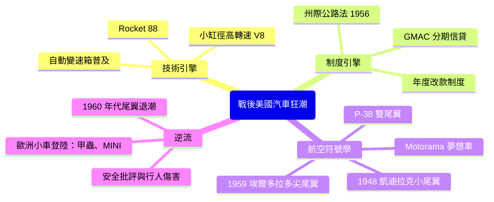

# 鉻黃裝飾與火箭尾翼：戰後美國陸地巡洋艦狂潮

## 兩台引擎：V8 與州際公路

1945年之後，美國汽車產業踩下油門的力道，來自兩台「社會引擎」。第一台是技術的：凱迪拉克與奧茲莫比在1949年前後量產現代化的**小型高轉速 V8 引擎**，把戰前累積的設計能力轉化出源源不絕的動力儲備；同年奧茲莫比推出「**Rocket 88**」，把 V8 裝上輕量車身，成為後人公認的第一部「肌肉車精神」量產車，也成為早期搖滾樂的取材對象。第二台是制度的：1956年《**州際公路法**》（Interstate Highway Act）授權鋪設約6.6萬英里的州際高速公路網，把汽車補貼成美國的國家基礎建設——通勤走廊、郊區住宅、汽車電影院、快餐店，一整套**汽油與水泥**的生活方式在十年內成型。

家庭在郊區生第二胎、買第二部車，車商則急著推出第十個型號。戰後十年的美國市場，是一場看得見的消費狂潮：汽車不再是交通設備，而是家庭客廳的延伸、社會地位的戶外廣告。整個社會——從國會到搖滾樂——都在為「開快、開大、開得亮」背書。

## 尾翼的誕生：從 P-38 到六五年絕景

1948年，哈利·厄爾從戰爭帶回一件「紀念品」。他在戰時參觀了**洛克希德**等飛機廠，對雙尾翼戰機        的兩支垂直尾翼念念不忘。他把這個航空意象微縮到 **1948–49 年款凱迪拉克的車尾**：兩片拇指大小的小尾翼出現在量產車上——這是汽車史首次把「速度的英雄象徵」直接移植自軍機。

技術上它毫無用途；符號上它威力巨大。冷戰初期的美國是航空時代：試飛員躲避的超音速紀錄、火箭神話、金屬線條的每一道斜角——美國人渴望自己的車「有一天也能飛」。尾翼正是這種**把國家級航太技術影像化為個人商品**的符號轉換器。設計師從此有了取之不盡的圖案庫：飛彈、噴射引擎、雷達罩、放射狀的星際宇宙。

厄爾把尾翼的尺寸做成**年度道具**：每年的車尾都要比去年更突出。到1957年款，尾翼已是底特律的通用語言；1959年款凱迪拉克·艾爾多拉多把這場競賽推到頂點——車尾兩片高聳的尖錐尾翼，配上火箭尾燈與鏡面鍍鉻，被後人稱為「**尾翼時代的最後一抹斜陽**」。那一年，從最便宜的雪佛蘭到最貴的艾爾多拉多，全美車尾都在長刺：一場**車尾戰爭**，打得各家年度改款無路可退。

## 鉻、馬力與鏡子：都市符號學

尾翼並非孤軍。它們是一整個**消費符號系統**的一部分：

- **鍍鉻**：戰後鎳鉻供應恢復後，鍍鉻面積年年攀升；發亮的金屬像資本主義的白鏡，照出「你已經過得不錯」。
- **雙色烤漆**：上下分割的視覺欺騙，讓車「顯得低」。
- **過量的裝飾鍍件**：有些車款前後鍍件數以百計，行家戲稱投資分析可用「**以鍍鉻計量**」——鍍件越多，銷量越高，直至過熱。

這不是純粹的審美放縱——制度在推動：GM年度改款需要新語彙，鍍鉻廠需要訂單，GMAC的分期信貸讓「換車」比「修車」更划算；每換一次造型就產生一輪「不體面」的舊車淘汰。尾翼鍍鉻看似狂歡，在經濟機制上卻與斯隆的**動態報廢**精密咬合：它是底特律的十二個月計時器，每年重設一次需求。

## 尾翼的退潮：安全、油耗與大眾金龜的逆襲

塔尖過了便是落日。1959–60年代，三股力量把尾翼拍回信心下水。第一是**安全批評**：高聳尖尾翼在事故中對行人如同利刃，律師與保險業都開始追究責任；     也給銷售部門負       新         壓力。          phá 第二是**審美疲乏**：一旦人人有尾翼，尾翼便不再神秘。     第三則是真正的爆款，是一批來自歐洲的「小而精」車：**福斯甲蟲車**、BMW 700，以   經濟性、靈巧與可靠形象登陸美國，說服消費者「不必開得浮誇也能有品味」，尾翼所承載的美國自信，     在城市青年、大學生與反主流文化中逐漸被「   精緻實用     」      的歐洲偶像（MINI、甲蟲、後來的BMW 2002）逐項置換，從鍍鉻ooled 社會、  尾翼作為時代符號        退至 1960 年代成  
小   等。  1965年 Energ        年款尾翼就已完全退流——     業簡化的BM         1069 W 通往工程       的新世代形象。

## 一個時代的剪影

1959年艾爾多拉多的尾翼，如今被某些設計師視為「最宏偉的工業雕塑」，也是被視為「資本過剩的墓碑」。不論褒貶，這尾翼是一段歷史的句讀：好萊塢出身的厄爾把戰爭機器轉成為家庭神話；     制度化的公路（      和 法制   制度、      金融、      鋼鐵    廠商   ）把這神話規模化為**百萬輛的量產商品**；而當新一代消費者認清石油、安全與品味問題，這神話又被來自沃爾夫斯堡的甲蟲車反 見       。汽車史是一部機器史，也是一面**美國夢的曲面鏡**——鏡上的鍍鉻，每十年就會照出不同的自己。
