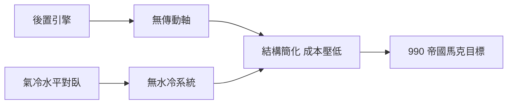

# 費迪南德・保時捷與氣冷後置引擎

1875 年，費迪南德・保時捷（Ferdinand Porsche）出生於奧地利波希米亞邊境的馬費爾斯多夫（Maffersdorf，今捷克佛爾斯拉維采）一個鐵匠家庭。他是家中第三子，父親安東・保時捷期待他繼承鐵匠鋪，但少年費迪南德的興趣全在電——他在自家閣樓拉電線、裝電鈴，十八歲時偷偷在夜間為全鎮裝上電燈系統，被父親發現時只換來一頓怒罵。他沒有受過正規工程教育，只在維也納的工業學院旁聽，其餘全靠自學。這種「無文憑的天才」身分，讓他一生帶著近乎偏執的自信：他相信自己對機械的直覺勝過任何學院理論。

## 從輪轂電機到世界博覽會

1898 年，二十三歲的保時捷進入維也納的雅各布・洛納（Jakob Lohner）馬車製造公司。他為電動車提出了一個大膽方案：取消傳動軸與齒輪箱，把電動機直接做進前輪輪轂裡。1900 年巴黎博覽會上，這輛 Lohner-Porsche 電動車震驚全場，輪轂電機（hub motor）的概念比今日電動車的輪轂馬達早了一個世紀。為克服電池太重的問題，他更進一步設計出油電混合車「Mixte」，以汽油引擎發電驅動輪轂電機——這幾乎是二十一世紀混合動力車的百年前身。

## Austro-Daimler 與 Mercedes SSK

1906 年，保時捷轉任奧地利戴姆勒（Austro-Daimler）技術總監，設計出 Prince Henry 賽車等名機；第一次世界大戰期間他因軍用引擎設計獲頒榮譽博士學位。1923 年他跳槽斯圖加特的戴姆勒（Daimler-Benz 前身），主持開發了搭載機械增壓六缸引擎的 S、SS、SSK 系列——Mercedes SSK 至今仍是賽車史上的傳奇。但保時捷的夢想始終是「人民的車」：他想造一輛人人都買得起的小車，戴姆勒董事會卻認為這與品牌的高端定位不符。與董事會的激烈衝突，使他在 1929 年黯然離職，短暫替 Steyr 與 Mercedes 工作後，於 1931 年 4 月在斯圖加特創立自己的工程事務所——「Dr. Ing. h.c. F. Porsche GmbH」。公司最初的生意是替 Wanderer、Zündapp 等廠設計小型車，卻始終沒有量產機會。

## 希特勒的「國民車」

1933 年希特勒上台，提出兩個汽車夢：一是賽車計畫（催生了銀箭賽車），二是讓每個德國家庭開上汽車的「國民車」（Volkswagen）。1934 年，保時捷帶著他的小型車構想赴柏林會談，希特勒當場在紙上畫出他心中的車形，並定下苛刻條件：油耗、車速、能載兩名成人與三名兒童——售價不得超過 990 帝國馬克，約當一般工人半年多的薪水。當時德國最便宜的车也要兩千多馬克，這個價格在業界看來近乎瘋狂。

保時捷的解法是一部教科書式的緊湊廉價哲學：引擎放在後軸之後，取消傳動軸，省去中央通道，車內空間極大化；採用氣冷引擎，免除水冷系統的水箱、水泵與漏水之虞，適合寒帶冬天與缺乏保養能力的主人；水平對臥四缸（ boxer）重心低、運轉平衡；懸吊用扭力樑配橫向葉片彈簧，零件少而耐用。為了驗證車身形狀，他在斯圖加特建了簡易風洞測試模型，最終定型為流線的「甲蟲」造型。

## 制度的狂熱與戰爭的干擾

國民車計畫並非單純的工程案，而是納粹體制的宣傳工程。「Kraft durch Freude」（力量來自歡樂，KdF）組織發行強制性的儲蓄購車券，每週存 5 馬克，承諾存滿即可交車。約 34 萬德國人簽約繳款，然而戰爭爆發，工廠於 1938 年在沃爾夫斯堡（Wolfsburg）動工後，1939 年即轉產軍用車輛與 Kübelwagen 軍用版甲蟲。沒有一個儲蓄者拿到量產國民車——他們的錢戰後成了糾紛。

保時捷本人深度捲入戰爭經濟。他的公司承接軍用車輛設計，甚至涉入虎式戰車的競標（其電傳動方案落敗，卻留下 90 底盤改裝為驅逐戰車）。他與軍備部長史佩爾（Albert Speer）關係密切，其工廠使用了強制勞動。戰後這段歷史成為他一生最大的污點。

## 監禁與遺產

1945 年 12 月，應法國政府邀請赴談判「法國國民車」的保時捷，與兒子飛利（Ferry）、女婿皮希被法國以戰犯嫌疑逮捕。法國汽車業（後來的雷諾 4CV 計畫）顯然想借重他的才華，但他拒絕在佔領體制下屈服，被監禁於第戎與巴黎近郊長達二十個月，直到 1947 年 8 月才以鉅額保釋金獲釋。此時他已七十二歲，健康崩壞，只能坐在輪椅上看著兒子完成事業。

獲釋前的獄中歲月，正是保時捷家族最艱困的時刻。飛利・保時捷在斯圖加特以甲蟲零件拼出了第一輛保時捷 356——中置引擎試作車「356 No.1」就在 1948 年 6 月上路。1950 年，老保時捷坐著輪椅到沃爾夫斯堡參觀甲蟲量產線，看著自己 1934 年的設計以每分鐘一輛的速度駛下生產線，據說他久久無語。1951 年 1 月 30 日，費迪南德・保時捷因中風去世，葬於斯圖加特。

他的一生橫跨電動車、混合動力、賽車、國民車四個時代，是二十世紀汽車工程從手工藝走向系統工程的縮影。而他留下的兩份遺產——甲蟲車與保時捷品牌——一個代表工業化的極致，一個代表個性化的極致，直到今天仍在定義德國汽車工業的兩端。
