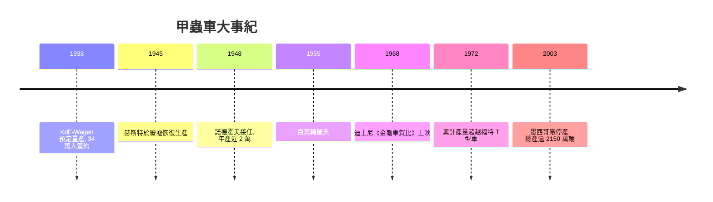

# 風洞初體驗：流線車身與甲蟲車風靡全球

1930 年代的汽車設計，正經歷一場從「馬車形狀」到「風的形狀」的革命。此前車身設計的核心是遮風擋雨與尊貴裝飾——直立的散熱器水箱罩、外露的擋泥板、垂直的擋風玻璃。隨著公路品質提升、車速突破每小時一百公里，空氣阻力從學術數字變成實際的油耗與噪音問題。美國的克萊斯勒 Airflow（1934）、飛艇時代的裝飾藝術流線美學（Streamline Moderne），讓「流線型」同時成為工程手段與時代審美。在德國，飛艇設計師保羅・雅雷（Paul Jaray）甚至為流線車身申請了專利，日後甲蟲車的車身輪廓正觸及這些專利。

## 斯圖加特的風洞

保時捷是德國業界最認真對待空氣動力學的工程師之一。早在 1920 年代末於戴姆勒任職時，他就對賽車做過流線化實驗。1931 年創立自己的事務所後，他在斯圖加特的事務所裡建造了簡易風洞與測試模型，為 Zündapp、NSU 等客戶設計的小車反覆修改車身曲線。國民車計畫展開後，模型車身的風阻係數一路壓到當時量產車罕見的低水準。1937 至 1938 年間，保時捷委託克勞斯・馮・弗肯豪森男爵（Klaus von Falkenhausen）等車手駕駛原型車進行長途測試，三十輛 V30 系列原型車累積了超過 240 萬公里的測試里程——這種規模的耐久驗證在當時前所未有，也奠定了甲蟲車「什麼都壞不了」的名聲基礎。

1938 年 5 月 26 日，希特勒親自出席沃爾夫斯堡工廠的奠基典禮，「KdF-Wagen」宣告投產在即。約 34 萬德國人以每週 5 馬克的強制儲蓄預定了這輛車。然而 1939 年 9 月戰爭爆發，量產國民車的計畫戛然而止，工廠轉產軍用車輛，甲蟲車只生產了極少量「指揮官車」，宣傳照上的量產線始終沒有真正轉動。

## 廢墟裡的英國少校

1944 至 1945 年，沃爾夫斯堡工廠在盟軍轟炸中損毀過半。戰後此地劃歸英國佔領區。英國汽車業界組成的調查團 1945 年來訪，結論近乎宣判死刑：這家工廠沒有價值，這款車「不符合汽車的基本技術要求」，太吵、太醜、毫無吸引力，連免費送給英國車廠都沒人要。

扭轉一切的，是英國陸軍少校伊萬・赫斯特（Ivan Hirst）。這位受過訓練的工程師軍官 1945 年 8 月接管工廠，在沒有電力、零件散失、屋頂破洞的廢墟裡，憑一己之力重整生產：他從水裡撈出機器、修好廠房、恢復供電，並說服佔領當局讓工廠為英國佔領軍生產汽車——軍隊需要可靠的小車，而甲蟲車正是為可靠而生。1945 年 12 月 27 日，第一批甲蟲車在戰後的沃爾夫斯堡駛下生產線。沒有赫斯特的固執，這座工廠極可能被拆解作為戰爭賠償——英國內部確實有過這樣的提案。

## 諾德霍夫與單一車型哲學

1948 年，赫斯特邀請海因茨・諾德霍夫（Heinz Nordhoff）接任大眾汽車總經理。諾德霍夫出身歐寶（Opel），因曾在納粹時期任職而被美國佔領區禁止就業，卻被英國人網開一面。他就任後確立了甲蟲車史上最重要的戰略：不開發新車型，把全部資源投入單一車型的持續改良（continual improvement）。每一年，甲蟲車都默默換上更好的化油器、更大的引擎排氣量（從 1.1 升逐步到 1.6 升）、更好的煞車與懸吊，卻從不改變外形與基本架構。這種「進化不改款」的策略，與通用汽車每年改款刺激消費的美國模式完全相反，卻把品質與售後服務做成了甲蟲車的護城河。

1949 年貨幣改革與馬歇爾計畫啟動後，西德經濟起飛，史稱「經濟奇蹟」（Wirtschaftswunder）。甲蟲車恰好成為這個奇蹟的化身：便宜、耐用、修得起，是戰後德國家庭的第一輛車。1948 年產量近 2 萬輛，1950 年突破 9 萬，1955 年 8 月 5 日，沃爾夫斯堡舉行盛大典禮慶祝第一百萬輛甲蟲車下線——那輛金色特別塗裝的車今日仍保存在大眾汽車博物館。出口版甲蟲車更成為德國最大宗的單一出口商品，為西德賺取了重建所需的外匯。

## 賀比與全球現象

1968 年，迪士尼電影《金龜車賀比》（The Love Bug）上映，一輛編號 53 的白色甲蟲車成了有性格、會思考的賽車英雄，奪下當年美國票房冠軍。這部電影把甲蟲車從「經濟奇蹟的德國象徵」轉化為「全球流行文化的可愛主角」，反襯出它與戰後年輕世代反主流心理的微妙契合——當美國車越做越大、越來越浮誇時，這輛小車的謙遜與頑強成了一種態度。

甲蟲車的量產一路延續：1972 年 2 月，第 15,007,034 輛甲蟲車下線，超越福特 T 型車，成為史上產量最高的單一車型。德國本土生產至 1978 年，墨西哥普埃布拉工廠則一直撐到 2003 年 7 月 30 日，全球總產超過 2,150 萬輛。一個 1934 年為獨裁政權宣傳而生的設計，最終以「人民的車」的樸素本質走遍世界——甲蟲車的歷史，正是工程決策如何在制度的狂熱與戰爭的廢墟中倖存，並被和平年代的市場重新加冕的最好註腳。
