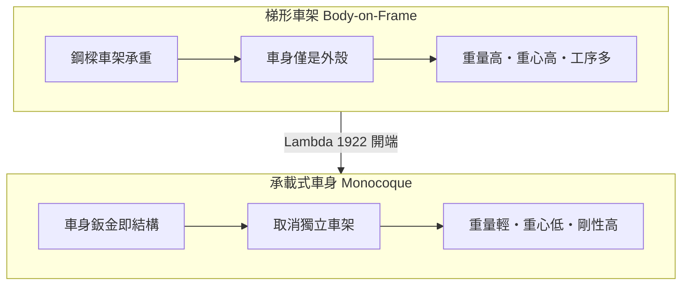
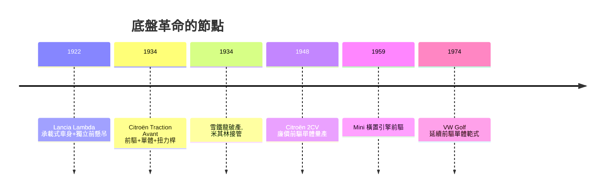

# 單體構造與前輪驅動的底盤革命

二十世紀上半葉的汽車，幾乎清一色採用「梯形車架＋承載車身」（body-on-frame）：引擎、變速箱、懸吊全部裝在一副鋼樑焊成的梯子上，車身像帽子一樣「扣」在車架之上。這種構造容易製造、易於換殼，卻笨重、重心高，車身對結構強度幾乎沒有貢獻。挑戰這個範式的兩個人，一位是義大利的維琴佐・藍旗亞（Vincenzo Lancia），一位是法國的安德烈・雪鐵龍（André Citroën）與他的工程師安德烈・勒菲弗爾（André Lefèbvre）。

## 賽車手藍旗亞

藍旗亞 1881 年生於都靈附近一個製罐商家庭，十二歲就輟學打工，後來成為菲亞特的首席試車手兼賽車手——他手腳極快，1908 年曾代表菲亞特參賽，也是早期少數能一邊開車一邊思考機械問題的車手。他出身底層、個性內向執拗，對細節的堅持近乎苛刻。1906 年，二十五歲的藍旗亞創立自己的車廠，從此以工程師身分立業。

1922 年，Lancia 推出 Lambda，這是汽車史上第一批真正意義上的「現代車」：它取消了獨立的梯形車架，讓衝壓鋼板車身與底盤結構合為一體承載——承載式車身（monocoque）的濫觴；前輪首次採用獨立懸吊（滑柱式，比麥花臣柱早了二十餘年）；並搭載藍旗亞自創的窄角 V4 引擎，壓低車頭高度。Lambda 生產了約一萬三千輛，在當時卻被同業視為過於激進的怪胎：車身與底盤一體，意味著撞壞了無法「換殼」，對手工車身時代的老牌廠來說簡直異端。藍旗亞不改初衷——他把賽車手對重心的直覺轉譯成結構：重量低、重心低，車才會聽話。1937 年他因心臟病早逝，年僅五十六歲，但 Lambda 指出的方向，二十五年後成為全行業的標準。

## 雪鐵龍的豪賭

安德烈・雪鐵龍是汽車史上最像行銷天才的工程師。他 1912 年參觀福特流水線後，把大量生產模式引進法國；一次大戰期間他的工廠日夜趕製砲彈，戰後轉產汽車，並以巴黎艾菲爾鐵塔上用二十五萬顆燈泡拼出「Citroën」字樣的廣告聞名歐洲。他大膽、浮誇、敢賭，而這種性格也決定了他的悲劇。

1934 年 3 月，雪鐵龍推出 Traction Avant：前輪驅動、承載式車身、獨立扭力桿懸吊、液壓煞車，四項革新一次到位，比同時代任何量產車都先進一個世代。操刀的是工程師安德烈・勒菲弗爾——他是巴黎高等物理化工學院出身、受先驅 Jules Salomon（早年為雪鐵龍設計過 Type A 的量產小型車）薰陶的設計者，後來更成為戰後 Citroën 2CV 與 DS 的靈魂工程師。前驅佈局取消了傳動軸，車廂地板可以完全放平、重心大降；搭配單體車身，Traction Avant 的操控在 1930 年代鶴立雞群，成為搶匪、警察與電影共同鍾愛的「法國國民跑車」。

但技術躍進的代價是災難。單體車身的量產工藝在當時還不成熟：早期 Traction Avant 車身剛性不足、鈑金開裂、故障頻傳，返修率讓工廠陷入地獄。雪鐵龍為此投入的天文數字，加上他個人在股市與工程上的連環豪賭（他甚至出資自己的破產清算，1933 年雪鐵龍已債台高築），公司於 1934 年 12 月宣告破產。1935 年，最大債權人米其林（Michelin）正式接管雪鐵龍——輪胎廠發現，前驅車的胎耗數據正是它最寶貴的實驗場。雪鐵龍本人於 1935 年 7 月病逝，未能看到自己押注的範式成為主流。

## 成為戰後世界的範式

Traction Avant 災難之後，行業沒有退回梯形車架，反而沿著藍旗亞與勒菲弗爾指出的路加快前進：戰後 Citroën 2CV（1948，仍出自勒菲弗爾之手）、英國 Mini（1959，伊西戈尼斯將橫置引擎與前驅、單體結合，把車室空間壓縮效率推到極致）、乃至 1974 年的大眾 Golf，全部生於同一套範式。原因很實際：承載式車身適合大批量點焊與沖壓生產，比梯形車架更省鋼材與工時；前驅省去傳動軸、降低地板與重心，讓小型車既有空間又穩定；兩者相加，正好滿足戰後歐洲「人人有車、便宜耐用」的制度性需求——從馬歇爾計畫重建、共同市場整合到福利國家的消費社會，汽車設計的物理選擇與經濟制度的選擇咬合得天衣無縫。

藍旗亞與雪鐵龍——一個固執的賽車手與一個豪賭的推銷家——都沒能活著看到勝利，前者早逝，後者破產而死。但 Lambda 與 Traction Avant 證明：革命性的工程總要先付學費，而學費往往由最勇敢（或最莽撞）的人來付。今日每一輛你開過的前驅掀背車，車身裡都藏著 1922 年都靈與 1934 年巴黎的兩場豪賭。
