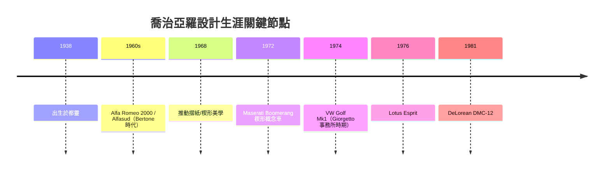

# 喬治亞羅與楔形設計：折紙時代

## 都靈街頭走出來的少年

一九三八年，第二次世界大戰的陰影正籠罩歐洲，喬治亞羅（Giorgetto Giugiaro）出生於意大利都靈近郊的一個藝術家庭。祖父繪製教堂壁畫，父親經營油畫工作室，家人原本期望他成為畫家。但少年喬治亞羅的畫紙上出現的不是聖像與風景，而是流線的汽車側影。戰後的都靈是菲亞特的天下，整座城市的呼吸都與汽車工業同頻，一個愛畫車的少年在這裡長大，幾乎是命運的必然。

十四歲那年，他進入菲亞特的設計部門當學徒，白天描圖、晚上到都靈的藝術學校進修。十七歲時，他帶著自己的一疊設計草圖參加了都靈車展，被當時最有影響力的車身製造廠 Carrozzeria Bertone 的少東——努奇奧·博通（Nuccio Bertone）一眼相中。博通回憶那天的情景時說過：「我在展場看見一個瘦弱的年輕人坐在角落，他攤開的草圖卻讓我站起來走近。」博通立刻把他請進 Bertone，這一步，改變了二十世紀汽車設計史的走向。

## 折紙時代的降臨

進入 Bertone 不久，年僅二十一歲的喬治亞羅便交出了他真正意義上的成名作：一九六一年的 Alfa Romeo 2000（Giugiaro 版車身）。這部車的線條乾淨、比例沈穩，率先擺脫了戰後圓潤繁複的裝飾語彙。接著 Alfasud 的設計更體現他的務實性格——他相信好設計是讓平凡小車也能優雅。

一九六○年代，喬治亞羅開始系統性地推動一種後來被稱為「折紙設計（folded-paper / origami style）」的語言：車身表面像一張被折過的紙，棱線銳利、反光面清晰、水平高度分明。這種美學不是無中生有——它回應了戰後塑料化工與模具工藝的進步，衝壓技術可以精確做出大面積的平面與利落的摺邊，不必再依賴手工敲打出繁複曲面。技術、材料與美學在此互相驅動：時代供給了「折」的能力，喬治亞羅供給了「折」的品味。

其中最著名的範例，是基於雪鐵龍與杜卡迪之外——不，應當說，是他為一家英國車廠留下的傳奇：一九七六年發表的 Lotus Esprit。喬治亞羅以乾淨的摺面將楔形車頭、內摺腰線與帆布般的後罩融為一體，Esprit 甚至在 007 電影中化身潛水車，成為折紙美學的文化圖騰。他更是楔形車身革命的旗手：一九六八年為 Bizzarrini M530、以及一九七二年設計的 Maserati Boomerang 概念車，都已指向「楔形（wedge）」——車頭低切如刀，車身高揚，整車像一枚插入風中的箭鏃。他隨後設計的 Lotus M100 Elan（一九八九）與多款量產車，延續了這條幾何美學血脈。

## 福斯 Golf Mk1：把幾何美學帶進尋常百姓家

一九七四年，喬治亞羅完成了他一生影響最深遠的作品：福斯第一代 Golf（VW Golf Mk1）。當時福斯剛結束金龜車時代，急於找到後置引擎以外的量產方向。喬治亞羅以直角摺紙的方式界定車身：輪拱切齊、腰線水平、車窗與車門的接縫如尺規繪製，每一寸都服務於「空間效率」與「造價效率」。

這部車之後成為史上最暢銷車系之一開端的基礎，也確立了一個設計信條：好設計不是讓車子被看見，而是讓車子被「使用」而不厭倦。同一時期他還兼任多案併發——一九七一年的 Maserati Ghibli 已是摺紙長鼻跑車的前哨，一九七八年他替 BMW 設計的 M1 同樣出於其手。甚至一九八一年的 DeLorean DMC-12，那個不鏽鋼車身、鷗翼車門、《回到未來》裡的時間機器，其車身設計亦是喬治亞羅的手筆。可以說，從平民掀背車到科幻電影道具，整個世代的汽車面孔，有相當比例出自這位都靈人之手。

## 榮譽與開宗立派

一九六五年，喬治亞羅離開 Bertone 自立門戶（先與 Ghia 合作，一九六八年與工程師奧爾多·蒙塔巴羅共同創立 Italdesign）。這家工作室不只設計外型，更整合工程開發，成為「設計—工程一體化」的新模式，汽車設計自此從工匠藝術轉向系統產業。

他的成就獲得制度性的承認：羅德與施瓦茨之外的設計界大獎中，德國紅點設計獎（Red Dot）曾以「Best of the Best — Design Team of the Year」等多項榮譽給予其團隊高度肯定；一九九九年，在世紀之交的專業評選中，他被選為「世紀汽車設計師（Car Designer of the Century）」，與「世紀汽車」金龜車的評選同列汽車百年慶典的終身成就。評選機構的評語可一言以蔽之：他以最小的線條改變了最多人的移動方式。

晚年他將事務所交棒給兒子法布里奇歐（Fabrizio），完成了大師時代向家族新生代的「轉場」。若說二十世紀前半是義大利馬車匠的黃金歲月，那麼戰後至一九八○年代就是「喬治亞羅時代」——摺紙的時代、楔形的時代。他把繪畫世家的手藝、工業化的尺規、與對「人人皆可擁有好設計」的信念折疊進鋼板裡，讓汽車這件量產機器，成為二十世紀最普遍也最耐看的雕塑。
