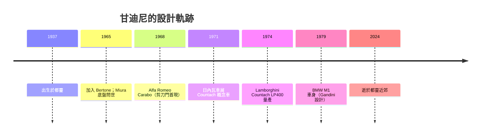

# 甘迪尼與 Countach：極速幻想的實體幾何

## 七歲開始的執念

馬塞洛·甘迪尼（Marcello Gandini，1937–2024）與汽車設計的緣分早得驚人：七歲的他就痴迷於汽車模型，拿紙板和小刀做出一輛又一輛想像中的車。他的父親是都靈一家樂器行的老闆，希望兒子繼承家族事業，但少年甘迪尼的心思全在車身的曲面上。這種「紙板刀工」的自我訓練，後來直接反映在他的設計特徵上：以摺疊、切割、楔入構成車身語言，彷彿材料只是一塊被賦予速度意志的黏土。

都靈戰後是義大利車身工坊（Carrozzeria）的戰場。年長五歲的喬治亞羅已在 Bertone 站穩腳步，一九六五年喬治亞羅出走自立，主人努奇奧·博通急需一位首席設計師接棒。甘迪尼上新進的應徵草圖讓博通一眼定情——從此這位未滿三十歲的年輕人，接手了全歐洲最受矚目的設計台。有趣的是，他與喬治亞羅幾乎走著同一條建造之路：都靈出生、摺紙語彙、Bertone 出師、而後自立門戶。同源而異流，皆成大師。

## Miura：讓引擎坐上後座

一九六五年的杜林車展，甘迪尼交出第一部大作：蘭博基尼 Miura 的底盤與車身概念（與工程師達拉拉、斯塔扎諾合作）。這部車把 V12 引擎橫置在座椅後方，車身像趴伏的猛獸，前翻車頭燈、內凹大燈孔，被後世公認為「超級跑車」成形的原點。二十多歲的甘迪尼，就此與費魯吉歐·蘭博基尼（Ferruccio Lamborghini）結下至關重要的合作。

## Countach：楔形的極致

一九七一年日內瓦車展，蘭博基尼展出一輛概念車，車身低得幾乎貼地，擋風玻璃近乎平躺，整車是一枚保持著「即將穿牆」姿勢的金屬箭鏃。姓名之事成為傳說：據最流行的說法，Countach（發音近「昆塔許」）來自皮埃蒙特方言的感嘆詞，是設計團隊裡一位成員見到原型車時脫口而出的驚嘆，近似「我的天啊！」——方言感嘆詞就此定名，成為汽車史上最奇特的車名。量產之路隨附而出：低矮車身需要極寬的輪距，使輪胎相伴而來，與 Pirelli 的合作（著名的 Pirelli 「cinturato」寬胎與 Countach 特別的側裙造型幾乎互相成就）也讓輪胎工程與車身幾何史無前例地值得互鎖研發。

Countach 的原創細節不計其數，其中被模仿最多的是「剪刀門（scissor doors）」——車門沿向上鉸鏈掀起。這並非純屬炫技：低得誇張的車身開普通車門十分不便，甘迪尼以結構問題逼出造型解法。此後近二十年，Countach 經 Countach LP400、LP500S 等演進，成為超跑百年文法中的教科書頁：楔形車頭、尾大燈單條、後方開孔的指揮式引擎室、張揚尾翼，一舉定義此後所有「超級跑車」該長什麼樣。

## 與蘭博基尼的合作與裂痕

甘迪尼與蘭博基尼的合作造就 Miura、Countach、Espada、Urraco 等經典，但兩位強人個性皆硬。費魯吉歐堅持自己的直覺，甘迪尼拒絕為妥協而折衷。一九八○年前後，蘭博基尼公司因種種經營問題財務陷入絕境，幾度易主、幾度瀕臨「絕命」倒閉，創辦人費魯吉歐早已售出股份、退隱於他自建的莊園釀酒。甘迪尼也在此期間離開曾是東家的 Bertone，轉向自由設計師生涯，先後為 BMW M1（一九七八年發表）、雷諾等車廠操刀。剪刀門的發明、楔形文法的成敗，都留給了時間審判：一九九○年問世的 Countach 後繼車 Diablo，輪廓依然出自甘迪尼之手——楔形語彙在新一代跑車上存活的證明。

有人形容，電力世紀來臨前的最後一段內燃機黃金時光，其速度幻想的「實體幾何」幾乎全部出自甘迪尼之手——在隱形戰機還未普遍的年代，年輕世代心中燃油世紀的速度圖騰，早已是 Countach 的角度與線條。它不只是車，而是一種把加速度與幾何學畫上等號的世界觀。

## 沉默的大師

與盛名在外的喬治亞羅相較，甘迪尼幾乎從不接受採訪，不寫自傳，讓作品說話。他晚年仍騎著摩托車穿梭都靈，直至二○二四年三月逝世。汽車世界以最簡單的方式致意：每一輛剪刀門掀起的超跑，每一次車展上低伏如箭的車頭剪影，都是這位沉默大師的簽名。在速度仍是人類集體夢想的年代，甘迪尼用紙板與刻刀起步，替整個世紀雕刻出了「未來」的樣子。
