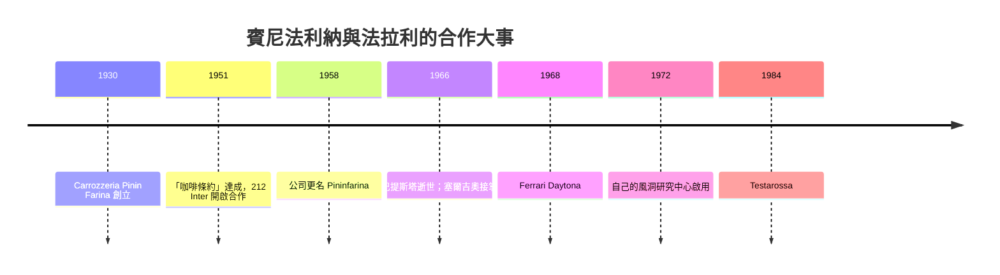

# 賓尼法利納與法拉利：性感曲線與流體力學

## 馬車匠之子的出生地

巴提斯塔·賓尼法利納（Battista Farina，1893–1966）出生於意大利皮埃蒙特的中央車庫世家，是十個孩子中的第十一位最年幼者。兄長開設車身廠 Stabilimenti Farina，孩童時代的巴提斯塔就在兄長的廠房長大，十八歲起便在金屬、馬車、車身的木模中學徒。因為他幼年時大家總喊他「Pinin」——皮埃蒙特語中「最小的孩子」的意思——「法利納·皮寧（Pinin Farina）」成為他一生品牌的前半。

一九三○年，Pininfarina 於杜林成立了自己的車身廠「Carrozzeria Pinin Farina」。他的突破點在方法而非表象：別家車身匠在木模上手工錘打鋼板，他卻率先將量產衝壓與工程繪圖引入車身製作，以「先設計圖紙，再以標準化工藝成型」的流程造車。這不僅是技術升級，而是把「車身製造」從手工藝重新定義為工業設計的宣示。一九三○年代的繁榮（經濟大蕭條後的復甦與美國市場需求）給予了這條路線驗證的空間——他的 Alfa Romeo 與 Lancia 車身以乾淨、流線、面向量產的方式贏得遍誉，包括 1936 年的 Lancia Aprilia 等力作。

## 一九五一年，「咖啡桌上的條約」

與法拉利的相遇，是汽車史上最著名的商業羅曼史之一。一九五一年，經由雙方共同友人引介，巴提斯塔之子塞爾吉奧（Sergio Pininfarina）陪同父親，在都靈近郊一家餐廳與恩佐·法拉利（Enzo Ferrari）會面。兩位固執的義大利強人在咖啡桌上一見如故，達成口頭協定：賓尼法利納自此負責法拉利公路車的車身設計。這份君子之約未曾寫成正式合約，卻維繫了超過七十年至今，被後世暱稱為「咖啡條約」。

合作的序幕是 1951 年的 Ferrari 212 Inter 等車型，接著 1952 年的 Ferrari 342 America，以及隨後著名的 250 系列——車身往往還以「Pinin Farina」簽名，一九五八年後公司名稱正式改為 Pininfarina，之後，這個姓氏本身即成為義大利工藝的代名詞。

## 恩佐·法拉利的固執

恩佐·法拉利不是好相處的人。他固執地把賽事放在首位，把公路車視為「為賽車融資」手段，並從一開始就拒絕把設計交由他人：他要求賓尼法利納尊重法拉利的比例規範——長頭短尾、座艙後移、引擎蓋佔比必須宣示 V12 的存在。1965 年代的 Dino 206 GT 是恩佐為紀念早逝愛子阿爾弗雷多·迪諾（Alfredo "Dino" Ferrari）而開發，其車身正是賓尼法利納之手；這是老法拉利一生中少數的情感讓步。美國記者把那段法拉利對客戶的解釋稱為：「我的車賣給什麼人，車身就得被他們讚美；但他們買它，是為了引擎。」在此氛圍下，賓尼法利納扮演的角色是「理解固執的人」——他們不是法拉利的附庸，而是能說服法拉利修改比例的唯一同行者。

## 流體力學是看不見的造型師

賓尼法利納真正的方法論，是讓美感服務於流體動力學，並讓流體動力學說服固執。1955 年起，公司建立了全歐洲車身廠中最先進的風洞測試室之一；塞爾吉奧培養的設計部門引進「1:1 模型風洞驗證」的標準工作流程。1960 至 1980 年代的代表作——諸如 1968 年的法拉利 365 GTB/4（Daytona），車頭蓋著連成一氣的犀利懸鼻與並列頭燈，將球面燃油風阻控到極致；1971 年的 365 GTC/4 和 1984 年 Testarossa（以其側面巨型導入鰭賦名）則以「造型意象引導氣流」的方向塑造了 80 年代超跑風潮。同一時期，賓尼法利納還為 Peugeot、Cadillac、GM 等多廠服務，並設計了 Alfa Romeo 的 Alfa 164、Peugeot 406 Coupé 等作為日常之王。

注：真正的全尺寸風洞中心落成於一九七二年的 Grugliasco／Cambiano 研發園區，這使賓尼法利納成為全球少數能「自驗自證」車身空氣力學的獨立設計公司。

## 從手工藝到設計工業

巴提斯塔·賓尼法利納一九六六年去世前，公司已完成從工坊到集團的轉型：量產代工、獨立設計、風洞測試一體化。兒子塞爾吉奧把生意版圖擴大，孫輩則走向電動要職；但這個家族的最大遺產是一座橋樑——連接了「手工匠的品味」與「工業界的量產紀律」。性感曲線背後，是風洞中的反覆吹測；而風洞裡反覆吹測的，是龍頭般固執的兩位義大利老人與他們的後繼者，共同保守的「咖啡條約」。

車都會老去、引擎會淘汰，但流體力學是永恆的立法者。賓尼法利納教會整個產業一件事：為美塑形，不是違背物理，而是物理的翻譯。
