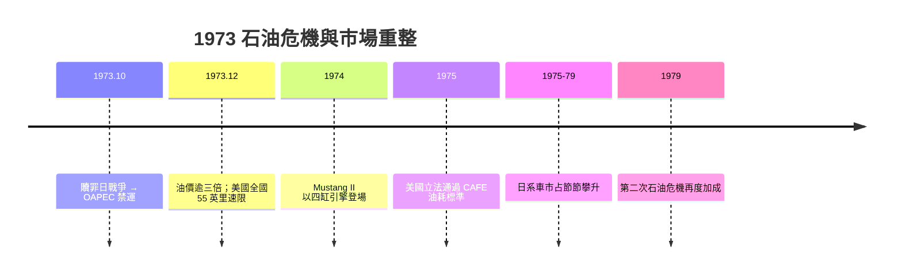

# 石油危機：美系 V8 怪獸的崩塌與日系崛起

## 廉價汽油時代的終結

二次大戰後的美國，汽車文化建立在兩個不證自明的前提上：汽油永遠便宜，V8 引擎永遠是答案。一九五○到六○年代，底特律三大車廠競相把排氣量推向極限，Pontiac GTO、Chevrolet Chevelle SS、Dodge Charger 搭載動輒七公升、近四百匹馬力的引擎，十公升行駛二十多公里的油耗數字，在每加侖只要三十美分的年代無人在意，甚至成為炫耀的資本。設計師以「加長、加寬、兩噸重」的方式詮釋富庶，車即是美國生活方式的計量單位。

美學如此，制度亦然：美國聯邦法規從未設定油耗上限，高速公路系統源源不絕供應道路空間。一九六八年之後越南戰爭推升通膨，但真正的清算要等到一九七三年。

## 一九七三：OPEC 的武器化

一九七三年十月，第四次中東戰爭（贖罪日戰爭）爆發。石油輸出國家組織（OPEC）中的阿拉伯成員國組成 OAPEC，宣布對支持以色列的國家——尤其是荷蘭與美國——實施石油禁運，同時逐步減產。同年年底，OPEC 基準油價翻了一倍以上，從每桶約三美元漲到十一美元以上。這是史上第一次，現代工業文明最核心的資源被制度化地當成地緣政治武器。

美國瞬間陷入史上空前油荒：加油站外大排長龍，部分州實施奇偶車牌分日加油，尼克森政府在十二月簽署緊急立法，把全國速限壓到每小時五十五英里。消費者在油槍前一夜之間長出了新的數學腦袋：油耗不是性能指標，是錢包指標。龐大的 V8 轎車在二手市場行情跳水，「美式大排氣量」一夜之間從榮耀變為負債。

## 底特律的倉促回應：肌肉車的剿殺

三大廠的反應可用「應急」二字：不是重新設計，而是閹割現有車款。縮小排氣量、調低壓縮比、貼上省油標籤——最典型的犧牲者就是福特野馬。一九七四年問世的 Mustang II，以四缸 Pinto 引擎（一九七一年推出的 Pinto 小車本已是簡配圖存之作，後來更因油箱設計缺陷引發惡名昭彰的安全醜聞與召回）作為入門動力，車身比初代野馬更小更重，肌肉車神話就此斷代。Chevrolet 的 Camaro 亦步亦趨，全美性能車系在本世紀中葉迎來集體冬眠。

一九七五年，美國國會終於立法補破網：通過《公司平均燃料經濟標準（CAFE）》，強制車廠全車系平均油耗逐年改善。這項制度性壓力之後數十年重塑了整個美國產品線，甚至間接催生了 SUV 的法律漏洞文化——但那是後話。

## 日本的準備：被禁運輕鬆越過

泡沫快速的另一面是慢活的準備。日本資源全賴進口，戰後的工程文化自始就以「資源效率」為設計前提。一九六六年豐田 Corolla、一九七二年本田 Civic——它們不是為油危而生的應急品，而是油危發生時已經在量產線上候命的答案。

一九七三年後，輕巧、省油、可靠、便宜的日本小車在美國市場如入無人之境。豐田 Corolla（一九六六年起）與豐田 Corolla 120 系、本田 Civic 第一代（一九七二年問市，一九七三年以後進入美國）以四缸小引擎與前置前驅架構，自帶遠超美系同級的油耗經濟性；Nissan（當時在美掛 Bluebird、Datsun 120Y 等名號）與 Honda Civic 同屬這波浪潮的先鋒。一九七○年代後期，豐田已成全美進口車第一品牌；一九八○年，日本汽車年產量正式超越美國，奪取世界之冠。

## 突如其來的另一刀

市場自會裁決，政治也會跟進。一九八一年，美日政府簽署「自願出口限制協定」（VER），限定日本車商每年輸美上限約一百六十八萬輛——這反而在商業上幫了日本廠一把：配額有限，豐田與本田索性把高階產品線 Lexus、Acura 推進來賺取單價。同時日本車廠以「移植生產」為名赴美設廠：一九八二年，本田在俄亥俄州 Marysville 設立 Honda of America Mfg. 平行廠，開始量產 Accord，成為第一家在美國生產汽車的日本車廠。

石油危機因此不只是一次能源事件，而是一次世界汽車文明的重組：它殺死了 V8 怪獸的黃金年代，把「效率」變成全球車廠的第一設計約束條件；它證明了制度性衝擊（禁運、CAFE、配額）比任何技術革命都更能重排市場；它也把世界的汽車重心第一次從密西根挪向了太平洋對岸。歷史在此留下冷峻的註腳：底特律花費三十年才承認，一九七三年冬天排隊的那條車龍，排的不是汽油，而是時代的更替。
