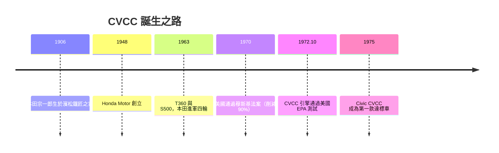

# 本田宗一郎與 CVCC：環保法案下的工程奇蹟

## 鐵匠之子的手

本田宗一郎（Soichiro Honda，1906–1991）生於靜岡縣濱松近郊的鐵匠之家。他的童年記憶是車床與鋼屑：父親做腳踏車修理，少年本田第一次見到汽車駛過村道時，回憶自己「追著那股汽油味跑了好幾里」。沒讀完高等小學的正規課程，他十六歲隻身前往東京，在一家汽車修理廠當學徒，白天擰螺絲，晚上睡在車底。二十二歲回鄉開設自己的「濱松分店」，靠修理與改裝車輛累積了驚人的手藝——據說他能僅憑引擎聲診斷病灶。

一九四六年與一九四八年是兩個起點：先創立「本田技術研究所」，用戰爭剩餘的發動機改裝成自行車上的機車引擎；一九四八年正式成立本田技研工業（Honda Motor），從摩托車起家。一九五八年的 Super Cub 以「人人都能騎」的姿態席捲世界，成為史上產量最高的車輛。本田並不甘於兩輪：一九六三年，本田首部汽車 T360（小型卡車）與 S500（輕量跑車）同時問世，以高轉速小引擎的身手宣告一家機車廠殺進四輪世界。

## 一九七○：穆斯基法案的宣戰

本田進入汽車業的時機，看似最壞，實則是最大的舞台。一九七○年十二月，美國國會通過《清潔空氣法》修正案（Clean Air Act Amendments），參議員埃德蒙·穆斯基（Edmund Muskie）主導的條款——後世稱「穆斯基法案」——要求：一九七五年底前（指 1975 車型），新車排氣污染量必須降到一九七○年水平的十分之一，即削減約 90% 的一氧化碳與碳氫化合物，一併大幅減氮氧化物。法案在洛杉磯二十多年毒霧的公眾憤怒下通過，連底特律都認定不可能達成，一度試圖遊說延期；但立法者拒絕讓步，法案原封不動。制度性壓力自此成為全球汽車工程最強的驅動力之一。

## 眾人走向觸媒，本田走向燃燒室

車界公認的捷徑是事後處理：在排氣管裝觸媒轉化器，但觸媒需用無鉛汽油——而當時美國加油站幾乎全是含鉛油，基礎設施改造曠日費時。本田宗一郎給年輕工程師們的指示與眾不同：「別在煙囪外裝濾網，去讓火燒得更乾淨。」

項目由年輕的研究工程師八木静好（Shizuyoshi Yagi）領軍。當底特律全力押注觸媒轉化器時，本田團隊從燃燒物理下手，在引擎缸頭上動刀——宗一郎幾乎天天泡在試驗室，聽馬達聲、聞廢氣味，用鐵匠之子的方式督軍。一九七三年以前，這個項目的預算在公司內部屢遭質疑：一家尚無份量的汽車新兵，憑什麼追一個全產業都認為做不到的期限？

答案在燃燒室。

## CVCC：小燃燒室的特殊火花

他們的解法是一組工程思想的縮寫：

CVCC（Compound Vortex Controlled Combustion，複合渦流控制燃燒）的最大發明不在觸媒，而在燃燒室幾何：缸頭上加設一個小型副燃燒室，火花塞點燃其中較濃的混合氣；燃焰噴入主燃燒室，以強烈渦流點燃那裡較稀薄的貧油混合氣。稀薄燃燒（lean burn）意味著燃燒更完全、CO 與 HC 大幅下降，且不需觸媒、不需無鉛汽油，只需調校精準的機械。以當時的技術語彙說：別人淨化煙囪，本田淨化火焰本身。

一九七二年十月，本田宣布首度以 CVCC 引擎通過美國環保署（EPA）主持的官方測試，成為法案通過後第一家交出合格成績的車廠；一九七五年車型年起，Civic CVCC 正式在美販售，成為第一款在未使用觸媒轉化器的前提下符合穆斯基標準的市售車。此舉轟動全美輿論，報紙以「小公司戰勝大法規」為題爭相報導，底特律巨頭也紛紛前來取經——福特更向本田技術授權，將 CVCC 裝進自家 Pinto Escorts 等車款上試驗。

## 偏執的回報

回頭看，這是一場典型的本田式賭局：一方面宗一郎個人長年堅持「不靠觸媒、不靠電腦」的機械本位主義；另一方面，正是這種執拗，逼迫團隊在燃燒本質上交出突破。而且在法律公佈（一九七○）與截止（一九七五）之間只有五年，EPA 測試的排程協商、油品問題、量產成本——所有時鐘同時倒數。最終，一家兩輪起家的車廠給了整個汽車世界答案：不是巨頭們認定唯一的觸媒路線，而是另一條廉價、獨立、不需新基礎設施的路。

## 老人有他自己的預言

本田宗一郎於一九九一年去世。他一生偏執於一件事：工程師要自己動手驗證，而不是等物理來將就。他曾說，CVCC 最大的功勞不是保住了本田的生意，而是證明了環保法規不必是工程師的天敵——嚴苛的法律反而是最好的催生者。穆斯基法案的九十個百分點，最終由一家小車廠的副燃燒室先跨過去；而整個行業被迫跟進的結果，是效率、環保、可靠度三項指標在整整一個世代內同步躍遷。制度驅動技術，技術回饋制度——這正是二十世紀汽車工程最完美的一次合奏。
