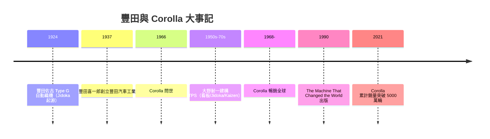

# 豐田生產方式與 Corolla 傳奇

## 自動織布機的孩子

要理解 Corolla 與豐田，必須先理解一台織布機。豐田喜一郎（Kiichiro Toyoda，1894–1952）的父親豐田佐吉（Sakichi Toyoda）是日本「發明王」：出身木匠之子，自助研發出自動織布機，一九二四年完成 Type G 自動織機——其革命之處在「自働化（Jidoka，帶有人的自治意識的自動化）」：織線一斷，機器自己停機，不會繼續生產次品。佐吉的名言體現哲學：「機器應有人格，壞了就要停下來坦白。」這台織布機的專利權，後來以一百萬日圓賣給了英國公司——這筆錢，成了豐田造車的本錢。

喜一郎在東京帝國大學學的是機械工程，替父親的織機事業效力的過程中赴歐美考察。福特汽車流水線的效率令他震撼，但他本於資源匱乏的日本，認為不能照抄美國式大批量生產：「我不要日本多產的英美式，我要日本式的生產。」一九三七年，豐田自動織機的汽車部門獨立為豐田汽車工業（Toyota Motor Corporation），喜一郎出任首任社長。他說出企業哲學的核心命題：**「庫存是惡——理想是今日之量，今日造（Just in Time，剛好及時）。」**

## 大野耐一：把哲學做進車間

豐田喜一郎有哲學，把它做進車間的是大野耐一（Taiichi Ohno）。從一九四○年代起，大野在喜一郎「及時生產」構想的授權下，以美國超市「貨架上缺了才補」的補貨邏輯為啟發，反向打造出「看板（Kanban）」系統：用實體卡片在工序之間傳遞需求信號，實行「後工程向前工程取貨」，逼近零件的零庫存。再加上 Jidoka 的「自働化」（操作員發現異常即拉下停機繩 Andon，整條線停下來解決問題）與 Kaizen（全員持續改善）兩大支柱，共同構成 Toyota Production System（TPS，豐田生產方式）。

## 檢修段落

上段有誤，讓我們重述大野耐一的貢獻：一九五○年代，大野耐一在豐田汽車生產部門成長於喜一郎「及時生產」哲學下，把美國超市「缺貨才補貨」的邏輯改造成看板（Kanban）系統——後工程向前工程取貨，用卡片在工序間傳喚需求，直至「零庫存」。再輔以自働化（Jidoka，異常就停線，操作員可拉 Andon 繩）、Kaizen（全員持續改善）兩大支柱，構成 Toyota Production System（TPS，豐田生產方式）。

大野的作風近乎偏執：他要求主管到車間畫粉筆圈、站上一整天觀察操作員的每一個動作，找「浪費」；他堅信「減少庫存本身就是降低成本」，也等於逼出每一處問題——庫存一少，機器故障、重工、流程不順全部裸露無遺。這種以「暴露問題」為榮的管理哲學，與西方「以隱藏問題為職業」的傳統完全相反，也是 TPS 日後最難被抄走的部分。

## Corolla：最沒有個性的暢銷神話

一九六六年，豐田推出 Corolla，口號是「全世界最需要的小車」。它不強調性能也不炫耀設計，主張的是三件事：省油、可靠、維修便宜。第一代即配 1.1 升引擎與省油驅動；一九七三年石油危機來臨時，Corolla 已在量產線上候命多時，迅速成為「油荒年代的答案」。到了一九六八年前後，Corolla 已是日本最暢銷車之一；一九九七年，它躍居全球單一車型銷售王寶座；二○二一年，Corolla 家族累計銷量突破 5000 萬輛，為全球汽車史上最暢銷的單一車系。

Corolla 傳奇的真正引擎，不是外型，而是 TPS：每一位下線的 Corolla 背後，是看板、Andon 繩、Kaizen 建議書制度共同支撐的「零不良出貨」承諾。當底特律的車開不到五年就鏽透，Corolla 開完三十萬公里還照常上路——消費者不記得規格，只記得「豐田不會壞」。品牌神話由此而生。

## 《改變世界的機器》：學院最終蓋章

豐田模式從一間日本車間的內規，變成全球管理學聖經，靠的是一份研究著作：一九九○年，麻省理工學院（MIT）國際汽車計畫的研究員 James P. Womack、Daniel T. Jones 與 Daniel Roos 合著出版《The Machine That Changed the World》（中文通譯《改變世界的機器》）。該書以「精益生產（Lean Production）」為名，把 TPS 系統化：用大量對比數據說明豐田在生產力、品質、開發時程上全面領先歐美，並把「精益」定義為「用更少的一切——人、空間、工具、工時——造出客戶真正想要的東西」。此書成為商學院的革命性教材，自此豐田生產方式從一家公司的內部知識，升格為二十一世紀的全球管理語言。

## 因果鏈的重構

把線拉直，這段歷史的驅動鏈為：自動織布機 → 「不產次品」思想 → 喜一郎造車時援引 JIT → 資源匱乏的日本（戰後石油、鋼鐵、資金皆缺）迫使 TPS 成型 → Corolla 用 TPS 壓倒性贏得可靠口碑 → 石油危機讓「省油可靠」成為全球需求 → MIT 以學術研究將其定名為「Lean」。教育與思想驅動技術，資源約束塑造制度，制度反過來定義文化：這就是豐田，以及最暢銷車的真相——一場在思想與經濟的共同作用下，每天比昨日更精益一點的持久革命。
