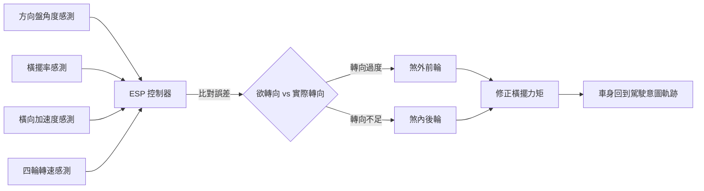

# 節標題：ABS 到 ESP——電子科技重構底盤安全

如果說可潰縮車身與安全帶是被動安全的「硬體革命」，那麼一九七〇至一九九〇年代發生的，便是一場「軟體革命」：靠晶片、感測器與演算法，讓汽車在物理極限的邊緣自己救自己。

## 飛機上的萊茵河智慧

防鎖死煞車的概念誕生在天上。一九三〇年代航空工程師已發現，起飛降落時煞車鎖死會使輪胎爆裂、起落架斷裂，Maxaret 等機械式防鎖死裝置於是裝上英國飛機。一九六〇年代起，飛機上的電子化航電思路開始移植地面：美國 Bendix 與福特在 1960 年代末測試車用 ABS，Chrysler 更在 1971 年為 Imperial 車系提供量產的四輪 ABS；日本方面，豐田也於 1971 年起在皇冠車系上試裝。但早期系統價格高、可靠性不足，只能算是昂貴的試驗場。真正的破局來自 Bosch：一家在航空控制領域亦有積累的德國工程團隊，把飛機式的數位控制思維搬到汽車上，與 Mercedes-Benz 聯手開發了十年、燒掉逾四億德國馬克。一九七八年，Bosch 的電子式 ABS 在 Mercedes W116 S 級上量產問世——汽車史上第一套以微處理器控制的量產防鎖死煞車系統。它的原理至今未變：每個車輪上有轉速感測器，控制器以每秒數十次比對車輪減速度與車速估計，一旦輪胎滑移率逼近抱死閾值，便以動態調節閥快速「點放」煞車壓力，把滑移率維持在 $\mu\text{-}\lambda$ 曲線峰值附近，讓駕駛人在急煞中仍保有轉向能力。

## 從 ABS 到 TCS：控制的升級

一九八六年，Bosch 與 Mercedes 把同樣的感測思想反向應用到驅動輪，推出 TCS/Traction Control——防止驅動輪在濕滑路面空轉打滑。ABS 管「煞不住」，TCS 管「起步打滑」，兩者共用輪速資訊與液壓單元，這在硬體上預留了一個更大的可能：如果把方向盤角度與車身橫擺角速度也測出來，汽車能不能知道「駕駛想去的方向」與「車實際去的方向」的差別？一九八七年，Mercedes 與 Bosch 開始研究這個問題；一九九〇年代早期項目組在此基礎上完成量產化開發。

## ESP：一看橫擺、就知你想去哪

一九九五年，Mercedes-Benz S 600 Coupé 上出現了世界第一套量產 ESP（Electronic Stability Program，電子車身穩定系統）。它的巧妙在於「思考的層次」：ABS 與 TCS 只懂輪子，ESP 懂整台車。系統比對方向盤轉角（駕駛意圖）與橫擺角速度感測、橫向加速度感測（車身實際動態），當二者不一致——例如濕滑路面轉彎時車尾外甩的「轉向不足/轉向過度」——演算法便自主對特定車輪施加煞車力，產生一個修正力矩把車身拉回軌道，必要時還同步介入引擎輸出。用最簡的式子說，它控制的是 $\dot{\psi}_{actual} \approx \dot{\psi}_{desired}$：讓車實際的橫擺率逼近駕駛意圖。這是汽車第一次「猜中並修正」駕駛的錯誤，被稱為自安全帶以來最大的單一安全躍進。

## 氣囊：另一條電控戰線

電子安全不只是底盤。一九八一年，Mercedes 在 W126 S 級上首次量產駕駛座氣囊（搭配安全帶預緊器），靠的是 Bosch 開發、能判讀碰撞訊號並在約 30 毫秒內引爆氣體發生器的電子控制單元——毫秒級的判定，正是微處理器時代才做得到的本事。到 1995 年 S 級 W140 已配齊前座雙氣囊與側面氣簾。

## 制度收網

電子安全的普及不是靠說服，而是靠制度。一九九七年瑞典《Folksam》與歐洲 NCAP 的獨立碰撞評級開始把 ESP 視為加分項；二〇〇七年，美國 NHTSA 的數據顯示 ESP 可降低約三分之一的高風險翻覆事故，遂於 FMVSS 126 規定 2012 年前全美新車強制配備 ESC；歐盟隨後亦強制。一項發明以不到二十年時間從選配變成全球法定標配，這在汽車史上前所未有——因為它拯救的是「還沒發生的」事故，這樣的功勞必須靠統計學來證明，而證明它的是制度，不是車展的鎂光燈。

回望這三十年，ABS、TCS、ESP 與電子氣囊的接力，本質上是「感測—計算—作動」這組工業範式對一個百年機械行業的征服。Bosch 與 Mercedes 的聯合開發模式，則示範了巨頭公司如何以「車廠出題、供應商解題、再共同量產」的方式跨越單一企業的技術邊界；而美、歐法規在關鍵時刻的強制收網，最終把工程師的偏執變成千萬駕駛的日常。電子安全不是某一個英雄的發明，而是一場由航空技術、半導體進步與挺身而出的監管者共同完成的制度工程。
