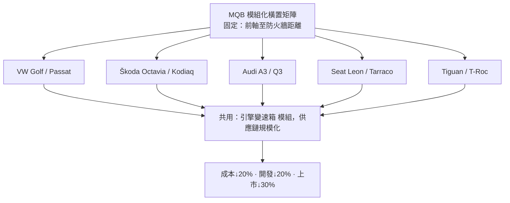

# 節標題：從 PQ35 到 MQB——平台化的製造經濟學

一九九〇年代中期，一位福斯集團的工程主管在內部會議上算過一筆帳：當時福斯集團旗下大眾、奧迪、Škoda、Seat 各自為政，光是柴油引擎、變速箱、轉向系統就有數十種互不相通的版本。集團每年賣數百萬輛車，規模全球數一數二，利潤率卻比豐田差一大截。要害不在車不夠好，而在「重複勞動」太多。解法，是接下來二十年改寫全球汽車工業的平台化革命。

## 從「單一車款共用」到「模組化橫置魔方」

福斯集團的平台策略經歷三個階段。第一階段是傳統平台共享：如 PQ35 平台（P 代表客車 Platattform、Q 是橫置引擎、35 表示世代），承載第五代 Golf（2003）、Audi A3、Škoda Octavia 二代、Seat Leon 等車。車廠間「共平台」意味著共用地板、懸吊與動力總成，成本立刻下降，但平台固定，衍生車型受限。第二階段自 2007 年前後啟動：時任集團首長的 Ferdinand Piëch 之後繼任者 Martin Winterkorn 主導一項更激進的構想——不設「平台」，只設「模組尺寸」。二〇一二年，MQB（Modularer Querbaukasten，模組化橫置矩陣）正式量產問世。

MQB 的核心是鎖定一個唯一不可變的尺寸：前軸中心到防火牆、油門踏板的距離。這段距離（約 278 毫米的「L113」概念）一旦固定，引擎、變速箱、轉向機、電池的安裝相對位置全部不變，而軸距、輪距、車身高低乃至引擎型號全都可以按車型自由疊加。早期的風險也真實存在：工程師擔心共用結構會「稀釋」品牌的駕駛性格，於是集團以同一副底盤配不同懸吊調校、車身剛性補強與 NVH 套件來區隔奧迪與 Škoda 的手感——「平台相同、性格可選」成了整場革命必須向市場證明的命題。於是一個 MQB 底盤架構，竟能衍生出 Golf、Passat、Tiguan、T-Roc、T-Cross、Škoda Octavia 與 Kodiaq、Audi A3/Q3、Seat Leon 等全橫置車系共數十款、每年數百萬輛產量。福斯統計，MQB 使開發支出降低約 20%、單車製造成本最多下降 20%、上市時間縮短約 30%——這是把豐田學「標準化作業」的思想用工程語言固化到車體結構裡。

也不再需要每一款車單獨定制線束長短、接插件型號。帳面上，MQB 的量產規模舖得越開，單位成本就跌得越深；帳面下，它把整個集團擁有的許多工廠變成一座巨大而同步的機器。這是一場在工程師圖紙、採購合約與工廠生產線之間三線並進的改革。

## 經濟學的深層邏輯

MQB 的真正威力在供應鏈的制度化。當數十款車共用同規格的轉向機、煞車、電控架構與引擎族，供應商能以超大批量生產單一組件，福斯的議價力與品質一致性同步躍升；工廠端則因工位介面標準化，同一條總裝線可生產不同品牌車型，柔性製造成為標配。這套「把經濟規模寫進汽車解剖學」的做法，隨後被整個行業追隨：豐田的 TNGA、雷諾-日產的 CMF、Volvo 的 CMA/SPA，乃至現代起亞的 K 平台，都是 MQB 思想的回音。Piëch 在 Audi 時代主導的縱置平台整合與 1990 年代起的「跨品牌共用」策略，正是埋在 MQB 底下的思想種子。

## 從 MQB 到 MEB：電動時代的同構

二〇一九年，福斯把同一套邏輯電氣化，推出 MEB（Modulare E-Antriebsbaukasten，電動模組化平台）：電池包是一組尺寸可疊加的「積木」，橫貫地板，前後軸距隨電池段數伸縮，一個平台生出 ID.3、ID.4、ID. Buzz、Q4 e-tron 與 Škoda Enyaq。MQB 與 MEB 之間，福斯也嘗試了雙軌 J1/PPE 等高端平台。電池規格標準化帶來的，不只是造車成本，更是一個新型態的規模賽局——誰的平台被自己的品牌與盟友（如福特採用 MEB）廣泛採用，誰就定義了電動車的「接口標準」，如同當年標準軌距鐵路統一世界貿易的工程規範。

## 高光的代價

平台化並非無本生意。MQB 時代福斯因「性能與成本的完美平衡」獲利大增，卻也在 2015 年跌入柴油排放醜聞（Dieselgate）——標準化極致壓縮成本的壓力，正是醜聞的組織土壤之一。MQB 教育世人的是一條雙面真理：工程的一致性是利潤的槓桿，也是制度的試金石。汽車工業在 2010 年代之後的整併、電動化速度、乃至中國車廠的逆襲，都能在 MQB 這面鏡子裡找到自己最初與最後的倒影。
