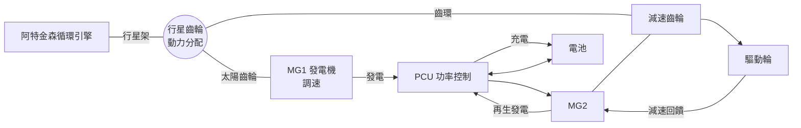

# 節標題：普銳斯與 THS——油電混合動力破局

一九九三年，豐田內部悄悄成立了一個代號 G21 的特別專案，總部給它的任務沉重而含糊：想像二十一世紀的汽車。專案團隊多數人想的是更小的車、更時髦的車，直到當時的豐田常務——後來的社長——內山田竹志把題目改寫得更狠：「油耗必須是目前車的二倍。」這一個數字目標，把 G21 從改款腦力激盪，推向了動力系統的革命。一九九七年十月，第一代 Prius（Prius = 拉丁語「先行」）在日本上市，成為世界第一台量產油電混合動力轎車。

## 環境政治給的順風

Prius 的誕生離不開政治經濟學。一九九〇年，加州空氣資源局（CARB）通過了著名的「零排放車輛」配額——要求車廠在州內賣出的新車中，一定比例必須是零排放車。加州法規逼出了電動車（GM EV1）、也逼出了豐田高層的焦慮：與其被動陷入電池技術的泥沼，不如先做出一台「不用充電也能大幅省油」的車，在過渡期占住道德與技術高地。內山田團隊最終選定的技術路線正是混合動力；而 1997 年《京都議定書》的簽署，又在全球層面把 CO₂ 排放變成美日歐三地同時收緊的法規壓力。Prius 趕在這一波時代浪潮之前量產，第一代投產的實際油耗約為同級汽油車的二倍多（日本版表定約 28 km/L），正好踩中了法規的痛點。

## THS：行星齒輪的天才分配

豐田混合動力系統（THS，Hybrid Synergy Drive 為後續品牌名）的核心並非電池，而是一套看似平淡的機械裝置——行星齒輪動力分配器（power-split device）。引擎曲軸連到行星齒輪的行星架，MG1（發電機）接太陽齒輪，MG2（電動馬達）接齒環，齒環再聯結車輪。控制器只要微調 MG1 的發電轉速，就能連續改變引擎轉速與車速的比值——這也正是 THS 之所以被稱為 e-CVT（電子無段變速）的原因：沒有傳統變速箱的齒輪比，引擎卻可永遠工作在效率最高的轉速帶（著名的阿特金森循環設計以延遲關閉進氣門的方式延長膨脹行程，犧牲部分功率卻賺回更高的熱效率）。起步與低速時引擎可完全停機，由 MG2 純電驅動；加速時電池放電輔助；減速時 MG2 反向轉為發電機，把本來要摔進煞車皮的動能透過再生煞車（regenerative braking）灌回電池。塞車時每一腳煞車都在回血，這正是混合動力在都市路況比重整路況更有利的根本原因。

## 好萊塢與加利福尼亞的文化迴旋

2000 年 Prius 出口全球（首站北美），初期銷量平淡；改變命運的是文化。二〇〇〇年代，加州的環保思潮與好萊塢的明星經濟合流：李奧納多・狄卡皮歐、卡麥隆・狄亞茲穿著晚禮服在奧斯卡紅毯下車推薦 Prius 的畫面，讓這台其貌不揚的小車成為「看得見的美德」——穿在身上的社會運動。2005 年前後，Prius 車主在加州一度可使用低碳拼車車道，銷量與身份認同互相推升；豐田順勢在 2003 年推出第二代（THS-II，功率與再生效率大幅提升），使 Prius 成為全球最成功的新能源象徵。這場由 CARB 配額、明星車隊與京都議定書共同導演的文化接力，證明了綠色技術的傳播不只靠工程數據，還需要一件值得演示的社會時裝。

## 破局之後

豐田的生產力集中亦須一提：G21 專案以目標驅動、跨部門一體化的開發方式，在十年內把 THS 從原型推向每年數十萬輛的量產規模，並把行星齒輪專利體系、供應鏈（與松下合資的 Panasonic EV Energy 電池事業）與成本曲線同步壓下來——到了 2009 年第三代，系統的自製率與可靠性已使對手難以複製。批評者說混合動力只是過渡技術、豐田因此在純電時代起步遲緩；信仰者則說 THS 證明了「進步不在於最快的子彈，而在於最通用地過好每一天」。無論站在哪一邊，Prius 都已經改寫了汽車史的劇本：它讓引擎第一次學會在電機的伴奏下唱歌，也讓「油耗」第一次成為消費者與政治家的共同語言。
