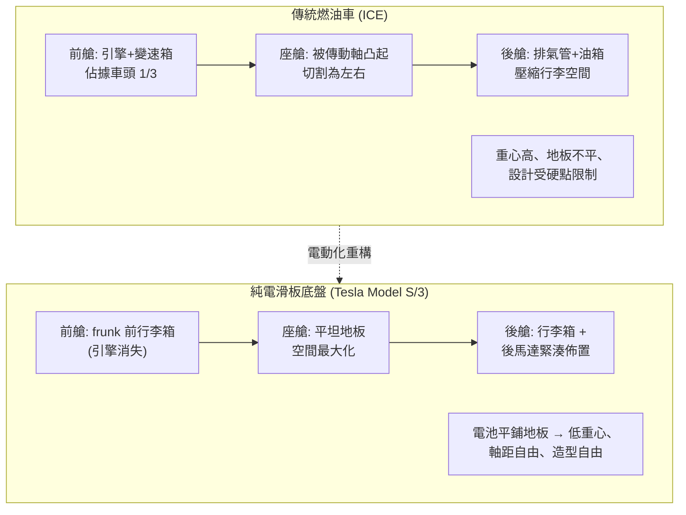

# 馮霍茲豪森與 Model S：取消格柵的純電包裝

## 一、從 Art Center 走出的造型詩人

2008 年，通用汽車（GM）正陷於金融海嘯與破產陰影之中。就在 GM 準備向政府求援的那一年，一位三十九歲的設計師坐在加州的辦公室裡，凝視著一台叫好不叫座的小跑車——Pontiac Solstice。他叫 Franz von Holzhausen，馮霍茲豪森，帶著德國貴族姓氏、在美國長大的設計師。

他的職業起點，是位於帕薩迪納、俯瞰洛杉磯的 Art Center College of Design——全球汽車設計師的黃埔軍校。在高強度的評圖文化中，他練就了兩項決定命運的本事：對比例近乎偏執的敏感度，以及快速從草圖跳到油土模型的手上功夫。

畢業後他進入 Mazda 美國設計中心，參與 RX-8 與 Mazda 6 的開發，這種「日式簡潔＋美式張力」的語彙讓 GM 伸出橄欖枝。轉戰 GM 後，他接手 Pontiac Solstice——這台車被《汽車趨勢》選為年度風雲車，卻也是他心中的一根刺：一款車再美，若公司體質不對，終究救不了品牌。他親眼見證了 GM 的僵化，也由此學會：設計者的命運，與其說取決於筆下，不如說取決於效力的組織。

## 二、Elon Musk 的電話

2010 年，Tesla 還是一家瀕臨破產的小公司，只賣過基於蓮花 Elise 底盤改裝的 Roadster。但 Elon Musk 手裡握著兩張牌：剛完成融資的現金，以及一支代號「白星」（Whitestar）的轎車專案。Musk 打了電話給馮霍茲豪森。他後來回憶，Musk 問的不是「你會不會畫圖」，而是「你想不想重新定義汽車？」

這是一場典型的 Musk 式招募：給的不是職位，而是歷史定位。馮霍茲豪森離開穩定的大廠擔任首席設計師，第一個任務是推倒重來一台被批評為「像 Mazda 一樣平庸」的原型車。他用幾個月重構車身比例——長軸距、短懸、低頂的跑車化轎車。這就是 2012 年問世的 Model S。

## 三、取消格柵：百年汽車語法的第一次斷裂

Model S 的設計革命，始於一個看似無聊的工程事實：電動馬達不需要大量空氣冷卻，汽車因此不需要傳統的水箱格柵。

這件事的歷史重量要回溯百年。自福特 T 型車以來，「格柵」一直是汽車正面的圖騰——從勞斯萊斯的帕特農神廟、BMW 的雙腎到奧迪的大嘴，格柵承載著品牌識別，甚至是階級符號。設計師可以改變車頂弧線，卻沒有人敢動格柵。而在 Musk「第一性原理」的要求下，馮霍茲豪森做出了決斷：既然不需要，就取消它。Model S 的車頭是一塊近乎完整的鋁合金曲面；這個「封閉車頭」發表時被批評為「無臉」，但五年之內全行業的電動車紛紛跟進，格柵從功能件退化为裝飾件。馮霍茲豪森用一台車，終結了汽車設計一百年來最重要的一條語法。

第一性原理在此扮演了制度性角色。Musk 反覆灌輸一個框架：不要問「汽車本來長什麼樣」，要問「物理定律允許汽車長什麼樣」。這種要求有時近乎蠻橫——他堅持隱藏式門把與極簡儀表台，工程團隊為此付出幾次量產災難的代價。馮霍茲豪森的角色，是在物理狂想與量產可行性之間「妥協的藝術」：Musk 負責撕裂常識，他負責縫合成一台能量產且好看的車。

## 四、滑板底盤：電池包重塑汽車空間

取消格柵只是外觀；更深的革命藏在底盤之下。傳統燃油車的空間被引擎、變速箱、排氣管、傳動軸層層切割，工程師必須在「不可妥協的硬點」之間見縫插針。Tesla 的方案改寫了空間邏輯：數千枚電池平鋪在地板上，前後各置一具馬達——這就是滑板式底盤（skateboard chassis）。

滑板底盤帶來三個連鎖效應。**其一，低重心**：電池包位於車身最低處，整車重心低於任何同級燃油轎車，未加懸掛黑科技就有跑車級的操控穩定性。**其二，空間最大化**：引擎消失後，車頭讓出前行李箱（frunk）；地板平坦、後座寬裕，Model S 成為史上第一台「五門掀背＋前後雙行李箱」的豪華轎車。**其三，設計自由度**：馮霍茲豪森終於能在沒有引擎蓋高度限制的前提下，畫出長軸距、低車頂的車——這是他在大廠體制下永遠畫不出來的車。

## 五、Model 3：極簡作為階級宣言

如果說 Model S 是面向富人的宣言，2017 年的 Model 3 則是面向大眾的賭注。Musk 的要求只有一個矛盾：造一台三萬五千美元的車，但必須看起來像十萬美元的車。馮霍茲豪森的答案是「減法」。Model 3 取消了傳統儀表——行車資訊集中在 15 吋的橫向中控螢幕上；車內幾乎沒有實體按鍵，空調出風口簡化為橫貫木紋飾板的縫隙。這種極簡部分源於成本控制，但更深刻地，它複製了 iPhone 對功能機的顛覆邏輯：把複雜性從硬體轉移到軟體。極簡內裝不是美學選擇，而是「軟體定義汽車」的物理前提——當車內只剩一塊螢幕，車就成為可以持續進化的終端。這也與福特 T 型車的「標準化」遙相呼應：1908 年的福特用「任何顏色都可以，只要是黑色」降低生產複雜度，2017 年的 Tesla 用「螢幕之外的東西都可以省略」降低供應商數量。

## 六、Cybertruck：用不鏽鋼向世界叫陣

2019 年 11 月，Musk 在發表會上親手把金屬球砸向 Cybertruck 的車窗，玻璃裂成蜘蛛網——那聲驚呼成為汽車史上最著名的直播事故。Cybertruck 的造型語言是徹底的平面幾何：整車沒有一條曲線，全部由摺痕銳利的平面構成。這不是審美偏執，而是製造約束的倒影——Musk 堅持用 301 不鏽鋼（與 SpaceX 星艦同源）作為外覆件，而這種高強度鋼無法沖壓成複雜曲面，只能折彎成平面。Cybertruck 的「未來主義」造型，本質上是「不鏽鋼衝壓工藝的物理極限」的美學化。馮霍茲豪森再一次把工程的第一性原理翻譯成設計宣言——發表會後一週，預訂量超過二十五萬台。

## 七、設計者的宿命

回望馮霍茲豪森的軌跡：在 Mazda，他學會克制；在 GM，他看清制度的枷鎖；在 Tesla，他遇到一個願意燒掉設計教科書的老闆。他的成功不能簡化為「遇見了 Musk」——他答對了「時代需要什麼樣的設計師」。當電動化、軟體化、直銷模式三股力量匯流，行業需要一個敢於同時對抗格柵、儀表與經銷商傳統的設計者。他用 Model S 回答：設計的最高境界，不是把車畫得漂亮，而是敢於把「不需要的東西」拿掉——哪怕那個東西，是汽車一百年的臉面。而當格柵、按鍵與儀表一一消失後，剩下的螢幕與線束，將成為下一場戰爭的戰場。
