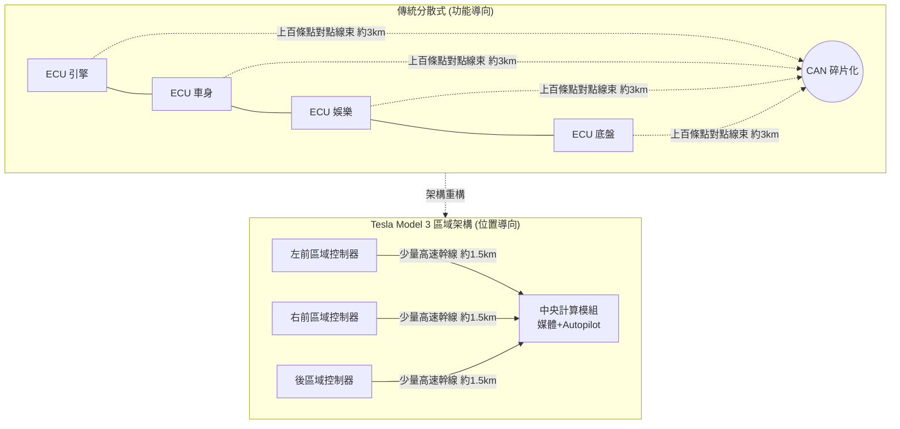

# 集中式 E/E 架構與 OTA：軟體定義汽車

## 一、線束的詛咒：百年汽車的電子巴別塔

要理解 Tesla 的架構革命，必須先理解傳統汽車電子的困境——而這個困境，是汽車產業百年分工制度的必然產物。

一輛 2010 年前後的豪華轎車，車上散布著超過一百個 ECU（電子控制單元）：引擎、變速箱、ABS、安全氣囊、空調、車窗、音響……每一個都由不同供應商（Bosch、Continental、Denso 等）開發，各有自己的晶片與軟體，彼此靠 CAN 匯流排（Controller Area Network，1986 年由 Bosch 發明）連結。整個車內網路，本質上是「數十家公司各自為政的聯邦」，而非統一設計的系統。

後果觸目驚心。首先是**線束的膨脹**：一輛高端燃油車的線束總長可達約三公里、重逾六十公斤、接點上千——線束是整車第三重的零件，僅次於引擎與底盤。其次是**軟體的孤島**：每個 ECU 的軟體由供應商封閉開發，車廠自己也讀不懂全部程式碼，任何功能改動都要跨供應商協調，一個小改款動輒十八個月。最致命的是**無法更新**：車子出廠那一刻，軟體就凝固了，bug 只能靠召回——把車開回經銷商用診斷儀一台台刷寫。在智慧手機一年迭代數次的年代，汽車像一台出廠即報廢的電腦。

病根不在技術而在組織：汽車產業的垂直分工鏈（車廠→Tier 1→Tier 2）是為「機械產品」設計的，而電子產品需要橫向整合。誰來打破這座電子巴別塔？歷史的答案是：一家從沒造過車的公司。

## 二、Tesla 的答案：區域架構與中央計算

Tesla 從 Model S（2012）開始就比同行更集中：自己寫車機軟體、自己定義 ECU，繞開供應商黑箱。但真正的革命發生在 Model 3（2017）。

Model 3 做出了一個堪與福特流水線比擬的架構決策：**放棄「按功能分散」的 ECU 佈局，改採「按物理位置分區」的區域控制器（zonal architecture）**。整車劃分為左前、右前、後三個車身控制器，加上中央計算模組（媒體控制單元與 Autopilot 運算單元）。原本每個功能各自拉線到駕駛艙，改為「就近接入」：車門上的馬達、鎖、鏡頭先接入側邊的區域控制器，再由少量高速幹線連到中央計算。結果是線束總長從 Model S 的約三公里，壓縮到 Model 3 的約 1.5 公里，重量與成本同步下降，自動化組裝也變得可行——機器人不需要在儀表台下方穿針引線了。

這場革命的制度意義大於硬體意義：當車上只剩少數幾個由 Tesla 自己寫軟體的控制器，汽車第一次成為「一台可以被整體編程的機器」。硬體集中化是軟體集中化的前提；軟體集中化是 OTA 的前提。

## 三、OTA：把汽車變成智慧手機

OTA（Over-the-Air，空中下載更新）並非 Tesla 發明——2000 年代 BMW 等車廠已用它更新導圖。但把 OTA 從「更新地圖」升級為「重寫整車行為」，Tesla 是第一個大規模做到的公司。

2012 年，Model S 交付之初就建立整車 OTA 能力：修懸掛異音的軟體參數、改進充電曲線、增加新功能，都像智慧手機推送系統更新一樣，在車主睡覺時完成。這徹底改寫了「汽車交付」的定義：交付不再是終點，而是軟體生命週期的起點。Musk 曾把傳統車廠的處境比作「諾基亞面對 iPhone」——差別在於，諾基亞知道危機來了卻動不了體制，而傳統車廠連「知道」都滯後了數年。

最具標誌性的一幕發生在 2018 年。《消費者報告》（Consumer Reports）測試 Model 3 後，因其 60-0 mph 煞車距離約 47 米超出評級門檻，罕見地未給予推薦。Musk 在推特承諾十天內改善。Tesla 透過 OTA 更新了 ABS 的演算法標定，數日後重測：煞車距離縮短約 6 米，優於同級車，評級翻正。一家車廠用軟體更新，在幾天內改變了已交付車輛的核心物理性能——這成為「軟體定義汽車」最生動的教科書案例。

## 四、全行業的轉向：軟體定義汽車（SDV）

Tesla 的示範效應迫使百年體制自我革命。「軟體定義汽車」（Software-Defined Vehicle, SDV）從行銷詞彙變成全行業的轉型綱領：**Toyota** 於 2021 年成立軟體子公司 Woven by Toyota，開發 Arene 車載作業系統；**Volkswagen** 於 2020 年成立 CARIAD，計劃自研 VW.OS，儘管項目歷經延期與管理層震盪，仍投入數十億歐元——這是德國工業對「軟體為王」最沈重的一次低頭。GM、Mercedes、Volvo 紛紛公布集中式架構與 OTA 戰略；中國車廠（蔚來、小鵬、理想、比亞迪）把 SDV 視為換道超車的必修課；供應商端，Bosch、Aptiv、大陸集團都把「區域架構＋中央計算」寫進下一代路線圖——Model 3 的拓撲圖成了行業公共財。

驅動力不只是技術模仿，而是商業模式的生存焦慮：當汽車的核心價值從「馬力與內飾」轉移到「軟體體驗與持續訂閱」，誰掌握軟體，誰就掌握價值鏈的分配權。這與二十年前 PC 產業「Wintel 剝削整機廠」的歷史如出一轍，車廠們顯然讀過這段歷史。

## 五、代價與風險：資安、召回與權力

軟體定義汽車並非免費午餐。**資安**：整車集中化意味著單點被攻破的災難放大。2015 年，安全研究員 Charlie Miller 與 Chris Valasek 遠端入侵一輛 Jeep Cherokee，能操控其轉向與煞車，導致 FCA 召回 140 萬輛車——汽車史上第一次由駭客引發的大規模召回。此後 UNECE R155/R156 網路安全與軟體更新法規（2021 年起生效）成為新車上市的法律門檻，OTA 從「能力」變成「被監管的義務」。

**軟體化召回**：當 bug 可以 OTA 修復，監管演化出「OTA recall」制度——NHTSA 有權要求以 OTA 形式召回修復缺陷。2022 年起 Tesla 多次收到此類召回令。車輛可以不下修理廠，但「召回」這個百年法律概念並未消失，只是換了執行形式。**權力轉移**：OTA 也把巨大權力交到車廠手中——車廠可以遠端改變已售車輛的性能（Tesla 曾因電池故障限制部分車輛充電容量而引發訴訟）。消費者買的是「車」還是「硬體授權」？這個制度問題至今仍在灰色地帶拉鋸。

## 六、歷史的迴響

Tesla 的 E/E 革命與一百年前的福特流水線有結構上的相似：福特通過重新組織**物料的流動**降低機械複雜度，Tesla 通過重新組織**電子與軟體的拓撲**降低系統複雜度。兩者本質上都在回答同一個問題——「如何讓大規模製造的產品，保持可管理、可進化」。

而這場革命尚未終局。當線束縮短、ECU 集中、軟體可持續更新之後，製造本身的革命浮現了：如何用更少的零件、更短的工時，鑄造出一台車的骨骼。那是下一節的主題：一體壓鑄。
