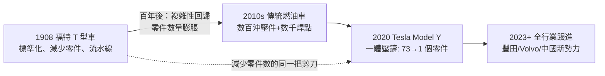

# Gigacasting：大型壓鑄的製造革命

## 一、七十三個零件的百年重負

2020 年之前，造一台汽車白車身（Body-in-White）的標準流程，百年來幾乎沒有本質變化：把幾百片鋼板沖壓成型，再用數千個焊接點把它們拼成一副骨架。光是車身後部，就由七十多個沖壓件經沖壓、焊接、塗膠、檢具校驗等工序組合而成；每多一個零件，就多一副模具、多一道工位、多一組機器人、多一次公差疊加的風險。

這套制度是福特的遺產。1908 年，亨利·福特用 T 型車證明了一個道理：**零件數量決定成本曲線的斜率**。福特的標準化政策——「任何顏色都可以，只要是黑色」——本質上是把複雜性從製造端移除，換取流水線的節拍與規模經濟（本書第 2 章已詳述）。一百年後，汽車產業在「多平台、多車型、多配置」的市場邏輯下，零件數量不減反增，複雜性成為利潤的慢性毒藥。

誰來重新拿起福特那把剪刀？答案是 Tesla，工具則是一台來自義大利的巨型機器。

## 二、IDRA：一家義大利老廠的豪賭

IDRA 集團是一家擁有半世紀歷史的義大利壓鑄機製造商，長期為汽車、家電業提供中小型壓鑄設備。2010 年代後期，Tesla 帶著一個近乎瘋狂的規格找到 IDRA：**鎖模力 6,000 噸以上的壓鑄機**——當時行業主流僅為 2,000-4,000 噸量級。

鎖模力是壓鑄的物理核心：熔融鋁水以高壓注入模具時會產生巨大漲模力，鎖模力不足，模具就會滲鋁。要一次壓鑄一整個後車底（約 1.5 米見方的鋁鑄件），需要 6,000 噸級鎖模力。IDRA 在兩年內完成了這台 Giga Press：設備自重數百噸、佔地相當於一個網球場、價格數百萬美元一台。Tesla 在加州 Fremont 工廠的廠房牆壁上直接開洞吊裝——機器比門大。

Tesla 的賭注是巨大的：模具成本數百萬美元，一旦設計失誤，整套報廢。但 Musk 的第一性原理很簡單：壓鑄機是一次性固定成本，焊接產線卻是持續性的變動成本（工位、機器人、人力、公差管理）；一個鑄件取代七十個零件，省下的遠不止機器錢。

## 三、Model Y 的後車底：2020 年的鑄造時刻

2020 年，Model Y 開始在 Fremont 量產，其**後車底（rear underbody）**成為史上第一個用一體壓鑄量產的白車身總成：七十多個沖壓焊接零件，變成 1 個鋁鑄件；對應的數百個焊接點，幾乎歸零。

量化效益驚人：
- **工位大幅縮減**：原本後車底需要一長串沖壓線＋焊接線，壓鑄後只需一台 Giga Press＋下游精整，廠房面積節省約三成以上；
- **公差鏈縮短**：零件從七十個到一個，裝配累積誤差從多級疊加變成「鑄件本身的精度」，車身對齊品質反而更穩定；
- **成本與重量下降**：省去大量連接件與工序成本，鑄件結構也更輕、更剛。

接下來的目標更激進：用 9,000 噸（後續甚至規劃更高噸位）的壓鑄機，把前車底與後車底連同中部，**一次鑄造整個車底**。上海超級工廠與柏林工廠相繼部署了 9,000 噸級機台，Cybertruck 的鋼質外殼之外，其不鏽鋼外板生態系與壓鑄結構也延續了這一思路。Tesla 內部把這條路線稱為「unboxed process」（開箱式製造）的基礎：如果車身能拆解為少數幾個巨型鑄件模組，整車組裝就能像「拼裝玩具」一樣平行進行，而不是傳統的線性流水線。

## 四、材料、模具與良率：偏執者的深水區

一體壓鑄絕非買台機器就能成功，真正的技術深水區在材料與模具。

**材料**：大型鋁鑄件傳統上必須經熱處理（T7 等）消除內應力，否則焊接或碰撞後會變形。但一個數百公斤的鑄件進熱處理爐，尺寸穩定性與成本都是噩夢。Tesla 與材料供應商合作開發了**無熱處理鋁合金配方**——透過調整矽、鎂等元素比例與鑄造冷卻工藝，讓鑄件在鑄態下就具備足夠的韌性與尺寸穩定性，並且在碰撞中具備可控制的變形與斷裂行為。這項專利化的配方，是 Gigacasting 的核心機密之一。

**模具**：巨型壓鑄模具有數十噸重、數百萬美元成本，內部熱流道、排氣、冷卻水路的設計直接決定良率。Tesla 自研模具設計能力，用模擬軟體與大量試鑄迭代。早期 Model Y 鑄件報廢率一度偏高，良率爬坡耗費數月——這是所有模仿者後來都會親身體會的學費。

**碰撞與維修**：傳統車身後部碰撞，換幾個沖壓件即可；一體壓鑄件一旦變形，理論上需整體更換或專業校正，維修成本與保險費率成為爭議焦點。Tesla 的回應是開發鑄件專用的校正與局部修復工藝，但保險行業的定價模型仍需時間消化這種新結構，豐田等跟進者也公開表達過保留意見。

## 五、行業跟進：從上海到全世界

Gigacasting 的示範效應，在 2021 年後迅速擴散——而擴散的樞紐，恰是中國的壓鑄產業鏈。

- **力勁科技（LK Group）**：這家香港起家的壓鑄設備商成為 IDRA 的母公司（力勁於 2014 年前後收購 IDRA），直接把 6,000-9,000 噸級 Giga Press 供貨給 Tesla 上海、以及中國的蔚來、小鵬、小米等新勢力，規模化速度甚至超過 Tesla 本尊。
- **美利信、文燦股份等鑄件廠**：承接一體化壓鑄件的代工，形成完整供應鏈生態。
- **豐田**：2023 年公布下一代電動車技術路線（BEV Factory），明確採用一體壓鑄與 giga casting 路線，並規劃自我修復式模組化結構。
- **Volvo**：宣布投資瑞典 Torslanda 工廠引入大型壓鑄；**GM、現代、大眾**也相繼公布壓鑄戰略。

中國的跟進尤具地緣經濟意義：壓鑄產業鏈（設備、材料、模具、代工）在中國的密度，使一體壓鑄從 Tesla 的護城河，在三年內變成中國電動車的成本武器。技術擴散的速度，比任何一代內燃機技術都快——這是二十一世紀製造業知識外溢速度的新常態。

## 六、百年呼應：零件數的剪刀再次落下

把鏡頭拉遠，Gigacasting 是福特 T 型車哲學的數位時代重演：

福特的剪刀剪掉的是「車身顏色的多樣性」，Musk 的剪刀剪掉的是「車身結構的碎片化」——但兩者的經濟學完全同構：**用設計端的極端簡化，換取製造端的指數級效率**。差別在於，福特的簡化靠的是工人的重複勞動，Musk 的簡化靠的是材料的科學與機器的噸位；福特把工人變成機器的延伸，Musk 把鑄造機變成設計的延伸。

下一章，我們將離開工廠，走進車廂——去看當螢幕取代按鍵、語音取代旋鈕之後，汽車座艙這個人類最多時間停留的空間，如何被重新發明。
