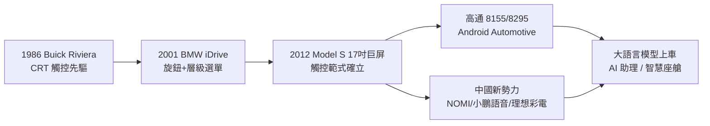

# 座艙數位化：從按鍵到巨屏與 AI 語音

## 一、機械儀表的百年秩序

在整整一個世紀裡，汽車座艙的演進是緩慢而線性的：速度計、轉速表、油量表、水溫表，配上一排機械開關與旋鈕。這套語法源自儀器的本質——告訴駕駛「機器此刻的狀態」。設計師的任務，是讓這些儀表「易讀、優雅、有品牌感」，僅此而已。座艙是工具箱，不是客廳。

打破這個秩序的力量，來自汽車產業之外：消費電子。

## 二、1986 年：Buick Riviera 的 CRT 觸控實驗

早在觸控成為常識之前的 1986 年，通用汽車的 Buick Riviera 就搭載了歷史上第一個量產車觸控介面——由 GM 與康寧（Corning）合作開發的 Graphic Control Center，用一台單色 CRT 顯示器，讓駕駛以手指觸控調用空調、收音機、行車診斷等功能選單。

這個實驗太早了。CRT 笨重、反應遲鈍、陽光下不可讀，1980 年代的駕駛文化也尚未準備好「用點螢幕代替轉旋鈕」。Riviera 的觸控系統在兩三年內悄然退場，成為汽車史上最著名的「錯誤的先驅」。但它留下了一個正確的預言：**座艙的未來，是螢幕**。

## 三、2001 年：BMW iDrive 與旋鈕邏輯

真正的轉折點來自 2001 年的 BMW 7 系（E65）。BMW 引入了 iDrive——一個位於中控台、由駕駛旋轉操作的旋鈕，驅動儀表台上方的液晶顯示屏，用層級選單管理數百項車輛功能。

iDrive 的動機是誠實的：功能爆炸後，實體按鍵將無限膨脹，必須建立一個「多對一」的邏輯入口。但它的實現激怒了第一代用戶——德國媒體稱之為「工程師的自負」，一位 BMW 高層甚至公開承認早期 iDrive「反直覺」。iDrive 的歷史價值不在於成功（經多年迭代才漸入佳境），而在於它第一次系統性地提出問題：**當汽車功能超過按鍵的物理承載極限，人機介面該如何重構？**

答案在十年後揭曉，但提出答案的，不再是慕尼黑或斯圖加特，而是帕洛阿爾托——確切地說，是一個從未造過車的軟體思維團隊。

## 四、2012 年：Model S 的 17 吋巨屏確立新範式

2012 年，Tesla Model S 把一塊 17 吋、直立的觸控螢幕放在了中控台正中央——幾乎是一台豎起來的 iPad。這塊螢幕承載了除車速之外幾乎所有的車輛控制：空調、懸掛、天窗、充電設置、導航、娛樂，甚至門鎖與燈光。

與 iDrive 的「一個旋鈕進行層級導航」不同，Tesla 的範式是「觸控直達＋卡片式佈局」——它直接複製了智慧手機的互動語法。這不是偶然：Tesla 的車機軟體團隊來自消費電子與遊戲產業，他們把汽車螢幕當作「一台裝在車上的平板」來設計，並且基於 Linux 自研整個作業系統，繞開了 QNX、微軟等傳統車機生態。

17 吋巨屏的影響立竿見影：五年之內，「大屏＋豎置或橫置＋觸控」成為全行業新車的標配；中國車廠更把螢幕軍備競賽推向極致——雙聯屏、三聯屏、可升降屏。同期，**HUD 抬頭顯示**從戰機技術（戰鬥機在座艙玻璃上投射速度與瞄準資訊，讓飛行員不用低頭看儀表）下放到量產車，把速度與導航投射到擋風玻璃上——這是「減少視線離開路面」這一安全邏輯，與「資訊上屏」邏輯的一次和解。

## 五、三股力量：晶片、中國新勢力與大語言模型

智慧座艙在 2020 年代成為主戰場，背後是三股力量的匯流。

**其一，晶片與作業系統的標準化**。高通的驍龍 8155（及後續 8295）車機晶片，把智慧手機級的算力搬進座艙，使多屏聯動、3D 渲染、即時語音成為可能；Google 則推出 Android Automotive——不是投射式的 Android Auto，而是原生車載作業系統，Volvo Polestar 2 等車款率先搭載。座艙的技術棧，至此徹底與智慧手機趨同。

**其二，中國新勢力的語音與生態突襲**。NIO（蔚來）自研 NOMI 語音助手，把擬人化表情放在儀表台上，成為座艙的「人格化入口」；小鵬的全場景語音可以連續對話、控制車輛硬件；理想汽車把「冰箱、彩電、大沙發」作為家庭用車的產品定義，在中國市場屢創銷量奇蹟。中國車廠把座艙從「駕駛的儀表」重新定義為「全家人的客廳」，這個文化差異成為實實在在的競爭力——歐美車廠被迫在中國市場跟進本地化的座艙生態。

**其三，大語言模型上車**。2023 年前後，GPT 類大模型開始進入車機：百度把文心一言接入車機，理想推出 Mind GPT，蔚來、小鵬也紛紛接入自研或第三方大模型。語音助手從「關車窗、導航到機場」的指令式，躍遷為能理解模糊語義、多輪推理的 AI 助理。座艙第一次具備了「對話」而非「識別指令」的能力。

## 六、按鍵的復仇：分心爭議與 Euro NCAP 新規

然而，按鍵的消失並非無痛。安全研究者多年的測試表明：觸控操作需要視線離開路面——調一個空調溫度，駕駛可能低頭 1-2 秒，時速 100 公里下意味著盲開 30-60 米。極簡巨屏的設計美學與駕駛安全，開始正面衝突。

監管終於出手。Euro NCAP 宣布自 2026 年起，新車若要獲得最高安全評級，關鍵功能（轉向燈、雨刷、喇叭、SOS 等）必須保留**實體控制**，純觸控設計將被扣分。這是繼 iDrive 之後，實體按鍵的第二次「復仇」——只不過這次的裁判不是用戶吐槽，而是具有實際商業約束力的評級制度。VW、現代等車廠已宣布在新車型上恢復實體按鍵。設計史在此展示了一條殘酷的規律：**範式革命之後，往往有一段鐘擺式的回調**。

## 七、從工具到體驗：座艙哲學的百年位移

回望這一百年，座艙設計的哲學經歷了三次位移：

1. **工具時代**（1900s-1980s）：座艙是儀表盤的集合，設計目標是「易讀、可靠」；
2. **功能時代**（1986-2012）：功能爆炸催生介面設計學科，iDrive 等系統試圖馴服複雜性；
3. **體驗時代**（2012-今）：座艙成為「第三空間」的候選——螢幕、語音、AI、氛圍燈、音響共同構成體驗產品，設計目標變成「讓人願意待在車裡」。

這個位移的底層驅動，是汽車產品價值從「機械性能」向「軟體體驗」的轉移（如前節所述的軟體定義汽車）。當自動駕駛最終成熟、人的注意力從路面解放出來，座艙將不再是「駕駛工具」，而成為家與辦公室之外的第三生活空間——那是我們第 10.3 節的主題。但在抵達那個終點之前，還有一場更激烈的技術路線之爭要先打完：車輛到底該用什麼樣的眼睛，看清這個世界？
