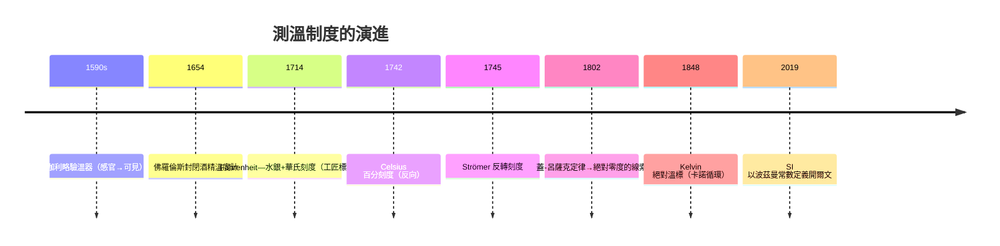

# 節標題：從體感受到精確測溫——攝氏、華氏與絕對溫度

在溫度計出現之前，人類對「冷熱」只有身體的感覺。亞里斯多德把冷與熱列為基本性質，醫生用摸額頭診斷發燒，煉金術師憑火焰顏色判斷爐溫。感覺是不可傳遞、無法比較的：你無法把「昨天覺得很冷」和「倫敦今天很冷」放在同一把尺上。科學要能談論溫度，第一步是把它變成可操作、可記錄、可重複的量測。這一步不是由大教授完成，而是十七、十八世紀的工具匠與玻璃匠，在玻璃爐與工坊的肩膀上一寸一寸墊高的。

## 伽利略的「驗溫器」與玻璃工藝

1590 年代，伽利略在帕多瓦製作了所謂 thermoscope：一根開口細玻璃管插入水中，玻璃球受熱時空氣膨脹、水位下降。它把「看不見的熱」轉成「看得見的水柱高度」，但 它同時受大氣壓與濕度影響，根本不是溫度計。真正的突破有賴於兩項技術：玻璃燈工（佛羅倫斯學院 Accademia del Cimento 的玻璃廠）與液體密封。佛羅倫斯學院在 1650 年代製出封閉酒精溫度計，並選了固定分度；政治上，這是梅迪奇家族支持的機構，儀器成為貴族沙龍裡的「自然哲學武器」。然而各地刻度互不相同——佛羅倫斯一度、巴黎一度、倫敦一度不等值，科學資料無法交流。標準化的需求，正是後來一切刻度戰爭的根源：沒有共同的量測制度，就沒有歐洲共同的自然科學市場。

## Fahrenheit：但澤的玻璃匠與水銀

Daniel Gabriel Fahrenheit（1686–1736）出生在波蘭治理下的但澤（今格但斯克）一個商人家庭，父母因誤食毒蘑菇雙雙去世。監護人送他去阿姆斯特丹學商，他卻逃家偷學吹玻璃與做儀器，從此以自由職業工匠維生，長年遊走於丹麥、英國、荷蘭的宮廷與工坊之間——他刻意不依附大學，寧可讓儀器自己說話。1714 年前後，他完成決定性的技術組合：

1. **水銀替代酒精**。利用羅默與他人經驗，採用純度高、膨脹均勻的水銀，比酒精更耐高溫、對溫度變化反應更靈敏；
2. **玻璃吹製與管徑控制**，使毛細孔徑一致，刻度才能真正重複；
3. **三點定標**：0 度取「冰、水、氯化銨（或海鹽）」混合的最低溫度，32 度為純水冰點，96 度（後來校正約為人體體溫，98.6°F）為口腔溫度。這三點涵蓋疾病與寒暑的日常範圍，製出的溫度計「每一支都一樣」。他用華氏溫度計測得水沸點約 212°F，使 32–212 恰為整數 180 格——可能正是他滿意的巧合（180 也是平角的天數）。

Fahrenheit 1724 年同時被選入英國皇家學會，卻鮮與人通信，也不發表長文，一生以產品說話。這「工匠文化」的勝利——用可售賣的儀器強迫全歐洲接受一種刻度——是科技推動科學的範例：不是理論先要求精確溫度，而是溫度計先存在，科學才發現自己需要它。

## Celsius：百分刻度與一場被遺忘的反轉

Anders Celsius（1701–1744）是瑞典烏普薩拉大學天文學教授。1741 年，他利用當地剛落成的天文台檢查自己製作的溫度計，1742 年發表《雙刻度溫度計的觀測》，把冰點與沸點之間分為 100 格，這是清晰有效的百分刻度。但他的刻度**與今日相反**：**0 度是沸水，100 度是冰點**。理由是避免出現「負溫度」，冬天永遠在 0 度以上，讀數直觀。

Celsius 1744 年死於肺結核，年僅 42 歲，未及看到自己名字刻上溫標。1745 年，他的繼任者、天文學家 **Mårten Strömer** 把刻度反轉成 **0 度冰點、100 度沸水**——同一時期，法國里昂的 Jean-Pierre Christin（1743）也獨立做出反轉，而烏普薩拉的植物學家林奈在溫室與植物實驗中正是需要這種「越高越熱」的讀數。此後很長一段時間，同在烏普薩拉的兩派工匠分別沿用「Celsius 格」與「Strömer 格」，一個世紀的儀器市場才慢慢統一。這段插曲告訴我們：**刻度的方向不是科學真理，而是人類使用習慣的社會協議**——真正的規範者不是物理，而是植物學家、園丁與廚房。

1948 年第九屆國際度量衡大會（CGPM）正式把從水為基的百分溫標定名為「攝氏度（degree Celsius）」。其後攝氏刻度以絕對零度與水的三相點重新定義，連「百分一百格」的原始意義都被更深刻的根基取代。

## 蓋-呂薩克：氣體定律與「溫度是物理量」

1802 年，Joseph Louis Gay-Lussac 發表氣體膨脹定律（今稱蓋-呂薩克定律），指出氣體在定壓下體積隨溫度線性膨脹，$\frac{V}{T}=\text{常數}$（以今日記法）。早在 1787 年雅克·查爾斯（Jacques Charles）已私下得出相同關係但未發表；蓋-呂薩克以極其細心的實驗（1804 年他更與 Biot 乘熱氣球升至數千公尺採取高空大氣）把膨脹係數定在約 $1/267$（今值 $1/273.15$）。這條線性關係隱含一個驚人的外推：**如果氣體一直冷下去，體積會在攝氏 $-267$ 度附近縮到零**——這是「絕對零度」概念的實驗前身。它第一次把「冷有一個盡頭」變成可計算的物理問題。同時，蓋-呂薩克與洪堡研究空氣成分、與化學家道耳頓辯論蒸氣壓，法國精密量測傳統（拉瓦錫遺產）與氣體研究一起，把溫度從「水的行為」提升為「所有氣體共享的普遍參數」。

## Kelvin：把溫度從物質中解放出來

William Thomson（後來的 Lord Kelvin，1824–1907）1845 年自劍橋畢業，次年赴巴黎在雷諾（Victor Regnault）的實驗室學習法國精密量測傳統。1848 年，年僅 24 歲的他在《劍橋數學學報》發表《論絕對溫標》，理論依據是 1824 年法國工程師 Sadi Carnot 的《論火的動力之反思》。卡諾分析理想熱機時證明：可逆熱機的效率只取決於兩個熱源的溫度，與工作物質（空氣、水汽、任何東西）無關。Kelvin 敏銳看出其蘊涵：這給出了一個**完全由熱本質定義、不參考任何特定物質**的溫度——取一組相隔等距的熱源溫度，讓可逆機在 $T$ 與 $T-u$ 間對卡諾循環工作，從下式重新讀出溫度：

$$\frac{Q_{\text{低}}}{Q_{\text{高}}}=\frac{T_{\text{低}}}{T_{\text{高}}},\qquad \eta=1-\frac{T_{\text{低}}}{T_{\text{高}}}$$

1852 年起他與 Joule 合作的多孔塞實驗（Joule–Thomson 效應）補足了「絕對零度附近熱膨脹收斂」的細節，隨後在 1854 年共同提議：**開爾文溫標以克的分划大小與攝氏刻度一致**（Kelvin 本人在 1892 年才獲封爵位，起初溫標以他本名 Thomson 溫標）。Kelvin 溫標的美在於：**沸點、冰點、人體這些局部偶然事件全部退場**，溫度成為純粹的能量語言。今日 SI 的開爾文以波茲曼常數 $k_B=1.380649\times10^{-23}\,\text{J/K}$ 定義（2019 年起），它甚至不再依賴水的三相點 273.16 K——那是 1954–2019 年間使用的過渡定義。

## 制度的意義：工業革命為何需要溫度計

蒸汽機是十八世紀最昂貴的機器。Newcomen 機耗煤如山，瓦特的改良關鍵在「分離冷凝器」，其動機正是他觀察到汽缸反覆加熱冷卻的浪費——這種洞見需要精確比較汽缸內外、鍋爐與冷凝器的溫度。礦主、政府、保險公司在合同中逐漸寫入「at a given heat」條款；引擎的銷售合約以「每年耗煤量」結算，這是一種把熱學量變成**經濟契約條件**的制度演化。同時，航海（溫度影響羅盤、比重計）、釀造、紡織漂染、醫學（體溫、流行病）都要求可交換的數據。科學史式的觀察是：**溫度計是第一種被整個市場化世界共同使用的物理儀器**，它創造了「量測共同體」——這是熱力學在十九世紀中葉能以「普適科學」姿態登場的社會前提。沒有華氏的玻璃與攝氏的分格，就沒有卡諾的循環可被 Kelvin 讀懂；沒有 Kelvin 的絕對溫標，焦耳與克勞修斯的革命就只能停留在啤酒廠的梯子上。

