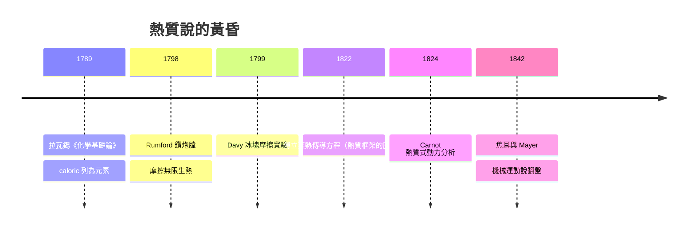

# 節標題：熱質說的興衰——熱是流體還是運動

十八世紀末，若你問巴黎科學院任何一位院士「熱是什麼」，他會不假思索地回答：一種看不見、無重量、自我排斥的流體，名叫 **caloric（熱質）**。這個學說由拉瓦錫（Antoine Lavoisier）在 1780 年代系統化，與他的氧化學說一起寫進《化學基礎論》（1789）。然而到了 1840 年代，這座理論大廈卻被一個在慕尼黑軍工廠裡監督鑽炮膛的逃亡美國人、以及一個曼徹斯特釀酒師，從兩個意想不到的方向拆毀。這是一段關於「有用的錯誤理論」如何比「正確的理論」活得更久的歷史。

## 熱質說的誘人架構

熱質說的吸引力在於它把熱變成了**可以記帳的東西**。熱質是守恆的流體：從高溫體流向低溫體，總量不變，就像水從高處流向低處。這使定量研究成為可能——熱量計（calorimeter）這個詞本身就是熱質說的產物，拉瓦錫與拉普拉斯的冰熱量計用融冰量測反應熱，數據漂亮得出奇。比熱、潛熱（布莱克（Joseph Black） 的成果被納入）、熱傳導方程——傅立葉 1822 年的《熱的分析理論》整門數學物理都建立在熱質意象上。拉普拉斯甚至用它修正牛頓的聲速公式：他與年輕的 Poisson 論證聲波壓縮是**絕熱**過程，氣體的彈性來自被壓縮時捕捉的熱質，修正後的聲速計算與實測吻合，$v=\sqrt{\gamma p/\rho}$。工程上，蒸汽機的「熱質落入冷凝器」的圖像甚至啟發了卡諾：他 1824 年的水輪機比擬（熱質如水從高水位落到低水位推動水車）正是純熱質語言。**一個本體論上錯誤的理論，卻在計算上連連得分**——這是科學史上反覆上演的制度性張力：期刊、學院、工程契約獎勵「能算出數字的理論」，不會獎勵「哲學上也許更乾淨的猜想」。要挑戰它，光有思想不夠，必須找到一個熱質守恆**原則上無法解釋**的可重複實驗。

## Rumford：逃犯、間諜、伯爵

Benjamin Thompson（1753–1814）的人生本身就是一部小說。他生於麻薩諸塞州沃本，少年時做過學徒、當過鄉村教師，娶了富有寡婦；美國獨立戰爭爆發時，他效忠英王、涉嫌為英軍傳遞情報，遭家鄉群眾攻擊、塗柏油險些被處死，被迫拋妻棄女逃亡英國。在倫敦他成為殖民大臣的科學顧問，被選入皇家學會；1783 年又前往大陸，搖身成為巴伐利亞選帝侯卡爾·特奧多爾的軍事顧問——伏爾泰的朋友、內閣總管與外交重臣，重組慕尼黑軍隊、推動濟貧（有名的「軍事工作所」：用軍隊養窮人生產軍需，順帶發明勝過咖啡與茶的「Rumford 湯」給窮人營養），1791 年獲封神聖羅馬帝國伯爵，自選頭銜「倫福德」（Rumford，他妻子家鄉小鎮的名字，也算對落入他手裡的地產的一種紀念）。

1798 年，他在慕尼黑 Arsenal 監督無煙槍砲鑽膛作業時注意到：鑽頭愈鈍，發熱愈多——若熱質是從物質裡「擠出」的守恆流體，鈍鑽頭被削走的金屑更少，釋放的熱質理應更少；實況卻相反，而且熱可源源不絕。他設計了著名實驗：把鈍到幾乎只剩磨擦的鑽頭壓在炮膛內，以兩匹馬轉動近兩個半小時，讓約 18 磅的水從冷燒到沸騰——**馬只做了機械功，沒有火焰**。他在《倫敦皇家學會哲學彙刊》發表《關於摩擦所生熱的探究》（1798），寫下名言：「能被摩擦無限供給的東西，不可能是有限的物質——除非認為熱是**運動**。」他甚至量測了金屑與原金屬比重、比熱差異微乎其微，堵死「熱質藏在金屬屑中」的解釋。

1799 年他到倫敦，用巴伐利亞帶來的名聲與金錢推動創立**皇家研究院（Royal Institution）**——最初為在倫敦貧民區推廣科學與應用工藝，後來成為 Davy 與 Faraday（Davy 發掘了他）的舞台。Rumford 自己任首任會長，設計了節能爐、煙囪與「Rumford 火爐」，並以公務員式的細節偏執監督每一分經費——眾多董事嫌他專斷，他不久就被排擠，再度橫渡海峽，晚年退居巴黎，1814 年死於巴黎郊外的 Auteuil。他與拉瓦錫遺孀 Marie-Anne 的短暫婚姻（1805–1809）同樣不歡而散——兩個性格同樣強悍的人註定難以相容。

## Davy 的冰：兩把刀之間的哲學

1799 年，二十歲的 Humphry Davy（Penzance 藥房學徒出身，後經 Rumford 創辦的皇家研究院聘任，迅速竄紅）發表《論熱、光與呼吸的組合》：在真空裡以時鐘機構使**兩塊冰**互相摩擦，環境維持在冰點以下，冰卻融出一部分水——水的比熱高於冰，若熱質來自物質本身，融冰所需的熱質無從產生。Davy 寫下：「熱的本質是**運動**。」這在宣言上蓋棺，但論證嚴謹度遠不及 Rumford（設備漏熱、真空可疑之處不少），當時並未說服主流。

## 為什麼正確的觀念等了半世紀

Rumford 與 Davy 並未立刻推翻熱質說，原因值得深省。其一，兩人的實驗雖顯示「熱可無限由功產生」，卻**沒有給出當量的數值**；科學界不缺本體論辯論，缺的是可代入方程的數。其二，熱質說在聲速、熱流、熱機設計上的成功，使工程界毫無更換動機——理論的存亡常取決於**它服務的產業支付的維持費**。其三，Rumford 品行乖張、Davy 年少氣盛，都讓「熱是運動」看來像江湖口號而非研究綱領。真正致命一擊要等到 1840 年代：焦耳用槳輪把功變熱並測出 $4.18$ 焦耳/卡，精確的當量把 Rumford 的定性洞見變成定量定律；而克勞修斯與 Kelvin 改寫卡諾時，發現只需「熱是能量的一種形式」，水輪比擬雖廢、卡諾方程卻保全。這是科學史漂亮的弔詭：**打倒理論的，不是打倒它的成功，而是接管它的成功**。熱質說死後，它的數學屍體（傅立葉方程、熱量計數據、卡諾效率式）被能量理論全數收編——科學的進步，常常不是推倒，而是收編。

