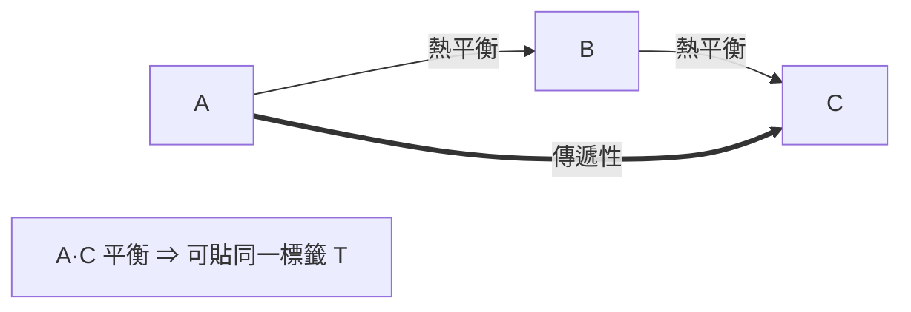

# 節標題：熱力學第零定律——熱平衡與溫度的邏輯基石

熱力學的定律編號耐人尋味：第一定律 1850 年前後確立，第二定律在 1824 年的卡諾與 1850 年的克勞修斯手中成形，而「第零定律」卻遲至 1931 年才由英國天文物理學家 Ralph H. Fowler 正式命名。一個比第一定律更早、更基礎的概念，為何兩百年來無人替它另立名目？答案本身就是一段思想史：直到二十世紀，當物理學家開始用公理化、以邏輯結構重整熱力學的表述（教育與教科書文化的產物），人們才看清，整座溫度的理論大廈原先橫支在一條無人宣稱的樑柱上——**熱平衡的傳遞性**。

## 從「摸起來一樣」到狀態函數

先回到十八世紀的實境。Black 與量測社群用溫度計建立了「溫度相等」的慣常操作：把溫度計接觸物體，水銀柱停住不動，就說兩者「同溫」。這件事在熱質說時代天經地義——熱質像水一樣，「水位齊平」正是平衡的同義詞。但當熱質說在 1840 年代被推翻、熱被重新定義為能量傳遞的一種形式，一個邏輯問題浮出水面：如果熱是混亂的分子運動，「兩個物體不再淨交換熱」憑什麼保證可以定義出一個數值 \( T\)，而且這個數值對**所有**互相平衡的物體都相同？

關鍵在於一條看似平淡的經驗事實：**熱平衡是傳遞的**。若物體 A 與物體 B 接觸時處於平衡（無淨熱流），且 B 與 C 也處於平衡，那麼把 A 與 C 拿到一起（不管中間是否有 B）也必然平衡。這不是邏輯必然，而是可以被實驗違反的經驗命題——某些奇異的材料系統並不滿足；但對日常物質，傳遞性無比可靠。一旦承認它，數學結構立即展開：傳遞性把所有物體分割成「互相平衡的等價類」，而**每一個等價類都可以貼上一個標籤**，這個標籤就是溫度。換言之，溫度之所以是個良定義的**狀態函數**（只取決於系統當下的狀態，與歷史路徑無關），其單純的根基正是傳遞性。經典教材的表述是：「若兩系統各與第三系統處於熱平衡，則彼此處於熱平衡」；這句話使「溫度計」這個第三系統的介入變成合法的量測動作——溫度計不必與每一樣被測物直接比對，只要它與被測物平衡時的讀數一致，被測物之間就共有一個溫度。

嚴格說（如二十世紀對「非傳遞性平衡」的研究所顯示），需要平衡關係把整個參數空間切得乾淨；這條公理化小徑要到二十世紀的數學熱力學（如 Giles、Lieb 與 Yngvason 以「絕熱序」重構熱力學的進路）才算走完，但方向早在 Fowler 的命名時已確定。

## Fowler 的命名：1931 年的教育史事件

Ralph Howard Fowler（1889–1944）是劍橋的數學物理學家，以統計力學著稱——他與查爾斯·達爾文的孫子、物理學家 Charles Galton Darwin 合作寫出著名的 Darwin–Fowler 方法，把統計力學從公設推到微正則與正則分布；他也是把天文學與量子物理接起來的人，指導過 Dirac、Milne，後來成為 Eddington 的同事、1922 年起劍橋數學講席的重要人物。第一次世界大戰他因腿傷離開前線，轉任海軍彈藥部保留的 Ordnance 委員會，戰後主編彙整彈道學與統計方法的資料，養成以「公理與操作定義」整理學門的編輯本能。1931 年，Fowler 與 Edward A. Guggenheim 在合著的教科書（《Statistical Thermodynamics》的先聲，論文中及 1939 年成書時系統陳述）中，把這條平衡傳遞性公理明訂為「第零定律」（zeroth law），並解釋命名理由：**它在邏輯上先於第一定律**——沒有溫度的良定義，「熱」這個概念在第一定律 \(\Delta U = Q - W\) 中根本無法被操作（何謂「熱流進系統」？你必須先能判斷溫差、判斷「誰是被加熱的誰」）。

這個命名行動的教育史意義值得咀嚼。它是 1920–30 年代劍橋化學教學現場的產物：化學系的學生曾被「熱力學」、「自由能」、「活度」等概念轟得暈頭轉向， Fowler 與 Guggenheim 企圖以公理系統重建地基，把「什麼是溫度」放在第一章。從此「第零定律」進入世界各國的教科書與課綱——一個 1931 年才出生的名字，被安排在比牛頓還老的定律之前。這是教育制度反饋科學結構的標準案例：**教學秩序的需要，逼出了科學家遲到的自我清算**。

## 量測實踐：溫差電偶與氣體溫度計

第零定律不是書齋遊戲，它直接寫進量測技術的規範。**氣體溫度計**（定容或定壓）在十九世紀被選為「標準溫度計」，因為氣體壓力經複雜補正後與熱力學溫度有簡單關係；但氣體溫度計昂貴、遲緩、易碎，只能置於少數國家計量實驗室（1869 年後：倫敦、柏林、巴黎——1887/1889 年第一屆國際計量大會的呼聲、1948/1968 年 International Practical Temperature Scale 的定案）。日常與工業界大量使用的是**熱電偶**：Seebeck 1821 年發現兩種金屬接點的溫差會產生電動勢，Peltier 1834 年發現逆效應。一支鉑銠-鉑熱電偶出廠時，都要先在一套「固定點」（冰點、水三相點、錫、鋅、銀、金的凝固點——這些是理想熱源，第零定律的具體化身）校準，然後才能被信任成為「第三系統」。

工程上這是一場静悄悄的革命：煉鋼爐的溫度、飛機發動機的燃燒室、啤酒發酵槽——全世界的溫度資料之所以能互相比較、寫進合同、成為專利糾紛的證據，都因為大家默認了同一條公理：平衡可傳遞，標籤即溫度。英國國家物理實驗室（NPL）、德國 PTR（Physikalisch-Technische Reichsanstalt，1887 年由 Siemens 催生）、美國 NIST 前身（1901）這些**國家計量機構**的成立，正是把第零定律從物理公理轉成政治制度：量測不再只是工匠的手藝，而是國家之間握手時的共同語言。

## 深意：溫度是「社會協議」的技術化身

回頭看，第零定律教給我們的不只是邏輯。溫度成為良定義的狀態函數，靠的是一條關於**世界如何安排**的經驗事實；而這條事實要發揮作用，還需溫度計、固定點、國家實驗室、國際溫標這整套制度的支撐。熱力學的形上學與計量學的官僚系統，原來是同一塊水晶的兩面。 Fowler 晚年因戰時工作積勞，1944 年在劍橋逝世；他留下的命名，把兩百年前工匠們摸黑架起的溫度計，接口到了二十世紀公理化的門楣上——命名是遲到的，傳遞性一直都在。

