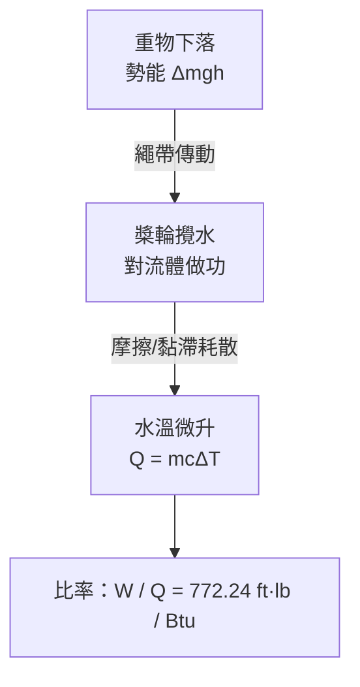

# 節標題：焦耳的槳輪實驗——機械功與熱的當量

1847 年 6 月，英國科學促進會（BAAS）在牛津召開年會。會場一角，一位二十七歲、口音濃重的曼徹斯特釀酒師站起來，報告他測到的怪事：**攪動水就能讓水變熱，而且比例固定**。主持人依會議規則示意他若無新意不妨簡短，席間甚至有人視這位「曼徹斯特來的業餘者」為無足輕重。就在他幾乎要被會議的體面禮節淹沒時，一位自格拉斯哥來的年輕教授舉手發問，一連串問題精準鎖住實驗核心，逼他把數據完整講完。這個聽眾名叫 William Thomson，日後的開爾文勳爵。他原本來牛津是想聽卡諾學說的爭論，卻意外聽到它得自的另一根支柱。科學史上很少有這樣的畫面：**一個差點被學院禮節犧牲的業餘者，被一個尚未站穩的年輕教授救回了發言權——而兩人合力改寫了物理學**。

## 啤酒廠裡的科學家

James Prescott Joule（1818–1889）生於索爾福德，父親是富有的釀酒商 Benjamin Joule。他是典型維多利亞早期的「紳士業餘者」，但與貴族業餘者不同的是，他的財富來自工業：Joule 家的釀酒廠每年以千桶計生產波特與黑啤，**溫控就是錢**。麥芽糖化需精確溫度，過高會殺死酶、過低效率差；Joule 少年時親手量測蒸汽與水的溫度，對「每一分煤」有天然的成本意識。1834 年，父親把他送到曼徹斯特文學與哲學學會的道爾頓門下——年邁幾近失明的化學原子論者親手教他幾何、算術與航海三角，培養了他一生對**數與量**的信仰。1838 年前後，電流成為時尚：電動機的發明者（Moritz von Jacobi 等）宣稱電動機將取代蒸汽機。Joule 第一個系統研究的問題非常務實——釀酒廠的燃料帳本：電動機燒一磅鋅，與蒸汽機燒一磅煤，何者買到更多的功？

1840 年，二十二歲的他把電流生熱的規則測了出來：導線在單位時間放出的熱正比於電阻與電流平方，$P = I^2 R$，後世稱**焦耳定律**。更重要的隱藏線索是：一段電路放出的熱只取決於 $I^2R$ 與時間，與電池的化學品種無關——這暗示熱量有普遍尺度，可以被「別的東西」（此處是電池中的化學反應）買單。在研究 Jacobi 電動機的效率時，他把「每磅鋅可取出的力學功」定為引擎的 duty（做功經濟指標），並驚覺電池消耗的鋅量與所作的功之間有嚴格比值——且這個耗損正好以電阻生熱的形式出現。熱與功的兌換，在電的世界裡先現形。這是槳輪實驗的引信。

## 1845：槳輪與重錘

1845 年，Joule 在劍橋舉行的 BAAS 年會上發表《論熱與機械力的當量關係之存在》，描述其裝置：一個銅製容器中的水，由下落的重物通過繩輪帶動槳輪緩慢攪動；水溫的微升以能讀出 $1/200$ °F 的精密溫度計記錄。此後他不斷改良，到 1850 年提交皇家學會的《熱的機械當量》論文中宣稱：一磅水上升 $1^\circ$F 需要耗功 **772.24 英尺磅**（foot-pounds），換算即每卡路里約 $4.186$ 焦耳，與今日認可值 $4.1840$ 相差不到千分之一。這個近乎奇蹟的精度，不是仰賴先進儀器，而是 Joule 把一切都做得極其笨拙卻盡善：黃銅槳葉、絕熱木箱、以魚膠封縫、逐一扣除軸承摩擦補正，然後**一遍又一遍重複**。熱不是某種物質，而是可以被功「買到」的東西，且匯率固定——這正是十九世紀熱力學新基礎的基石。

## Thomson 的轉向

回到 1847 年牛津：Thomson 本是卡諾的忠誠信徒——熱質說的語言裡，卡諾 Wirkung（作用）只靠熱源溫差定義，與「熱是運動」矛盾。Joule 的講演給他的震撼是：**若熱可無限由功產生，熱質守恆即死，但卡諾的數學竟然還得救**。Thomson 開始與 Joule 通信（留下數百頁書信，Joule 字跡潦草、Thomson 字跡工整），1848 年 Thomson 依卡諾發表絕對溫標，1851 年他正式提出第一定律的新表述，把 $J$（當量）與 $U$、$W$、$Q$ 這些量安放進一致的數學。1852 年起兩人合作的 Joule–Thomson 效應（多孔塞實驗：實際氣體絕熱節流會降溫），是化工與冷凍工業（林德製冷、液化空氣）的物理基礎——學院理論與工廠測量的合流，至此完成。

## 為何曼徹斯特而非劍橋

Joule 的成功有著深刻的社會條件。劍橋的數學傳統（ wrangler 文化）優雅但不負責聯繫工廠，皇家學會被貴族與牧師科學家主宰；曼徹斯特卻是當時世界棉紡與化學之都，本地成立了學會、工學院與志願研究網路，Joule 的第一批論文正是發表在《Manchester Literary and Philosophical Society Memoirs》上而遭主流漠視。工業文化給的兩件禮物，學院給不了：**精密量測的日常紀律**（溫度計、天平、成本會計）與「有用即真理」的耐心。Joule 一生在自家地下室與酒廠旁做實驗，甚至蜜月旅行帶著溫度計去測夏慕尼瀑布頂底的水溫差（他想驗證重力位能→熱），把新娘氣得半死——這則 1847 年的軼事真實性被史家存疑，卻精準象徵他的人生：**任何地方都能是實驗室**。

1889 年 Joule 死於柴郡薩爾（Sale）家中，享壽七十。他生前曾任曼徹斯特文哲學會會長，皇家學會在 1850 年選他為會員、1870 年授 Copley 獎章；他去世後，物理學界共同把能量單位命名為「焦耳」。他留下的不只是 $4.18$ 這個數，而是一條方法論戒律：**當兩種看似不同的東西可以互相兌換，把它們的匯率量到第三位小數**——這正是十九世紀科學轉入現代物理的祕密。

