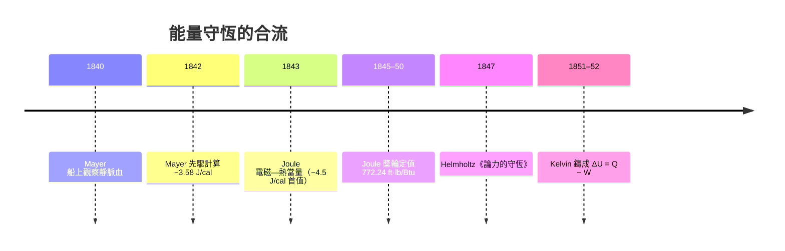

# 節標題：熱力學第一定律——內能與能量守恆

「能量是不滅的。」今日這句話像代數上的同義反覆，人人朗朗上口。可是在 1840 年之前，物理學的主導詞彙不是「能量」而是「力」（Kraft）——活體運動、活力 vis viva、化學親和力、電張力，各是各的「力」，彼此不能兌換。把這十幾種「力」合併成一種可記帳的貨幣，靠的是三個幾乎同一時代的局外人：德國的船醫 Robert Mayer、英格蘭的釀酒師 Joule、柏林的生理學宗師 Helmholtz，最後由蘇格蘭的 Thomson 把它鑄成嚴格的熱力學表述。這場數學少、概念多的革命，改寫的不只是物理，更是人類對自身與工業的想像。

## Mayer：船醫的洞見與時代的冷遇

Julius Robert Mayer（1814–1878）是符騰堡州海布倫的醫生。1840 年，他擔任荷蘭商船 Javo­re 號（爪哇號）的隨船醫師前往熱帶；在雅加達泊地為船員放血時他注意到一個奇象：**靜脈血比他在德國看到的鮮紅得多**，近乎動脈血。生理學當時認為血色由供氧與溫度決定；Mayer 由此推理：熱帶氣候下身體不必燃燒那麼多氧去維持體溫，**氧化作用用的氧少了，被「燒剩」的氧自然留在血中**——食物的化學能，等於身體產的熱加上做的功。若兩者可以互換，必有一個固定比值。1841 年他把論文投給 Poggendorff's Annalen（當時德國物理的門面），被主編 Poggendorff **直接拒登、不予回覆**——一個醫生談物理，在當時看來不足為訓。1842 年，著名化學家 Liebig 主編的《Annalen der Chemie》收了他的《論無機界的力》，但只被當成營養生理學的邊角文字。1845 年他自印長文《有機體的運動與營養之關聯》，列出從重力、熱、電到化學親和力的種種當量估算——其中利用氣體的定壓/定容比熱差 $c_p - c_v = R$（氣體膨脹對外做功即為兩者之差），推得 $\text{1 cal} \simeq 3.58 \text{ J}$，**是史上第一個從理論計算（a priori）得到的熱功當量**。

命運對他最苛刻。1840 年代末，他的兩個孩子接連夭折，自身被譏為江湖騙子、被指抄襲（Joule 之名先聞於世，更晚 1862 年英國的 Tait 與部分期刊把優先權判給 Joule，使他遭到羞辱式的邊緣化）；1849 年（一說 1850 年 5 月）他自三樓跳窗自殺未遂，隨後被送入精神病院數年。主流學圈一路冷眉相對，直到 1858 年 Liebig 為他緩頰、1862 年英國物理學家 Tyndall 在皇家學會演講為他正名，把 Mayer 抬上優先權之爭的最前排）；1871 年他從皇家學會領到 Copley 獎章——比 Joule 晚一年。Mayer 得終天年，1878 年死於家鄉，名聲回來時已是老人。

## Joule 與 Helmholtz：實測與整合

Joule 的槳輪實驗供給了當量的**稱重**（詳見本章上一節）：772.24 英尺磅/Btu。而把散落各處的當量、實驗與哲學整合成一座體系的，是柏林的外科醫生兼生理學教授 **Hermann von Helmholtz**。1847 年，年僅 26 歲的他把小冊《論力的守恆》（*Uber die Erhaltung der Kraft*）投交柏林物理學會，反因「太基礎、太思辨」被婉拒刊印，只能自印出版。以牛頓力學的中心力前提，系統證明如果一切自然力最終都是基本粒子之間的保守中心力，則不論熱、化學、電磁、光、生命現象，皆不能憑空產生任何「力」——**一般自然力的量必須守恆**。他明文戳破的正是永動機：如果允許某種人造的力憑空增生，永動機就可能；觀察得到的大量永動機失敗紀錄，就是守恆律的經驗支柱。他把生理學也納進來：肌肉不是「力之源」，而是化學能的轉換器——這對當時「生命火花」（vitalism，生機論）思想是直接宣戰。此書今日被視為能量守恆定律的第一份完整文獻，當年銷路寥寥，靠 Du Bois-Reymond 等少數生理學友人的力捧才逐漸為人知。

## Kelvin 的鑄型：$\Delta U = Q - W$

把散沙鑄成金磚的是 William Thomson。1851 年起他在《愛丁堡皇家學會會刊》與《劍橋數學學報》發表一組《論熱的動力學理論》，以卡諾＋焦耳兩條支柱重建全部熱理論，明快定義：**內能** $U$（他引入的新概念，意指「系統內部儲存的動能與位能之和」，只繫於系統當下狀態）為狀態函數，**熱** $Q$ 與**功** $W$ 是兩種「過程的貌相」而非「系統擁有的量」。第一定律的表式從此定格：

$$\Delta U = Q - W$$

（英國與歐陸的簿記符號方向至今仍互異：Thomson 採取 "$W$" 為系統對外做功、$Q$ 為系統吸收之熱；克勞修斯以 $\mathrm dQ = \mathrm dU + \mathrm dW$ 表述，把所有過程量寫在左邊。）此式的深意有三層。其一，$U$ 是**點函數**，$\oint \mathrm dU = 0$，而 $Q$、$W$ 是**路徑函數**——只看始末狀態，「加熱」與「做功」無從區分，區分只在「怎麼走」。這破除了兩千年來把熱視為物質的直覺：熱不是實體，是傳遞的方式。其二，能量成為不可化約的共同貨幣：化學鍵、引力、電磁場、動能，一律以同一把尺記帳，物化學、生理學、工程學在「能量」這個詞上重新合流。其三，守恆律是**最有操作性的否定判準**——「出現多餘的能量」即荒謬，這一條直接把第一類永動機逐出了合法物理。

## 「力的經濟學」：思想革命的社會面

德國經濟史家把 1840 年代的德國稱為「力學的世紀」，而英文世界則講「英國科學的文化領導」：兩邊的正確說法是，**能量守恆是手工工業轉型為機械工業的意識形態結晶**——火車把煤變成運輸，工廠把蒸汽變成棉布，新式中產階級的財務頭腦把一切都換算成帳面。在這種文化裡，「力是廉價的、取之不盡」的十八世紀詩意被推翻：**能量是人類工業的貨幣，且必須按匯率兌換，沒有印鈔機**。德國思想界立即接住這個隱喻：從「力的經濟學」這種流行語，到把能量守恆讀成「物質世界無奇蹟」的唯物論戰綱——Büchner 的《力與物》（Kraft und Stoff，1855）乾脆以能量守恆當成無神論的物理證據；兩代之後，這條守恆律成為二十世紀經濟學、生態學與資本主義批判共同引用的底層規則（「一切價值的源泉是能量與序」等論題的源頭之一）。熱力學第一定律不僅告訴我們宇宙不欠我們任何東西，還告訴我們**我們所付的一切都以某種形式被償還、被記錄**——人是能量帳本上的一行，而非旁觀者。

