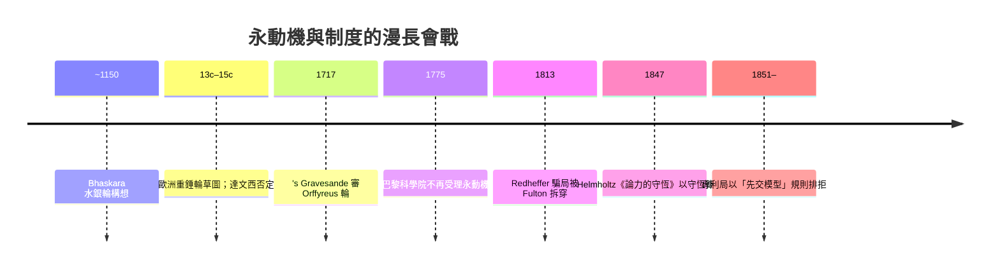

# 節標題：第一類永動機的幻滅

在熱力學第一定律確立之前的三百年裡，「永動機」（perpetuum mobile）是歐洲發明文化最頑固的夢：一台不需燃料、自己轉個不停的機器。它許諾的不只是技術奇蹟，還是一座**印鈔機**——磨坊轉動、城堡供水、鑄幣廠開工全不費燃料，能源的帳單永遠為零。正因為背後站著經濟誘惑，它又是漫長欺詐史的舞臺：江湖術士、宮廷騙局、科學院審查、專利訟案。第一類永動機的終結，不是被某個實驗駁倒，而是被兩樣東西雙重處決：**一條守恆律**（原理上的死刑），與**一個官僚決定**（制度上的驅逐令）。審視這場漫長的幻滅，能看到幻想、財政與科學制度化之間的三角關係。

## 最早的幻夢：Bhaskara 的水銀輪與中世紀重錘輪

最早的設想來自印度數學家兼天文學家 **Bhaskara（Bhāskara II，十二世紀，約 1150 年）**：一個輪的輪輻末端懸掛**注半滿水銀的細管**，他相信隨著輪轉，水銀會重心偏在一邊，輪即永轉。這是「過中心重物」原理的祖師版——機械論缺陷在於：重力場中重心下降過半之後，欲再上升必須把位能「償還」，整輪繞一圈的淨功為零；摩擦還要倒扣，輪必停下。十三至十六世紀的歐洲抄本（Villard de Honnecourt 等人的羊皮紙草圖）記下重錘輪、磁石滾道、虹吸循環諸方案；文藝復興工程師（如 Leonardo da Vinci）從實做中得出否定結論——達文西本人曾勤勉畫過幾幅重錘輪草圖，後來轉而以揶揄的口吻寫：**「追逐永動機的人，不屑實際，與煉金術者同類。」** 制度上的警覺則首見於 1717 年前後：荷蘭萊頓大學教授 's Gravesande 檢查德國發明家 Orffyreus（本名 Johann Bessler）的著名「自轉輪」（Selbstlaufendes Rad）。這個重達數百磅、砂漏箱般的巨輪在關了門的房間裡轉了兩個多月，看似無懈可擊；'s Gravesande 經數週測驗只寫下審慎結論：軸心摩擦極小、但機械結構被刻意遮蔽，「還是**有**什麼在驅動它，只是我看不見」。Orffyreus 反而因此惱羞成怒，宣稱教授有意誣他，暴躁地把自己的機器砸毀。彼得大帝聞名而來，幾乎出資購買；'s Gravesande 的報告使交易告吹。後世史家多認為，此輪必有隱藏的驅動機構——或許是由鄰室助手以暗藏的細帶傳動，或自人手輕觸通風窗傳入動力。

Orffyreus 的教訓是雙面的：**驗收依賴「包圍監視」，而隱藏的動力總能在細節裡藏身**。這促使一種新的方法論萌生——真正的判決不靠拆解，而靠**定量核算**：統計整個系統的功出入。這份定量思路的成熟，一直到 1840 年代的焦耳才到來。

## Paris 的紅牌：1775 年科學院的驅逐令

制度上的分水嶺出現在法國。**1775 年，巴黎科學院（Académie des Sciences）正式宣布：不再受理任何關於永動機的方案與專利**——審查委員會（成員含 Lavoisier、Coulomb 等人）在公文裡明白表示：永動機自數學與機械理論上看皆為不可能，**繼續接件只會浪費院方與發明人金錢與名聲，還會吸引不誠實的投機者**。這是科學第一次以**制度性拒絕**終結一種發明類型，比守恆律的問世還早七十年：科學院並不「證明」了不可能，而是承認一個更深的事實——**在以功與力為帳本的十九世紀之前，永動機方案在原理上永遠可以「聲稱」成功，驗證卻永無止境**。這種無底審查正是騙局的溫床；法院與市集需要的是判準，不是實驗。巴黎的驅逐令立下先例：各國專利局其後不久紛紛跟進（日內瓦、各德意志邦、美國專利局也先後要求永動機專利申請人**先繳交可運轉的模型**——此規定讓幻想自動出局）。制度教育公眾：不可證的承諾，不配進入契約世界。

## Redheffer：紐約的鬧劇被拆穿

美國的教科書案例是費城的木匠 **Charles Redheffer**。1812 年他申請專利未成，卻在紐約展出「永動機」：一台緩慢轉動、看來毫無動力來源的齒輪機器，入場費一美元，參觀者中不乏富商，甚至有人洽購股份。1813 年，參觀者中的懷疑者發現種種徵兆：參觀路線刻意繞行隔壁房間、房中偶有「磨坊」般的細響、機器只在適當時刻運轉。年僅十九歲的Cornelius Vanderbilt 任職展出，他注意到**機器的傳動齒輪轉動方向不合情理**，進而迫使取消展場，一路追查；真正當眾拆穿的是費城出身的 Robert Fulton（日後蒸氣船的發明家）：他未經通報直入展間，停掉曲柄、斷開暗藏傳動，機器仍在滾動——只是因為隔壁房間裡，一位老人正以手搖曲柄經細帶供力。Vanderbilt 終生向人說起此事——「世界上沒有白吃的午餐」成了他的信條。Redheffer 倉惶出城，其後逃往英國故技重施，再被拆穿，徹底破產失意而死。

## 守恆律的合院判決

純粹以理論終結的是 1847 年 Helmholtz 的《論力的守恆》：他開篇的出發點正是「**永動機在力學上不可能**」這一經驗規律——即「若有一個憑空造力的方案，必有一處被忽略的費用」。Joule 從 1843 年起也以同樣口吻向英國科促會發言：如果熱功當量確切存在，那麼任何想要「創造能量」的機器，本質上都在要求一桶無源的熱，等於要求**消失的帳**。第一定律的定量表述 $\Delta U = Q - W$ 把「憑空變力」翻成一個具體的數學判斷：**封閉循環且 $\oint \mathrm dU \ne 0$ 就是自相矛盾**。此時科學界第一次可以回答「為什麼不可能」，而不再只是「從未成功」。這在知識論上是巨變：失敗紀錄由「機械設計還不夠好」的暫時性藉口，升格為**數學不容許**的邏輯必然——是歷史上「以理論反推」來判死的罕例。

## 反過來看：失敗如何成為「證據」

最有趣的哲學問題是因果倒置：科學家先有了永動機三百年失敗的**輿論證據**，再用它去推守恆律；然後又用守恆律去「證明」永動機不可能——證據與結論在歷史上**互為因果**。這不是惡性循環，而是知識成長的正常模式：長期失敗這類「反面經驗」複合起來的壓力，累積到 1840 年代的門檻（Mayer、Joule、Helmholtz 三重獨立路徑同時抵達），守恆律才由「工匠的迷信」昇格為「自然律」。換言之，**第一類永動機的墓碑上刻著的不只是失敗，更是守恆律的出生證**——它以一種反面的集體實驗，參與了現代科學最普適定律的奠定。

至於投機文化（把專利與股份當商品的十九世紀）則繼續鑽營新命題：永動機死後，騙術轉向「稀薄的燃料」「祕藥」「永葆青春的水」，甚至二十世紀的「游離能」與若干今日的「桌面核融合」。巴黎驅逐令的智慧因此不朽：**遇到聲稱不必付費的承諾，第一步不是驗證，而是要一個可核對的帳本**——世界上所有誠實的帳本中，最大的那一本，叫能量守恆。

