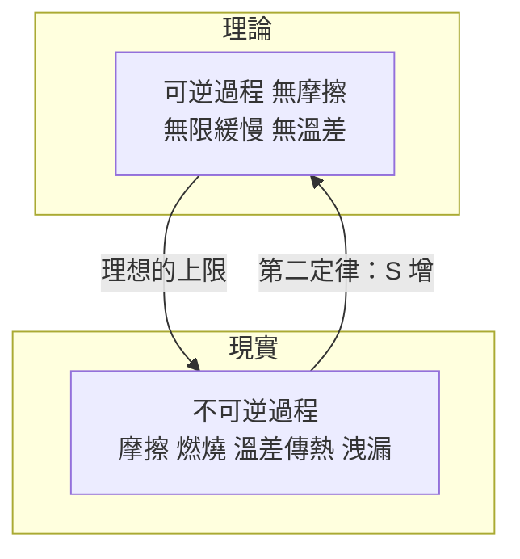

# 可逆與不可逆：能量質的退化

## 貓追尾巴的極限模型

卡諾循環是物理學史上最著名的思想實驗之一，而它真正的力量藏在「可逆」二字裡。可逆過程的定義近乎苛刻：

1. **無摩擦、無渦流、無洩漏**——所有損耗機制被假想為零；
2. **無限緩慢**——每一步都處於準靜態平衡，氣體在氣缸內的壓力隨時處處均一；
3. **無有限溫差傳熱**——熱的交換只在「差一個無窮小」的溫差下進行，等溫與絕熱步驟交替出現。

只有如此，過程的軌跡才能在 $p$-$V$ 圖上被原路反走，把系統與環境**同時**送回原狀，而不留任何宇宙痕跡。反過來，真實世界的一切——機械摩擦、燃燒、爐火對鍋爐的溫差傳熱、水流攪拌、玩具陀螺的緩慢倒下——都是不可逆的。

這裡有一個哲學炸彈：力學方程式（牛頓、拉格朗日、哈密頓）在時間反演下對稱，原子世界不辨過去未來；但人類與儀器活在一個只有單向的世界裡。難道「時間的方向」是宏觀世界的發明？這正是 19 世紀後半熱力學留給 20 世紀的一張欠條。

## 從「水量」到「水質」

卡諾用瀑布比喻熱機時，題外還寫了一句常被忽略的話：只有當熱**從高溫流向低溫**，才有動力可言；若兩熱源同溫，再多的熱也無用。換句話說，他已隱約看見：熱除了「量」，還有「質」。

接力棒傳到 1852 年，開爾文（William Thomson）發表《論自然界機械能普遍散逸的趨勢》（On the Universal Tendency in Nature to the Dissipation of Mechanical Energy）。他的語言充滿蘇格蘭長老會的道德重量：地球上的機械能正被不可逆地「散逸」——煤燒掉、溫差拉平、潮汐磨平海岸——並且「在人類所能安排的時間尺度裡不能復原」。他甚至用同位素地球冷卻的假設估算太陽與地球的年齡，跟當時地質學家與達爾文派要求的「深時」相碰撞（開爾文後來長達四十年否認演化論有足夠時間，這是一場至今仍具教育意義的失敗）。「耗散」不只是熱力學術語，更是維多利亞時代的天命感：一種科技樂觀主義包著宇宙悲觀主義的雙層結構。

注意，開爾文並非哀悼第一定律（能量永遠守恆），而是哀悼第二定律：能量**總量**不變、可用性**遞減**。用今天的語言：能量守恆，但品位下降。

## 兩種過程的數學

理想氣體的兩條路徑，寫下宏觀世界的基本對比：

**等溫過程（$T$ 不變）**，與大熱庫接觸，緩慢膨脹：

$$W = \int_{V_1}^{V_2} p\, dV = nRT \ln \frac{V_2}{V_1}$$

**絕熱過程（$Q = 0$）**，靠自身內能變化換取功：

$$pV^{\gamma} = \text{常數}, \quad \gamma = \frac{C_p}{C_V} > 1$$

絕熱膨脹降温、絕熱壓縮升溫，這正是卡諾循環的兩條斜邊。真實氣體（real gas）在低溫高壓還要再加上凡得瓦修正——分子體積與分子間作用力——卻不會改變定性結論：**所有真實引擎都跑不到卡諾極限**，因為活塞有摩擦、傳熱有溫差、做功有洩漏。工程學做的是一件事：量測每一步的損耗，看它距離 $\eta = 1 - T_C/T_H$ 有多遠。這是「理論用於審問現實」的 Victorian 工業美學，但也正是它把熱力學從法國理論帶入英國工程（W. J. M. Rankine 的《蒸汽機手冊》便是橋樑之一）。

## 不可逆性：時間之箭的第一份科學證詞

把卡諾的「質」、開爾文的「耗散」與稍後克勞修斯的熵（1865）連起，自然律首次被寫成**方向性**的語句：孤立系統的熵只增不減。物理學第一次有了一支箭。

但箭生前並不受歡迎。原子論者說：如果一切由遵守可逆方程的分子組成，熵增從何而來？玻茲曼以統計力學回應（$S = k \log W$），卻被洛施密特的「可逆性悖論」與龐加萊的「回歸悖論」夾擊——宇宙理論上可以回到原狀。這張 19 世紀的欠條，直到 20 世紀的宇宙學低熵初始條件、大爆炸、混沌與資訊理論才逐漸還清。

從軍事可逆的戰略，到無限緩慢的準靜態，再到時間之箭——一場由法國軍官、英格蘭貴族與普魯士教師接力完成的哲學革命，其起點不過是 1824 年那本只賣掉幾本的小冊子。
