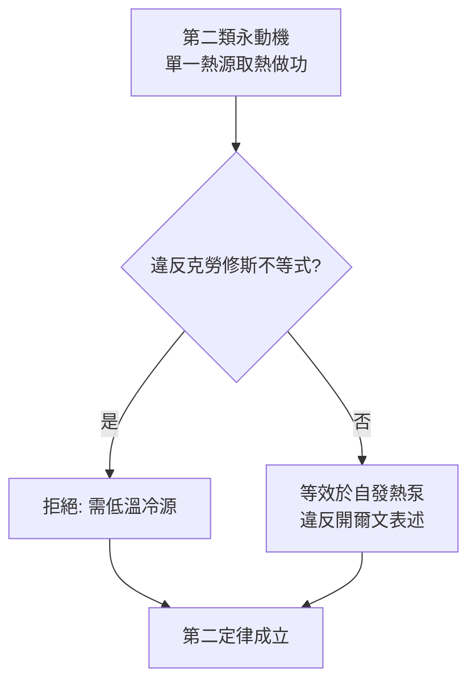

# 第二類永動機的幻滅

## 一種更狡猾的永動機

第一類永動機——憑空產生能量——早在 1775 年就被法國科學院宣布拒收此類提案。但第二類永動機更狡猾：它**不違反能量守恆**，只是想以更聰明的方式提取能量。設想一艘船：船體與海水之間以熱機能量轉換，直接從海水中抽熱做功，冷卻後的水再排回海中。海水的內能近乎無限，只要能「單點取熱變功」，世界便享有廉價的無限動力。

問題只有一個：**違反第二定律。**

若第二類永動機可行，全世界最方便的單一熱源就是環境——空氣與海洋。人可以從空氣中抽熱驅動工廠，再讓熱回流入空氣；這等於「繞過冷源」，而卡諾 1824 年的分析早已指出：冷源非有不可，且 $\eta = 1 - T_C/T_H$ 意味著 $T_C \to T_H$ 時效率趨於零。想從 $15\,^\circ\mathrm{C}$ 的海水取熱，必須找到（或人造）更低的冷源——這一冷源本身的建造本身就消耗功。

## 開爾文的雙重表述

1851 年，威廉・湯姆森（開爾文勳爵）在《熱的動力理論》（On the Dynamical Theory of Heat）中，把卡諾—克勞修斯的洞見刻成兩根法律條文：

**表述一（克勞修斯式）**：不可能使熱從低溫物體轉移至高溫物體而不產生其他變化（冰箱需用電，這是日常體驗的物理法則化）。

**表述二（開爾文—普朗克式）**：不可能從單一熱源取熱使其完全變為功，而不產生其他變化。

兩條等價：若表述一不成立，可造一台「自發熱泵＋理想熱機」的複合機，即第二類永動機；若表述二不成立，反向亦然。這種「若 A 可行則 B 可逆組合成永動機」的證法，是卡諾反證法的直接後代，也成為所有第二定律證明的標準格式。

## 克勞修斯不等式

1850 至 1854 年間，克勞修斯把定性表述 sharpen 成定量不等式。他引入一個好處是可以放進合同的東西——「折合熱」$\frac{dQ}{T}$，並證明任何實際循環：

$$\oint \frac{dQ}{T} \le 0$$

等號成立的條件是**可逆**；不可逆過程則嚴格小於零。到了 1865 年他直接把 $-\oint dQ/T$ 升格為狀態函數的定義，即熵。第二類永動機的死刑判决書因此有了精確數學形式：任何循環若宣稱「單熱源取熱變功」，必然違反此不等式。

## 真的有人思考過「海水發電」嗎？

歷史相弔之處在於：第二類永動機「被禁止」，但它允許的**殘餘空間**卻真實存在。若人工提供一個淺冷源（例如深海 $4\,^\circ\mathrm{C}$ 水層），從表面溫水取熱做功是合法的——這就是 1881 年的法國物理學家雅克・阿爾薩瓦・德・阿松瓦爾（Jacques-Arsène d'Arsonval）提出的海洋熱能轉換（OTEC）構想：利用熱帶洋面與千米深層之間約 $20\,^\circ\mathrm{C}$ 的溫差。他的學生喬治・克勞德（Georges Claude）1930 年代在古巴海岸真的造出實驗電廠，證明工程上可行、經濟上勉強。

按卡諾公式，$\Delta T = 20\,^\circ\mathrm{C}$ 意味著理論極限只有約 $7\%$，實際淨效率（扣除泵功耗）常低於 $3\%$。但 OTEC 從未死去：它燒的不是煤而是「溫差」，副產品是淡水與深海營養鹽養殖，在熱帶島國的能源—水—糧食 nexus 討論中反覆復活。21 世紀的儲能與海水取冷（SWAC）工程，正是這一 19 世紀理論「禁止無限、允許微薄」的另一面。

## 幻滅的價值

第二類永動機的幻滅教給工程學兩件事：一、**守恆不等於可用**——你有燒不盡的海水內能，卻幾乎抽不出功；二、**極限定理是一種資產**——卡諾極限讓工程師可以不試錯就宣判某方案死刑。英國熱力學家與評論家克拉克・麥克斯韋一句名言：「我們能企求於熱力學的，是告訴我們什麼做不到。」在蒸汽機、製冷、化工到今天的能源政策，這句話仍然成立。
