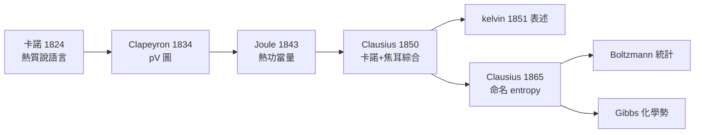

# 克勞修斯：熵的正式命名

## 普魯士式的嚴謹

魯道夫・克勞修斯（Rudolf Clausius, 1822–1888）生於普魯士屬地波美拉尼亞的克斯林，父親是貧窮的牧師兼小學校長。十六歲進柏林大學，出身是純粹的普魯士數理傳統：數學、物理同修，博士論文在天文學，導師正是對「海王星被算出來」的年代心向神馳的數理神學。柏林當時是個軍事化的知識城市：拿破崙戰後由威廉改革派建立、以洪堡思想立校的柏林大學，與戰後的柏林工業化幾乎同步——鐵路、電報、機械工業都需要精確的力學與熱學。克勞修斯的職業道路是典型普魯士模式：柏林皇家炮兵工程學校講師 → 蘇黎世聯邦理工（ETH Zurich，與後來的愛因斯坦同一校區）教授 → 再回德意志各校。他在蘇黎世的十五年是學術黃金期，同事包括透鏡製造師出身的格朗穆與後來抵達的赫姆霍茲圈。

## 1850：卡諾的翻案律師

1850 年，克勞修斯發表《論熱的動力》（Über die bewegende Kraft der Wärme）。他面對的難題是：卡諾理論的正確結論（效率只依賴溫度）被錯誤的熱質說支撐；焦耳的實驗卻顯示熱與功可以互換。克勞修斯的解法是外科手術式的：**保留卡諾循環與結論，割除熱質說，讓「熱的一部分做功、另一部分流入冷源」的觀點站起來。** 同一篇文章，他引入了內能 $U$（他當時寫作 $U$，這個符號沿用至今；1865 年他主動把 $U$ 稱為 energy——能量這個字的科學化使用有他的一份功勞）。

一個循環中：

$$U = \oint dQ - \oint dW$$

其中 $Q$ 是熱、$W$ 是功。第一定律在法國與英國傳統之間被他**焊接成功**。1854 年他把可逆循環證明為 $\oint dQ/T = 0$、不可逆為 $\le 0$——距離命名只剩最後一步。

## 1865：一個希臘字的誕生

1865 年，一篇題為《論熱動力基本公式的各種適用形式》的文章，克勞修斯終於給距離圓心這一狀態函數起名。他考慮過「轉變某種量」（Verwandlungsinhalt），最後用希臘字根 τροπή（trope，轉變）拼出 **Entropie**，刻意使其與德語 Energie（能量）音韻相對，音節相近。他寫道：「熵（能量與它的變化）……我特意選出這個詞，使之與名稱『能量』儘可能相像，因為這兩個量在物理上關係如此密切，其名稱上的相距相近似似乎是恰當的。」

其數學定義：

$$dS = \frac{dQ_{\mathrm{rev}}}{T}, \qquad \oint \frac{dQ}{T} \le 0$$

並附上宇宙尺度的雙重宣言：

> 1. 宇宙的能量守恆。
> 2. 宇宙的熵走向極大。

這兩句話之後的第三定律歷史、熱寂說與相對論挑戰，都是後話。但必須先看 1865 年那個用德文寫下「兩句世界諭令」的下午——彼時他人正在瑞士山間療養，批評聲四起，仍舊一言不發。

## 競爭、誤解與孤獨

與開爾文的關係是一場「同中藏異」的競賽：兩人幾乎同時（1851 年前後）得到等價表述，卻用不同哲學語言（開爾文想用工程術語「耗散」；克勞修斯想用數學公理「折合熱」），導致英語世界長期低估克勞修斯。赫姆霍茲 1847 年的能量守恆講義先於克勞修斯文章，也讓德國人誤以為熱學是赫姆霍茲的功勞——實則兩者相輔。蘇格蘭工程師蘭金（W. J. M. Rankine）則用一套自創的「分子渦旋」理論平行得出類似結果，雖然物理圖像錯誤，卻豐富了工程熱力學。（史家常提的「與吉布斯的競爭」其實是吉布斯受到克勞修斯的啟發，並非平輩競賽。）

克勞修斯本人是大戰後孤僻科學家的典型：不愛社交、書信簡短、回覆遲緩，學術論文長得像條文。他一生沒有弟子體系，晚年孤守波恩二戰後被搶救出來的實驗室與手稿（二次大戰波恩轟炸中他的舊宅實驗室被毀）。他 1888 年死於波恩，墓碑上沒有刻熵。

## 一個名字，兩個世界

1872 年，路德維希・波茲曼讀完克勞修斯的論文，開始用分子碰撞推翻熵的神秘；1876 年，吉布斯在耶魯以熵寫出化學平衡；維也納的馬赫、柏林的普朗克，都借用這一個詞。一位波美拉尼亞牧師的兒子造出的希臘字母，成為整個 20 世紀科學的暢銷語彙。

