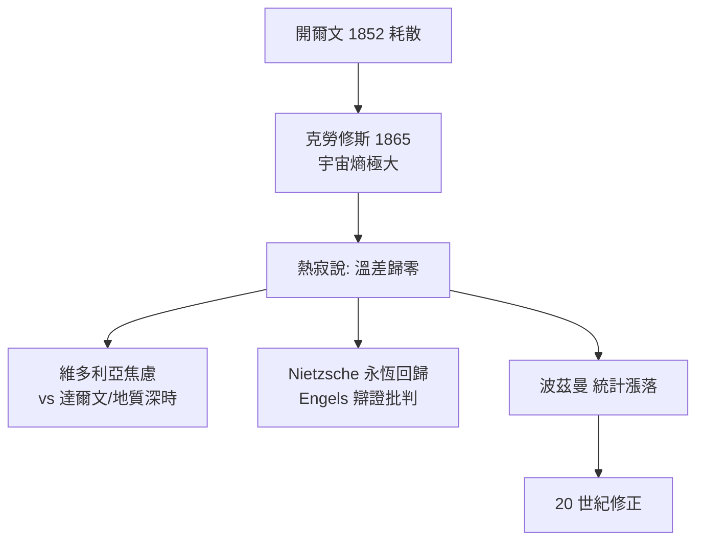

# 熵增原理與宇宙熱寂說

## 一句德文的宇宙諭令

1865 年，克勞修斯在《論熱動力基本公式的各種適用形式》末尾，留下科學史上最令人震撼的一句話：

> **Die Entropie der Welt strebt einem Maximum zu.**
> （宇宙的熵趨向一個極大值。）

他同時寫下姊妹句「宇宙的能量守恆」。第一句是等式，第二句是不等式；能量守恆說明宇宙的總帳不變，熵增原理卻給總帳一個方向。把這兩句合起來演繹到底，就得到一個令人背脊發涼的終局：當熵達到極大，宇宙中將不再有任何溫差，也就不再有任何熱可以轉化為功——一切變化停止，這就是**熱寂**（Wärmetod，heat death）。

## 兩位發言人的差異

「熱寂說」其實有兩個版本。開爾文 1852 年的《論自然界機械能普遍散逸的趨勢》描述的是「耗散」：太陽終將冷卻、地球終將無法維持生命所需的水流與風，人類與一切生命將在一場無可挽回的宇宙式衰退中結束。克勞修斯 1865 年的版本則是更冷峻的數學：不是「衰變」而是「平衡」——宇宙最終不是死亡，而是像一杯放涼的茶那樣**再無新事可言**。

兩人在 1860 年代互相引用卻語言不通：開爾文要的是工程與天體物理的身影，克勞修斯要的是公理化的純淨。這種差異，也預示了熱寂說在英語與德語文化圈引發不同回響。

## 維多利亞時代的焦慮

熱寂說傳開的 1860–70 年代，正是無神論與進化論掏空宗教世界觀的年代。達爾文 1859 年《物種起源》給出一幅「進步」的歷史圖景：生命由簡單走向複雜；萊爾與賴爾的地質學則提供令人暈眩的「深度時間」。然而熱力學第二定律卻像一盆冷水：**物理宇宙的總趨勢與生物的進步恰恰相反。** 英國的維多利亞人把「煤的耗竭—帝國的落日—宇宙的熱寂」連成一條神學式憂鬱曲線；德國哲學家尼采後來乾脆就用「最後狀態」這個物理詞彙當靶子，提出「永恆回歸」作為對抗線性末世論的存在論藥方。恩格斯在《自然辯證法》裡則從唯物論立場批判克勞修斯「把局域的經驗規律外推至無限宇宙」是僭越，倡議物質運動形式的轉換可能永無止境——這場馬克思主義的熵批判，在二十世紀還會被蘇聯科學反覆翻炒。

## 玻茲曼的反動與波動宇宙

路德維希・波茲曼提供了第一個「救生圈」：熵是統計的，不是命運。$S = k\log W$ 意味著巨觀的熵增只是「向機率大的狀態移動」，小系統中自發的熵減——漲落——機率雖小卻非零。他把這個想法推到宇宙論：在永恒的宇宙中，「我們」所在的世界膨脹、生命與文明，可能只是某個巨大漲落中的局部島嶼（後人稱 Boltzmann brain 思想實驗的遠古源頭）。這是一種冷冰冰的反動：不否認熵增，卻否認其絕對性。居禮家族所在的放射性研究、20 世紀初原子物理的發展，則慢慢把能量未來論從「煤與太陽」擴大到「核」與衰變的時間尺度——宇宙的燃料比開爾文估算的多得多。

## 20 世紀的再校正

真正的翻案來自宇宙學。1929 年哈伯（Hubble）發現宇宙膨脹；1948 年伽莫夫等人提出大爆炸與熱核宇宙論；1965 年彭齊亞斯與威爾遜測到 2.7 K 宇宙微波背景。修正的重點有三：

1. **低熵初始條件**：大爆炸的宇宙並非高熵的「平衡態」，而是一個極低熵、極光滑（引力尚待發揮）的初始狀態——正因起點如此整齊，其後才有一百多億年的熵可用於增長。熱寂不是「今天已接近」，而是熵的帳本遠未寫滿。
2. **膨脹的影響**：宇宙不是靜態熱力學系統，克勞修斯式的「有限系統達到極大後停滯」並不直接適用；膨脹中物質衰變、黑洞蒸發、時間尺度被一再推遠。
3. **ΛCDM 的冷靜版終局**：當代標準宇宙學模型的推演是「暗能量主導的指數膨脹 → 星系級黑洞吞噬 → 質子衰變（若發生）→ 黑洞蒸發 → 冷、暗、稀薄的逐漸平衡」，被稱為「宇宙的最終命運」之一，時間尺度以 $10^{100}$ 年計。它與克勞修斯的版本神韻相似，機制全然不同。

## 一場概念的長征

熱寂說在思想史上留下的最有價值的產物，也許不是那句預言，而是它逼人類練出的一個習慣：**把局域的物理規律拿來問「這在宇宙尺度上還成立嗎」**。克勞修斯問了，錯了一半；愛因斯坦與霍金接著問，修正了；今天寫在ΛCDM模型附錄裡的最終命運，則是不斷再校的暫時答案。熵增原理歷經一個半世紀仍然成立，它被修正的只是「適用的範圍」——這或許正是科學與預言的分別：預言以不變應萬變，科學以再校求愈真。
