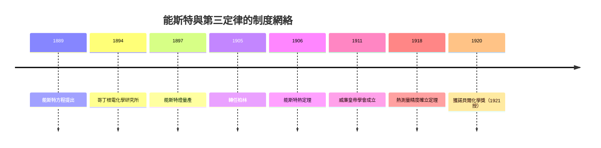

# 能斯特定理：絕對零度的可望不可即

1864 年 6 月 25 日，瓦爾特·能斯特（Walther Hermann Nernst）出生於西普魯士的布里恩（Briesen，今波蘭萬布熱日諾 Wąbrzeźno）。他是普魯士法官的第三個兒子，母親早逝，由父親撫養長大。這個生於鄉下的孩子後來卻成為德國科學帝國最精明的建造者之一：他不只是化學家，更是一個懂得把科學、產業與國家綁在一起的制度企業家。

## 從布里恩到哥丁根：電化學的崛起

能斯特先在蘇黎世、柏林求學，1887 年在萊比錫取得博士學位，同年經奧斯特瓦爾德引薦進入新設的電化學講座。當時電化學正好站在產業的風口：電鍍、電解、蓄電池都是新興的財富線。能斯特敏銳地抓住這個浪潮，1889 年提出著名的能斯特方程

$$E = E^\circ - \frac{RT}{nF}\ln Q$$

把伽凡尼電池的電動勢與化學反應的自由能直接聯繫起來。這條方程至今仍是每一本電化學教科書的入口。

1892 年他發明能斯特燈：一根摻雜氧化釔的鋯氧陶瓷棒，加熱到白熱便能發光，效率勝過碳絲白熾燈。專利授權的收入極其可觀，使能斯特在經濟上早熟——他成了少數不必依附薪水的德國教授。這份財務獨立塑造了他的性格：傲慢、直率、敢與任何人爭執。傳言他在餐桌上總點全場最貴的酒，因為「能斯特付得起，也值得」。

1894 年，他受聘哥丁根大學，一手籌建電化學與物理化學研究所，把哥丁根推成應用數學與物理化學的聖地；1905 年轉赴柏林接掌物理化學講座，與普朗克的理論物理研究所、接續而來的哈伯化學所有機化學薪火，構成柏林學派的三根支柱。

## 熱定理的誕生：為了分開親和力與反應熱

十九世紀末化學界懸著一個大問題：貝托雷以來的「化學親和力」到底等不等於反應熱？柏特洛主張反應熱就是親和力的量度；但能斯特從電化學知道，反應的可功用 $-\Delta G$ 度量，與反應熱 $\Delta H$ 一般並不相等——兩者的差由 $T\Delta S$ 補足。問題是：熵變 $\Delta S$ 只能靠電化學測量或統計推算，低溫下缺乏獨立的知道辦法。

為了拆開這團線，能斯特把電化學數據往低溫外推，發現了一件驚人的事：溫度越低，$\Delta G$ 與 $\Delta H$ 的曲線越來越靠近，在絕對零度附近兩者幾乎相切而且斜率相同。這意味著在低溫極限下 $T\Delta S \to 0$ 的速度比線性更快，等溫過程的熵變趨於零。1906 年，他把這條經驗規律公諲為「熱定理」：

> 接近絕對零度時，任何凝聚相系統的等溫可逆過程，其 $\left|\Delta S\right| \to 0$。

它不是從第二定律推來的，而是第三條獨立的原理。有了它，只靠常溫的熱量計數據就能算出平衡常數，不必高溫實驗——工業化學（合成氨、接觸法製酸）從此有了理論的計算器。能斯特立刻動員整個研究所，低溫熱學測量成為柏林的國家工程，他常說：「這是二十世紀化學的數據基礎。」

## 帝國主義學術性格：與普朗克、哈伯之間

柏林學派的成功不只是智識的，更是制度的。能斯特善於遊說普魯士教育部與工業界，促成威廉皇帝學會（1911）的成立， Physikalisch-Technische Reichsanstalt 的低溫設備也為他服務。他與普朗克性格截然不同——普朗克內斂，能斯特張揚；但兩人都相信德國科學應當是帝國的旗幟。

1914 年 10 月，能斯特在《93 人宣言》上簽名，為德軍入侵比利時辯護；他甚至親自到前線推廣偵測技術。哈伯主持化學戰、1915 年 4 月在伊普爾施放氯氣，能斯特的立場遠比想像複雜：他研究過催淚毒氣但反對致命毒氣的使用，戰後對哈伯的方法有所批評，也出力營救被協約國通緝的德國戰犯，主張以科學家免責。當他獲知 1920 年諾貝爾化學獎（1921 年授獎）是為了獎勵熱定理與物理化學工作時，他把獎金的一部分用來設立獎學金——他一生都在為德國學術的「再融資」打算，甚至戰後到瑞士收集法朗以便外匯。

轉折頗具諷刺：熱定理於 1906 年提出，諾貝爾獎卻要等十二年後才授；而 1918 年前後低溫測量的精度提升，使第三定律的應用範圍更廣。能斯特於 1933 年納粹上台前退休，1941 年逝世於 Muskau，臨終前還在抱怨量子力學的年輕人不夠尊重經典熱力學的「常識」。

## 為什麼「絕對零度可望不可即」？

能斯特定理的另一面，是「不可能用有限程序達到絕對零度」——因為每一個等溫過程所能抽走的熵都會隨溫度降低而衰減，降溫像打年利一樣越來越稀薄。這從制度與思想的層面看也有其意味：能斯特一生相信可以無限逼近，但看似「不可即」的限制正是物理學自身劃出的邊界。這條邊界在下一節的「殘餘熵」、在液氦、在稀釋製冷機中，繼續塑造著二十世紀的科技版圖。

