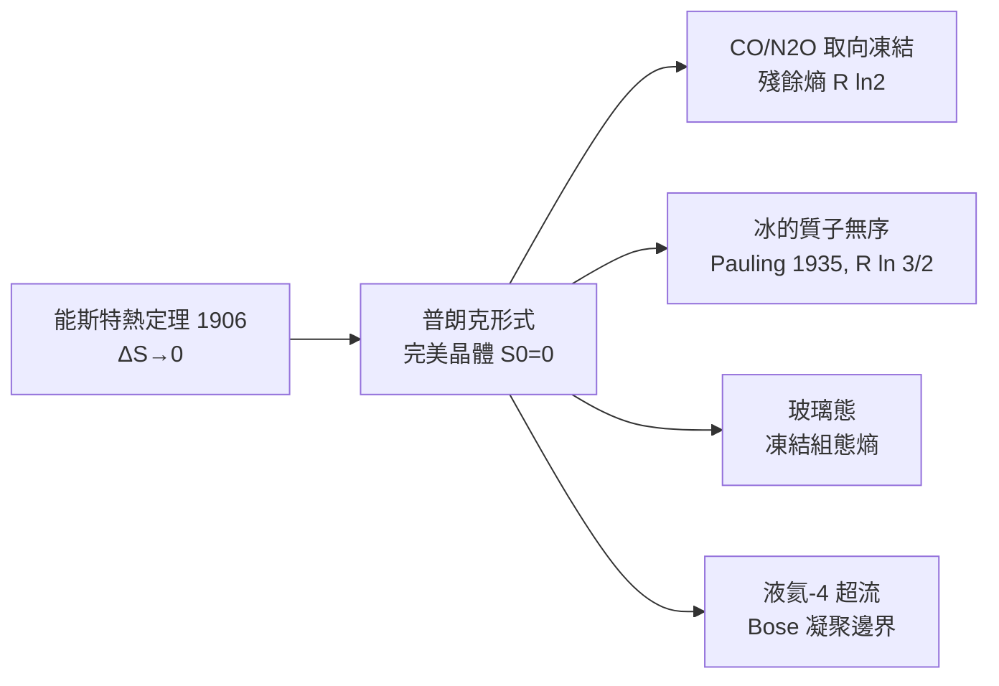

# 熱力學第三定律：完美晶體與殘餘熵

能斯特 1906 年的熱定理只是一條經驗規律，把它變成今天教科書裡「第三定律」的，是馬克斯·普朗克。1910 年代，普朗克在柏林與能斯特比鄰而居，他以自己慣有的乾淨俐落，把定理改寫為更強的表述：當溫度趨於絕對零度，完美晶體的熵趨於零

$$S \to k_B \ln W_0, \qquad W_0 = 1 \ \Rightarrow\ S_0 = 0$$

形式漂亮得像數學印章，但立刻遇到真實物質的反撲：如果微波晶體的微觀組態不止一種呢？熵憑什麼歸零？「殘餘熵」的故事就此展開。

## 取向凍結：CO 與 N₂O 的頑固

一氧化碳分子近於「左右對稱」——碳端與氧端的差別極小（CO 的偶極矩約 0.12 D）。晶體從熔體降溫時，每個分子的指向在幾十 K 就被冰封住，來不及翻轉到能量最低的統一方向。於是低溫晶體中每個 CO 都有兩種隨機取向，$W = 2^{N}$，殘餘熵理論值為 $R\ln 2 \approx 5.76\ \mathrm{J\,mol^{-1}K^{-1}}$。實驗測到的値稍低但不為零，因為分子會緩慢局部鬆弛。N₂O 同理，線性三原子分子也有頭尾不清的問題。這些「凍結的錯誤」不是平衡態的熵，而是動力學卡死的記憶——熱力學第三定律描寫的是平衡態，準確說，凍結系統是「偽平衡」。

## 冰的質子無序：鮑林的漂亮估算

更精彩的案例是身邊最常見的物質——冰。1933 年 Giauque 測得冰的殘餘熵約 $3.4\ \mathrm{J\,mol^{-1}K^{-1}}$，與第三定律矛盾。1935 年萊納斯·鮑林（Linus Pauling）給出解答：冰中每個氧原子被四個氫以氫鍵半方式相連，但氫原子的位置遵守「兩近三遠」的冰規則——每個氧附近兩個近氫、兩個遠氫。鮑林計算出每個水分子的可選組態數為 $W = (3/2)^{N}$，殘餘熵

$$S_0 = R \ln \frac{3}{2} \approx 3.37\ \mathrm{J\,mol^{-1}K^{-1}}$$

與實驗驚人地吻合。這是結構化學直覺力勝過精密計算的典範，也證明「完美晶體」四個字其實條件苛刻：冰永遠不完美。九十年代之後，人們才在中子散射與摻雜 KOH 的冰中觀察到真正的質子有序相變，屬於極慢動力學的範疇。

## 玻璃態：熵被凍結在半途

玻璃更極端。它不是晶體而是動力學停滯的液體：降温太快，分子來不及排列，熵在最後的玻璃轉化溫度被「凍住」，理論上每一塊玻璃在 $0\ \mathrm{K}$ 都保有巨大的組態熵。Kauzmann 於 1948 年提出「熵災變」悖論：若過冷液體的熵繼續下降而與晶體相交，熵便會在絕對零度之前歸零——這迫使我們承認必然有某種轉變（理想玻璃轉化）在更早發生。玻璃的故事說明第三定律不只關束縛，還暴露了我們對非平衡物態的無知。

## 液氦-4：不肯歸零的液體

所有物質在接近絕對零度時都應固化、熵歸零，唯一例外是氦-4。氦的零點運動太大，常壓下永遠是液體；要加 25 大氣壓才結晶。1938 年發現，液氦-4 在 2.17 K 以下變成超流體：黏度為零、能沿杯壁爬行。這正是 Bose 統計的宏觀顯現：全部原子湧入基態，$S$ 可以極小，但不是零——超流體內部還有聲子與旋子的激發熵。更奇的是氦-3：它是費米子，直到 1972 年才在毫開級展現超流相變。第三定律在這對同位素身上展現了「量子基底仍可有熵」的微妙邊界——要義是熵的斜率 $\left(\partial S/\partial T\right)$ 在 $T\to 0$ 時必須趨於零，而不必然是熵本身絕對為零的每一條路徑。

## 制度與文化：熱力學的德國世紀

普朗克的表述之所以勝出，不只是因為漂亮，而是因為 1911 年以後的德國物理化學，需要一條可操作的定律來回答氣體工業、合成氨、低溫工程的平衡常數問題。能斯特的實驗帝國提供了數據，普朗克的公理化提供了合法性，兩者合流，第三定律才被寫進教科書。隨後 Nernst 學派的低溫實驗又推動了昂內斯在萊頓的超導發現（1911），一條定律催生了一門產業。

第三定律至此成為熱力學大廈的屋頂。但它也劃下一條更深的線：絕對零度可以不斷逼近，卻不存在一條有限的路——這正是下一章的主題。
