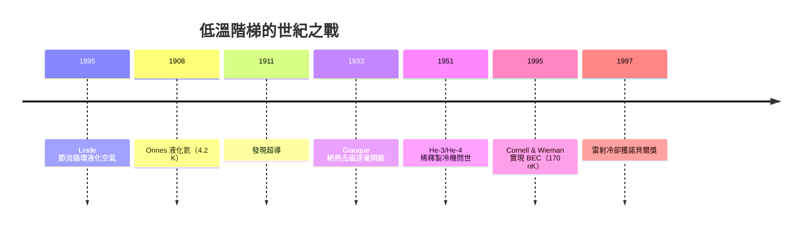

# 量子漲落與低溫物理：為何無法到達絕對零度

1912 年，能斯特在《熱力學定律的理論與實驗》中，把他的定理改寫成一條「不可達原則」：**不可能用任何有限的手續，把任何物體的溫度降到絕對零度。** 這句話看似消極，卻啟動了二十世紀最壯觀的技術競賽之一——人類不能抵達終點，卻沿路建立了一整座低溫物理的城邦。

## 打開階梯：Linde、Onnes 與氦的液化

卡爾·馮·林德（Carl von Linde）於 1895 年實現焦耳—湯姆森節流膨脹的循環液化空氣，並在慕尼黑啤酒與肉類保鮮市場看到了商機——冷凍技術從科學玩具變成產業。他資助了慕尼黑大學的實驗室，也間接培養了後來的製冷工程人才。這是科技驅動經濟、經濟回頭投資科學的早期範例。

真正的巔峰在萊頓。海克·昂內斯（Heike Kamerlingh Onnes）以「知識即是量測」（ door meten tot weten ）為座右銘，把荷蘭的萊頓實驗室建造成全世界氦液化的獨佔王國。1908 年 7 月 10 日，他將氦液化於 4.2 K，最後一批液氦是用姊妹儀器「接力」灌入低溫恆溫器的。1911 年，他在測量純汞的電阻時，發現 4.2 K 以下電阻突然完全消失——超導現象於焉誕生。這不是誰「想」出來的理論，而是把溫度梯降一級後，物質自己交出的驚喜。

## 加一階梯：絕熱去磁與稀釋製冷

氦液化之後，第三定律的不可達遠未被「證偽」——只是每降一半溫度，所需的工程複雜度呈指數上升。1933 年，吉奧克（William Giauque）用絕熱去磁：先把順磁鹽在強外加磁場中冷卻到液氦溫度，再絕熱移去磁場，讓自旋熵的釋放吞掉晶格熱，一舉達到毫開級。他為此得到了 1949 年的諾貝爾化學獎——製冷第一次以「熵的對價」為名獲獎。

1951 年倫敦（Heinz London）提出 He-3/He-4 稀釋製冷構想：兩種同位素在相分離界面處，He-3 溶入超流 He-4 相時吸熱，如同微型蒸發器，可連續數月維持數毫開。這台機器後來成為現代量子計算實驗室的標配。

## 用光取代冷：雷射冷卻與 BEC

值得一提的是，這場接力賽中「制度」一直扮演要角：萊頓實驗室把液氦變成了咖賣不出的獨家商品——昂內斯只以「標準樣品」的方式分裝送給友所，直到 1923 年加州伯克萊的實驗室才自製液氦成功，低溫壟斷才瓦解。壟斷的解除反而激發了更多元的低溫路線（絕熱去磁、稀釋製冷），說明科學的進步常來自「關鍵物質的去特權化」——這與今日稀土、量子晶片供應鏈的政治經濟學遙相呼應。

1975 年，Hänsch 與 Schawlow 提出用紅移雷射光「迎面拍擊」原子動能的想法。朱棣文在貝爾實驗室於 1985 年建成光學黏膠，Cohen-Tannoudji 加入亞多普勒冷卻（Sisyphus cooling），Phillips 奠定磁光阱——三人共享 1997 年諾貝爾物理學獎。此後沿著鉀、銣原子一路下探，1995 年 6 月 5 日，Eric Cornell 與 Carl Wieman 在 JILA 把銣-87 質體從 170 nK 冷到觸發玻色—愛因斯坦凝聚，整個原子雲塌縮進單一量子態。這是 1925 年愛因斯坦預言的宏觀量子現象，等了七十年才實現。低溫技術至此跨過了從「液化分子」到「凍結原子波函數」的斷層。

## 為什麼下不到底？三定律的合謀

不可達不是工程怠惰，而是三條定律的合力：

- **熵外推**：接近 $0\ \mathrm{K}$ 時 $\Delta S \to 0$，能抽走的熵越來越少；
- **能量對價**：每一步致冷都要付出功與機器複雜度，成本呈指數攀升；
- **量子漲落**：即便到 $0\ \mathrm{K}$，零點振動 $\frac{1}{2}\hbar\omega$ 仍在，動能不可能歸零；測不準原理也禁止同時確定每個粒子的位置與動量。

溫度像一條漸近線：可以無限逼近，每一級卻都要整座新科技森林來鋪路。

## 產業化的低溫

這條階梯也孕育了今天的科技基礎設施：MRI 所用的超導磁鐵浸泡在 4.2 K 的液氦中；LHC 的 1232 個超導磁鐵由液氦冷卻到 1.9 K，使其超流體充當兼具低黏度與高比熱的冷卻劑；至於 Google、IBM 的超導量子晶片，必須放在稀釋製冷機的 10–20 mK 混合腔內，否則熱噪聲會摧毀脆弱的量子相干。能斯特 1912 年的「不可達」宣言，最終變成一門年產值數十億美元的低溫產業——這或許是他最能滿意的結局：不能抵達的目標，反而最持久地驅動了行業與制度。
