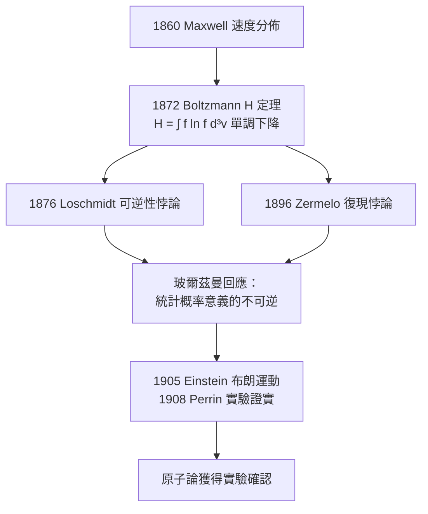

# H定理：從可逆力學到不可逆的宏觀

## 1872 年：力學裡長出時間之箭

路德維希·玻爾茲曼 1872 年發表的《氣體分子平衡的進一步研究》，是他最雄心勃勃的作品。他假設氣體分子間只發生兩體彈性碰撞，碰撞次數取決於速度分佈函數 $f(\vec v, t)$，由此寫出著名的玻爾茲曼輸運方程，並證明一個積分函數

$$H = \int f \ln f\, d^3 v$$

在一般條件下單調不增：$\dfrac{dH}{dt} \le 0$。若對應熵 $S = -kH$，這就宣告：熱力學第二定律不是從別處借來的額外假設，而可以從牛頓力學加統計聲明推導出來。時間之箭似乎第一次在力學的骨架內現身。這是繼 1860 年馬克士威速度分佈之後，動理論的又一次躍進——V以後稱為馬克士威—玻爾茲曼分佈 $f(v)$。

## 洛施密特的反駁：可逆性悖論

五年之後，玻爾茲曼的舊友、維也納的化學家約瑟夫·洛施密特（Josef Loschmidt）在 1876 年投下炸彈：既然兩體碰撞在時間反演之下仍是牛頓力學的合法解，那麼只要把所有分子的速度反向，系統就會沿原路回去——$H$ 將單調上升。可逆的微觀動力學，怎麼可能推導出不可逆的宏觀結論？

玻爾茲曼的回應展現了他思想的最高點：$H$ 定理並非對所有微觀初條件的絕對定律，而是一條**以壓倒性概率成立的統計命題**。逆行的確存在，但它對應的微觀排列是精確調校、數量極少，在真實氣體（$10^{19}$ 個分子的尺度）中出現的期望時間遠超宇宙年齡。宏觀不可逆性不是力學的必然，而是**初條件的偶然性加上天文數字般的概率**的結果。這一句話把熱力學第二定律從「定律」降級為「概率極限中的定律」——這是十九世紀思想史上最勇敢的策略之一。

## 策梅洛的循環悖論

1896 年，數學家恩斯特·策梅洛（Ernst Zermelo）基於龐加萊 1890 年的復現定理再下一城：有限的相空間中，任何保守系統都會在有限時間內任意接近其初始狀態——「復現」必然發生，那 $H$ 怎麼可能單調下降？玻爾茲曼的回答依然不變：復現時間對宏觀系統是 $10^{10^{19}}$ 年量級，跟復現比起來，宇宙自身的壽命都是一瞬；這個悖論雖然在哲學上嚴肅，在物理上無關宏旨。他略帶嘲諷地反問策梅洛：「您巧遇過骰子擲出同樣點的兩次嗎？那也可能發生。」

## 與能量論者的戰火：馬赫與奧斯特瓦爾德

洛施密特與策梅洛是善意同行，柏林維也納還有一批更深的敵人。恩斯特·馬赫以實證主義之名攻擊原子論：「你見過原子嗎？」；萊比錫的威廉·奧斯特瓦爾德創立「能量學」（Energetics）學派，主張用能量轉換而非分子計數就能重建一切物理，原子只是「富有成效但無必要」的假設。1895 年呂貝克自然科學會議上，奧斯特瓦爾德報告時，玻爾茲曼挺身出列，年輕的物理學家們（包括在一旁的普朗克，後來回憶道兩派激辯到「像是生命的戰場」）開始倒向玻爾茲曼，他的辯才讓他自嘲為「廉價邏輯的巫師」。但是論戰持續，對手佔著教科書與講座的權力位；玻爾茲曼於 1900 年被迫轉往萊比錫，1902 年重返維也納接替馬赫的席位——卻也在 1906 年於義大利 Duino 度假時自盡。

諷刺的是，就在他死去的前一年與後兩年，兩記重錘落地：1905 年愛因斯坦用分子碰撞統計解釋布朗運動；1908 年佩蘭以顯微實驗定量證實其預言——原子論、分子動理論終於獲得塵世法庭的判決。玻爾茲曼本人沒能等到；這場勝來得太晚的平反（vindication），成為科學史上「少數派科學家」最著名的案例之一。

更深一層看，H 定理所提出的「微觀可逆、宏觀不可逆」張力並未就此終結。二十世紀的統計力學——從吉布斯的系綜、昂薩格的輸運理論，到普利高津的耗散結構——一次次回到這條 1872 年的方程；即便今日用精確的量子力學把玻爾茲曼方程推導出來（如 1960 年代起的 Bogoliubov 方法），人們仍然承認：時間之箭的最終時鐘，指向 ergodicity 與系統初條件的集中程度。一場五十年前的德語論戰，就此變成了現代計算物理與電腦模擬的常識基礎——玻爾茲曼方程至今仍被用於半導體散射、稀薄氣體飛行器設計與血漿流變，是理論直接推動工程鑿鑿可證的範例。
