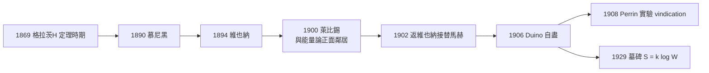

# 墓碑上的公式：被孤立的悲劇哲學

## 流動的講座：格拉茨—慕尼黑—維也納

玻爾茲曼的學術人生是一連串的搬遷。1869 年，年僅 25 歲的他便獲聘格拉茨大學數學物理教授——奧匈帝國最年輕的教授之一。格拉茨的二十年是他最富創造力的年代：H 定理、玻爾茲曼方程、統計熵都在此誕生。但 1890 年，他離開格拉茨前往慕尼黑，1900 年又轉往萊比錫，1902 年回到維也納接替馬赫的「自然哲學」講座，1906 年死於義大利。每一次遷徙都伴隨具體的制度理由：1894 年維也納以高薪挖角他，部分是帝國首都與「死敵普魯士」科學競賽的面子工程；1900 年轉萊比錫接替退休的克努伯，卻讓他更貼近能量派的根據地。他自認「體質不適合行政」，歷來刻意要求免除雜務。1903 年他重開「自然方法論」講座，講遍西方哲學史的各個章節，聽講的年輕人裡包括了維也納不少思想界的新血。

## 孤軍的論戰：馬赫、奧斯特瓦爾德與「看不見的原子」

玻爾茲曼的悲劇核心，是他一生替「原子實在論」孤軍奮戰。當時德語學術界的主流是兩股風潮：馬赫的實證主義——「不能觀察的東西不該出現在理論中」；以及奧斯特瓦爾德的能量學（Energetics）——把一切還原為能量變換的唯象論。1895 年的呂貝克會議上，他與奧斯特瓦爾德正面交鋒，普朗克回憶這場辯論「扣人心弦，像是生命的戰場」。玻爾茲曼有火藥般的修辭、即席的口才與受過的表演訓練（他的幽默演講是當時德語學壇的名品），但資源與講座的主導權多在對手手上。他寫給同事的信中自嘲：「我是唯一還相信原子論的人。」——誇張，但反映真實的心情。

## 憂鬱、眼睛與最後的旅途

玻爾兹曼終生受雙相憂鬱的折磨，日曆上甚至寫著「每十二年復發一次」的自我觀察。1905 年前後，他視力嚴重惡化，幾乎無法自己讀文獻與校對長稿，只能靠助手與家人朗讀——對一位以「長公式與密排計算」聞名的學者而言，這近乎被剝奪職業本能。1906 年春，他請病假赴海牙求診；9 月 5 日，在義大利的里雅斯特附近的 Duino 度假中，趁家人游泳時在旅館房梁上自縊。

他的妻子亨麗埃特·玻爾茲曼（Henriette von Aigentler，原為格拉茨的女教師，當年曾為了旁聽物理課而與當局抗爭，是他思想意義上真正的同行者）留下了幾封陳述與書信，成為後人考證其最後情緒的主要材料。家書裡的妻子記錄著他的焦躁、對講座的恐懼與反覆的失眠。一個把「概率論」帶進物理學的人，最終被自己思想的不可逆折損——這個對照常被寫成傳記的警句，其實史料只能證實前半段的痛苦。

## 墓碑與平反

玻爾茲曼葬於維也納中央墓園（Zentralfriedhof）。1929 年，學生在其墓碑上刻下如下的公式

$$S = k \log W$$

——物理史上最抒情的一塊碑。諷刺在於，這條公式在 1900 年被普朗克定形；即使這樣，墓碑不刻哪怕是玻爾茲曼自己真正的原版工作論文，而是他「被世界真正接收」的那個版本。

平反在他死後迅速到來。1905 年愛因斯坦以分子碰撞理論預言布朗運動；1908 年佩蘭（Jean Perrin）以超離心與乳濁液實驗定量證實，原子有了重量與數目（亞佛加厥常數的第一批測定）。奧斯特瓦爾德 1909 年在《化學雜誌》坦承，實驗使我們「能夠接受原子假設」。普朗克則早在 1900 年就用了玻爾茲曼的計數法推出輻射定律，並把 $k$ 命名為玻爾茲曼常數——他一生對原子論的猶豫，成為他最有力的自我批評。

## 少數派科學家與制度的教訓

玻爾茲曼的一生成為科學社會學的典型案例：當「看見」成為學術主流的知識論準則，預言測不到的實體（原子、分子、統計系綜）的科學家就會被制度性的邊緣化。維也納世紀末的文化——馬赫的實證主義、維根斯坦《邏輯哲學論》中「對不可說者須保持沉默」的箴言——同樣源自那股對「不可觀察」的深刻疑慮。而天才的回應本來應該是科學的正常修辭：用預言的可檢驗結果（布朗運動、黑體譜）反過來逼實驗界裁決。玻爾茲曼想到了，但沒等到。

他的墓碑提醒後人兩件事：第一，科學共同體可以在一次論戰中整體看錯方向——連後來改信原子論的普朗克都承認，玻爾茲曼的統計思想早就值得最高的榮譽；第二，制度性護持少數派，不只是慈善，而是科學演化機制本身——沒有被孤立的玻爾茲曼，就沒有 1900 年的普朗克，也沒有 1905 年的愛因斯坦。
