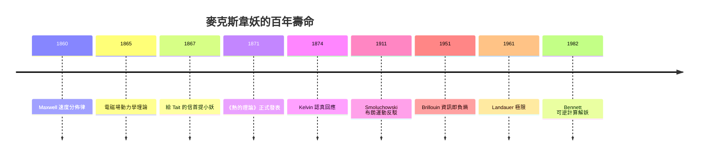

# 一扇小門前的怪物

1867 年冬天，格倫萊爾莊園的書房裡，詹姆斯·克拉克·麥克斯韋（James Clerk Maxwell）提筆給老朋友彼得·泰特（Peter Guthrie Tait）寫信。泰特當時正在和克爾文男爵凱爾文（William Thomson, Lord Kelvin）合作撰寫《自然哲學論》，一部試圖把熱力學納入統一力學體系的巨著。麥克斯韋是他們私下徵詢意見的第三位同道。信寫到熱力學第二定律時，麥克斯韋的筆鋒突然調皮起來：

> 「當一個熱分子來到門前時，讓這個『非常靈敏且手指乾淨俐落的類人生物』（a very observant and neat-fingered being）打開小門放它過去；當一個較慢的分子來到時，把門關上擋住它。」

他甚至調侃這個小生物不必聰明絕頂，只要有足夠敏銳的觀察力和眼疾手快就夠了，因為在常溫空氣裡，分子速度差異其實不算大。他還在信中開玩笑說這個點子只供私下流通，免得……在正式發表前被人搶先踢爆這個玩笑的底牌。

四年後，1871 年，麥克斯韋出版《熱的理論》（Theory of Heat）——這是為《自然哲學論》教材系列寫的通俗讀物。在「熱力學第二定律」一章裡，他把這個玩笑正式化了：設想一個容器被隔板分成兩半，隔板上有一扇無摩擦的小活門，由一個「存在著的有限存在」（a being，後人稱 demon，即「麥克斯韋妖」）把守。快分子從左飛來，開門；慢分子從右飛來，也開門放它逆行。久而久之，左側愈來愈熱、右側愈來愈冷——溫差憑空出現，而妖「既沒有對系統做功，也沒有花費任何可察覺的力」。一座自動運轉的第二類永動機似乎誕生了。

## 玩笑的底牌

但麥克斯韋的真實意圖，從來不是要推翻第二定律。他在信中說得很清楚：第二定律只與「我們無法處理物體的尺度和複雜程度」相關。換句話說，他是要指出：第二定律**不是一條像牛頓定律那樣的力學定律，而是統計性質的命題**——它只在大量分子的事件平均上成立，一旦降臨到可以辨認、選擇單個分子的層次，它就會破產。

這個立場深深植根於他自己的工作。1860 年，麥克斯韋發表《氣體動力學理論的說明》，導出了分子速度分佈律

$$f(v) \propto v^2 e^{-mv^2/2kT}$$

第一次指出氣體分子的速度**不是**一律相同，而是有一條連續的統計譜。這與克倫尼希、克勞修斯等人早期「所有分子同速」的粗糙圖像截然不同。既然分子天生有快有慢，那麼「熱」的不均勻本來就是微觀世界的常態；宏觀上的溫度均勻只是統計抹平的結果。麥克斯韋妖不過是把這條分佈譜人為地重新切開而已——他指出的是：第二定律的「不可逆」來自於**我們不可能追蹤每一個分子**，而不是自然界有什麼深層的禁令。

1865 年，麥克斯韋的電磁理論劃時代巨著《電磁場的動力學理論》問世，光速與電磁常數的統一使他成為歐洲最令人敬畏的物理學家——也正是在這一年，克勞修斯把「熵」 Entropie 一詞引入世界。同一時期麥克斯韋退隱格倫萊爾莊園務農、寫詩、研究色覺。在這樣的頂峰狀態下，他對熱力學的態度反而帶著一絲蘇格蘭式的懷疑與調侃：他認為克勞修斯把熱力學推向機械決定論的教條化是過頭了，甚至私下把第二定律稱為「統計性的真理」。透過妖的幻想，他投向的是一場對教條的代理人戰爭。

## 克勞修斯的怒火與凱爾文的小妖

並非人人都能看出玩笑的底牌。魯道夫·克勞修斯——「熵」的命名者——讀到《熱的理論》後十分不自在，他堅稱第二定律的普適性不依賴任何分子假說，把麥克斯韋的挑戰視為對宏觀熱力學純潔性的侵擾。較為務實的凱爾文則認真對待這個思想實驗。1874 年，他在論文中重述了小妖的能力設定——「智力和體力必須足以捕捉每一個分子」——並承認：若是真有這樣的生物，第二定律的表述必須改寫。他甚至說，這個問題的意義「值得未來兩個世紀的物理學家研究」，這個預言竟近乎全部成真。

泰特後來在給友人的通信與著作中把這個想像中的生物戲稱為 demon（蘇格蘭口語裡的精靈與機靈鬼）。名稱一錘定音，「麥克斯韋妖」從此在物理學的萬神殿裡登基。

## 百年學術生命

麥克斯韋妖的學術壽命遠超其創造者。1879 年麥克斯韋死於胃癌，年僅四十八歲，來不及看到自己的玩笑長成什麼模樣。此後一百多年，妖成為熱力學、統計力學、資訊理論、量子力學的試金石：

- 19 世紀末，普朗克堅決拒絕妖的挑戰，堅稱第二定律是絕對的——這條防線直到他 1900 年自己敲開量子論的大門才鬆動；
- 1911 年，斯莫魯霍夫斯基（Smoluchowski）指出妖的觀測與決策本身會因布朗運動而失靈；
- 1951 年，布里淵（Léon Brillouin）引入「資訊即負熵」的概念，指出妖必須照明分子、耗散光子才能獲取資訊，而這筆資訊代價足以抵銷熵的降低；
- 1961 年到 1982 年，蘭道爾（Rolf Landauer）與貝內特（Charles Bennett）證明：**擦除資訊必然導致每比特至少 $kT \ln 2$ 的能量耗散**，妖的記憶體才是真正的瓶頸——這條「蘭道爾極限」今天已成為晶片功耗設計的邊界條件。

從 1867 到今天，妖跨越了一個半世紀，從一封私人信裡的玩笑，長成連接熱力學與資訊理論的橋樑。下一章將會看到：正是沿著妖的足跡，人們才終於明白，**熵與資訊是同一枚硬幣的兩面**。

