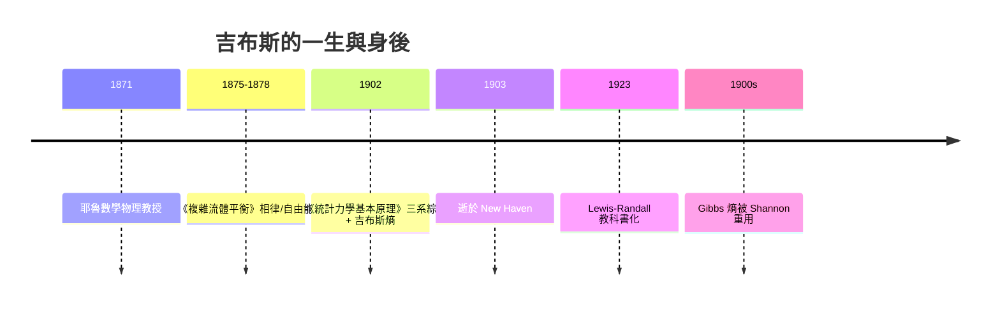

# 耶魯的孤島

1871 年，美國耶魯大學設立了全美第一個「數學物理教授」職位，聘請年僅三十二歲的喬賽亞·威拉德·吉布斯（Josiah Willard Gibbs）出任。這個職位幾乎是為他量身打造的——因為他沒有足夠的發表紀錄，校董事會裡甚至有人質疑何以把講座給一個「什麼都沒寫過」的人。幸好主持此議的耶魯校長和物理系同仁看重的是他在史密森學會申請過的小冊子與工程論文（他曾修復過一個蒸汽機調速器的理論）。吉布斯執教耶魯四十二年，薪俸低微，終身未婚，與姊妹同住在新港家宅，在當時以社交浮華聞名的美國上流社會，幾乎是個隱形人。

歐洲的物理學家很晚才知道他。直到 1890 年代，才經由范德瓦耳斯、勒夏特列與奧斯特瓦爾德等人的引介，德、法大陸慢慢消化吉布斯這個名字——奧斯特瓦爾德甚至親自把他的論文集譯成德文。更諷刺的是：他的《論非均質物體的平衡》長文，發表在康乃狄格科學院一份幾乎無人訂閱的彙刊上（1875–78 前後連載），錯過了它本來可能及時改寫的歐洲化學史。波茲曼曾抱怨：你必須先懂他的數學，才能理解他的物理；而英國學界的保守取向，也 使英國讀者誤解他多年。

吉布斯的性格把這一切都限制住：他不愛辯論、不寫通俗文章、從不指名批評對手，也極少透露自己如何「想出」一個理論。愛因斯坦 1902–04 年鑽研統計力學時曾細讀其著作（1902 年恰好也是他發表布朗運動論文前一年），他對吉布斯的評價是：吉布斯不但給出理論的形式，還給出了它的精神——儘管表達晦澀，仍是統計力學最清晰的奠基。

## 1902：最後一年的傑作

吉布斯在耶魯的最後一年（1902），出版了他畢生唯一一本書：《統計力學基本原理》（Elementary Principles in Statistical Mechanics）。書的副標題直接點出主旨：「特別針對熱力學的合理基礎而發展」。這一年，他的健康已經不佳來日無多，選擇在生命的盡頭出版此書，等於是臨終前把畢生想說的話整理給世界（吉布斯 1903 年四月病逝於紐黑文）。

吉布斯統計力學的核心手法，是不再像波茲曼那樣「追蹤一個真實的分子系統」，而是改為：

> 「同時考慮**無窮多個想像中的複本系統**，每個都與真實系統有相同的巨觀條件，但微觀狀態各異。」

這就是「系綜」（ensemble）觀念。按約束條件分三層：

| 系綜 | 約束條件 | 對應巨觀環境 |
|---|---|---|
| 微正則 microcanonical | $E,\,V,\,N$ 固定 | 孤立系統 |
| 正則 canonical | $T,\,V,\,N$ 固定 | 與大熱庫接觸 |
| 巨正則 grand canonical | $T,\,V,\,\mu$ 固定 | 可交換粒子 |

其威力在於：**只要寫下配分函數（partition function），所有熱力學量都是它的微分**——壓力、化學勢、Gibbs 自由能，一一自動浮現。此架構一出，熱力學就從唯象學變成了一門可以從力學推出的科學。

## 吉布斯熵：比 Boltzmann 更一般的公式

在本書中，吉布斯也寫下了那條後來以他為名的公式。若系統處於微觀狀態 $i$ 的機率是 $p_i$，則

$$S = -k \sum_i p_i \ln p_i$$

注意：若所有 $p_i$ 相等（微正則情形），此式就退化為 Boltzmann 的 $S = k\ln W$。所以它可以說是**波茲曼公式的一般化**，並且有三個立即可見的優勢：

1. 對**非平衡系統**也適用（任何一組 $\{p_i\}$ 都可以算出一個熵值）；
2. 對**多個子系統的複合系統**保持線性可加性（複合系統的吉布斯熵等於各子系統熵之和）；
3. 定義在**相空間的連續分佈** $\rho$ 上也能用積分寫：$S = -k\int \rho \ln \rho \,d\Gamma$。

最後這條件的寫法，120 年後將被 Claude Shannon 拿來，只把 $k$ 換成 1、把 $\ln$ 換成 $\log_2$，就無縫變成通訊中的資訊熵——第八章將詳述這個「數學形式的完全重疊」究竟是巧合還是本質，它也是本書的關鍵哲學線索。

## 化學與「亂度」：吉布斯的另一個戰場

吉布斯把統計力學推向化學的努力其實更早。1873–1878 年的兩篇《流體的平衡》、一篇《論以曲面為介質之固體的平衡》（表面化學先聲），就給出了：

- **相律**：$F = C - P + 2$，後來由荷蘭的 Roozeboom 發揚成為整個冶金、陶瓷、地質、材料工業的地圖；
- **吉布斯自由能** $G=H-TS$，成為判斷化學反應方向、化合物自發合成、電池電位的統一標準；
- 化學勢 $\mu$，使「質量作用定律」有了嚴格基礎，也把輪胎、肥料、石化這些 20 世紀的經濟支柱產業的設計，從試錯變成計算。

其中，「亂度」（randomness / disorder）這個象徵性詞彙，其實不是吉布斯本人愛用的字——是 Boltzmann 的 $S=k\log W$ 與吉布斯系綜合起來之後，由後來的教科書作者（尤其是美國 Lewis–Randall 一系）翻譯成工業與化學教育可以消化的意象。然而無論用什麼詞，$G=H-TS$ 讓「熵」從純物理的抽象走向了化學工程與工業熱力學的核心——這條路，基本上是吉布斯一個人默默鋪好的。

## 被讀得太晚的人

吉布斯死後不到十年，他在美國的地位快速上升。耶魯出版《吉布斯全集》，化學家 Gilbert N. Lewis 和 Merle Randall 於 1923 年出版《熱力學與化學物質的自由能》，把他的工作轉成整個 20 世紀化學系的標準課本；物理學界則由於 Einstein、Poincaré、Planck 各自消化他，統計力學逐漸變成「Boltzmann + Gibbs」兩足鼎立的祖師牌位。

一句流傳甚廣的概括（出自一位德國化學家的評語）說：吉布斯「在歐洲他被讀得太晚，在他自己的國家，他被認識得太淺」。耶魯給他的薪資微薄、美國當年偏重實用的高等教育風氣（大學以服務工業與農業為榮、輕視純理論）、加上他自己不事張揚的個性，三者疊加，才有這樣的遺憾。這段歷史提醒我們：**思想的傳播，與思想本身同樣重要**——吉布斯解決了 Boltzmann 沒有解決的形式問題，卻必須等一個沒有 Boltzmann 的時代，才有人替他站上講台。

