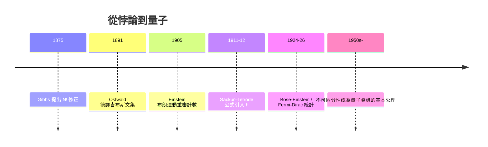

# 同一種氣體，為何會憑空生出熵？

考慮一個最簡單的思想實驗：一個絕熱容器被隔板分成兩半，左邊裝一摩爾氮氣、右邊裝一摩爾氧氣，溫度壓力相同。抽掉隔板，兩種氣體互相擴散，最後均勻混合——這是絕對不可逆的過程，熵增加了。計算很簡單：混合後每一種氣體的有效體積都變成兩倍，每摩爾的熵增是 $k\ln 2$，總共

$$\Delta S_{\text{混合}} = 2Nk\ln 2$$

這是任何要用分離法回收氮、氧的工廠（空氣分離是一項至今規模以百億美元計的產業）必須償還的熱力學債務，完全合理。

現在換一個實驗：左右兩邊裝的都是氮氣，相同的溫度、相同的壓力。抽掉隔板——宏觀上**什麼事都沒發生**。沒有流動、沒有擴散可以測量、也造不出任何溫差或壓差去推動機器。直覺上熵變應該是零。

但十九世紀的計算卻得出尷尬的結果。當年計算混合熵的方式，是把每種氣體的熵寫成體積的函數 $S = Nk\ln V + \cdots$，再把兩邊加總。抽板之後，每一邊氣體「可及的體積」都從 $V$ 變成 $2V$——**公式根本不知道兩邊是不是同一種氣體**。照算不誤，結果還是 $2Nk\ln 2$。熵平白無故地從「無事發生」的程序裡憑空冒了出來。這就是**吉布斯悖論**（Gibbs' paradox）。

## 吉布斯的刀法：除以 $N!$

1875 年，吉布斯在《論非均質物體中流體的平衡》的長文裡，用一段簡短冷靜的補註，砍下了這個結。他指出：計算氣體熵時，若把粒子當成**可以彼此編號區分**的對象（甲粒子、乙粒子、丙粒子……），那麼微觀狀態數被多算了 $N!$ 倍——因為交換兩個全同粒子的位置，在物理上是**同一個狀態**，但在「可區分粒子」的計數裡卻被算成 $N!$ 個不同的排列。

修正的方法是把相空間的體積除以 $N!$：

$$S = k \ln\!\left(\frac{W}{N!}\right) \quad\Longleftrightarrow\quad \frac{S}{N} = k\ln(\text{單粒子相空間體積}) - k\frac{\ln N!}{N}+\cdots$$

一除之下，化學勢裡多出的一項 $\frac{1}{N}\ln N!$ 恰好把兩側「同種氣體互混」的假熵增抵銷掉——同種氣體混合，熵增歸零；不同氣體混合，熵增 $2Nk\ln 2$ 原封不動地保留下來。悖論消失。

用斯特林公式 $\ln N! \approx N\ln N - N$，這個修正化成:

$$S = Nk\left[\ln\!\frac{V}{N} + \frac{3}{2}\ln\!\left(\frac{4\pi m U}{3Nh^2}\right) + \frac{5}{2}\right]$$

即今日熱力學課本裡的**薩克爾–特托羅德方程**（Sackur–Tetrode equation, 1911–12），它把普朗克常數 $h$ 明明白白寫進了理想氣體的熵——一條承諾了量子論的公式，卻是從一個純古典的悖論逼出來的。

## 「量子理論的前兆」

最耐人尋味的是吉布斯的態度。他**沒有**宣稱自己「解決」了悖論；他只是淡淡地說：把相空間除以 $N!$ 是使熵具備「廣延性與混合性」所必須的形式手續，至於這種「不可區分性」的物理意義，他承認自己並不清楚。這份誠實到了 1902 年《統計力學基本原理》裡依然如故——他在書中幾乎逐章提醒讀者哪些結論經不起「粒子可編號」這個古典假設的推敲。

二十多年後，物理的答案才姍姍到來。愛因斯坦在 1902–04 年鑽研統計力學、1924 年讀到玻色送來的光子統計論文時，都重新面對了「如何計數全同粒子」這個洞。1924–26 年，玻色與愛因斯坦、費米與狄拉克分別建立玻色–愛因斯坦與費米–狄拉克統計後，人們才明白：

- 微觀世界裡，兩個電子（費米子）**在原理上**就不可區分，交換它們不是「我們不知道誰是誰」，而是**根本沒有兩個狀態**；
- 態空間天生要投影到「對粒子置換對稱/反對稱」的函數子空間上，除以 $N!$ 不過是這個量子事實的古典贗品。

愛因斯坦後來把這件事稱為量子理論的「前兆」：一個純熱力學的矛盾，竟然在量子力學誕生前三十年，就逼出了「**相空間必須是離散的、以普朗克常數為胞格的**」這個革命性結論。換句話說，是熵的問題先撞上了量子論的大牆，而不是原子光譜。

## 制度與傳播的註腳

這段歷史的傳播同樣一波三折。吉布斯的原始論文載於康乃狄格學院學報，歐洲物理學家幾乎讀不到；德語世界主要是靠玻爾茲曼、能斯特學派與 1891 年奧斯特瓦爾德出版德譯《熱力學論文集》才慢慢消化。折射最遠的一站是荷蘭：范德瓦耳斯學派（吉布斯在萊頓的追隨者）在 20 世紀初把 $N!$ 修正植入氣體理論，影響了薩克爾與特托羅德——兩人 1911 年的論文分別從化學勢的加和性與普朗克的輻射理論出發，殊途同歸地得出同一條公式。而「吉布斯悖論」作為一個哲學問題（熵究竟依賴觀察者的「分辨能力」嗎？），甚至延續到今天：在量子資訊時代，它被重新表述為「熵是不是觀察者對系統施加的宏觀約束（粗粒化）的函數」——這個問題，將在下章香農與馮紐曼的對話中再次浮上檯面。

