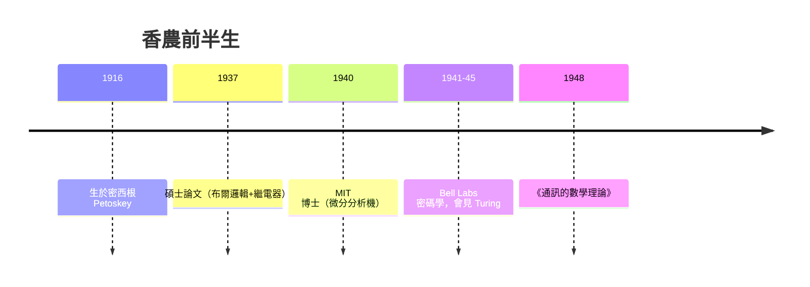

# 從繼電器、密碼機到比特

1937 年夏天，密西根大學的克勞德·香農（Claude Shannon）提交了一篇碩士論文《繼電器與開關電路的符號分析》。他在論文裡做了一件看似平常的事：把十九世紀英國哲學家布爾（George Boole）的邏輯代數，原封不動地映射到電話交換機的繼電器開關網路上——「開」是 1、「閉」是 0，串聯是 AND、並聯是 OR。這一映射，把「推理」變成了一種可以用金屬簧片來做的物理過程。多年後，這篇論文被譽為「二十世紀最重要的碩士論文」：所有數位電路、所有計算機中，邏輯閘的思維方式的源頭都在這裡。

香農的成長故事本身像一部美國中西部工程文化的小傳。他 1916 年生於密西根州佩托斯基，父親是商人兼法官，母親當過高中校長；童年的偶像是愛迪生——多年後他查家譜，發現兩家真的有遠親姻緣，成了他終身津津樂道的一樁自豪。他在密西根大學同時修電機與數學——這個「雙修」不是巧合，而是他一生的方法論：**把工程問題變成數學問題，再把數學答案變成可以按下的開關**。他在校就自製過飛行器模型、電傳打字機之類的玩意，「喜歡自己動手」是他一生的執著。

1937 年香農到麻省理工學院讀博士，導師是范內瓦·布希（Vannevar Bush）。布希給了他一台自己剛設計出來的「微分分析機」——一部用鋼軸與齒輪求解微分方程的機器。香農的博士論文（1940）討論的就是這台機器的數學表征。這樣「數學代表工程」的訓練路徑，十年後在《通訊的數學理論》上開花結果。

1941 年起，香農受聘於貝爾實驗室（Bell Labs），投入戰時密碼學工作。貝爾實驗室位於紐約曼哈頓、後來遷到新澤西默里丘（Murray Hill），是 AT&T 電話壟斷帝國的研究心臟。美國司法部視 AT&T 為壟斷企業，貝爾實驗室因而得以在壟斷利潤的庇蔭下進行大規模基礎研究——從電晶體（1947）到雷射、從 X-1 密話系統到太陽能電池，無不成之。貝爾實驗室的「五十年黃金時代」，正是壟斷利潤、制度豁免與戰時技術網絡交互作用的產物。香農的最高成果——1948 年《通訊的數學理論》——在這個脈絡下，本質上是**一個電話公司研究員，為公司的未來產業寫下的理論藍圖**。

戰時的另一條線：香農與訪問貝爾實驗室的艾倫·圖靈（Alan Turing）相識，兩人常在實驗室餐廳碰面喝下午茶。圖靈 1942 年以英國解密總部的代表身份來美考察「語音加密」，兩人交流的內容本質上是「把看似不同的系統寫成同一套數學」。多年後香農回憶：「我們瘋狂地交換彼此的想法，他談邏輯機器，我談我的通訊理論；那時我們都隱約覺得，這些終究是同一件事。」

## 1948：一次串載出兩篇，把整門學科開枝散葉

1948 年 7 月和 10 月，貝爾實驗室技術期刊《Bell System Technical Journal》分兩期連載了香農的《通訊的數學理論》（A Mathematical Theory of Communication）。這篇論文做了一件相當大膽的事：**把「通訊」抽乾語義，變成一門機率學**。

第一步：定義「資訊量」。一個隨機變數 $X$，取值 $x$ 的機率是 $p(x)$；香農的「自資訊」定義為

$$I(x)=-\log_2 p(x)$$

這個對數底的選擇決定了單位：$\log_2$ 給「位元」（binary digit → bit，這個詞一般歸功於他的同事、統計學家 John Tukey），$\ln$ 給 nat，$\log_{10}$ 給 Hartley（紀念 1928 年較早提出類似度量的貝爾實驗室前輩）。

第二步：定義「熵」。整個系統平均的自資訊是

$$H(X)=-\sum_i p_i \log_2 p_i$$

——這個公式與 Gibbs 在 1902 年寫下的統計力學熵 $S=-k\sum p_i\ln p_i$ 在數學上只差換底與一個常數因子。香農本人則是把「熵」這個名字的選擇歸功於馮紐曼的建議（下節詳述這段著名軼事），但無論如何，當他把公式寫下來時，正是接過了吉布斯的舊衣。

熵的行為完全符合日常直觀：**均勻分佈（拋均勻硬幣、擲骰子）熵最大**，$H=\log_2 n$（例如骰子 $\log_2 6 \approx 2.58$ 位）；**必然事件熵為零**。資訊量＝不確定性的減少量：事件本來愈難猜，「知道它發生了」就愈有價值。

第三步（這是整篇論文的重頭戲之一）：香農證明——**存在某種編碼，使信源的輸出可以壓縮到平均每個符號不低於 $H$ 位，但絕無可能低於 $H$ 位**。這是信源編碼定理（本章第三節將詳論），它不只是個理想——它是**硬極限**。一個字母頻率很不均勻的英文文本，每個字母其實只蘊含約 1.3～1.5 位資訊（8 位 ASCII 中約八成是冗餘），這正是後來霍夫曼編碼（1952）、算術編碼、字典編碼（LZ77/78 → ZIP → PNG）等所有壓縮軟體的理論地基。

最後一步：香農在同一篇論文中，把有噪聲信道的「終極速度極限」也一併寫下，即 $C = W \log_2 (1+S/N)$ 香農第二定律，為此後所有數字通訊（調變解調、通道編碼、資料鏈路的設計）畫出了幾十年的進步路線圖。

## 語義乾涸：一次無情的抽象

香農在論文的第一段就故意潑下冷水：

> 「通訊語義方面（傳遞的意義本身）與工程問題無關。」

這一抽象當時並不討喜。人們以為「資訊」是哲學與圖書館學的事，怎麼會是一個電話公司工程師用機率論寫出來的「對數加權和」？但正是這種「把語義關在門外」的清教徒式節制，使資訊論成為生物、心理、語言、計算機、物理、經濟一共用的基座：DNA 鹼基配對、神經元的 spike train、深度學習的交叉熵損失函數、檔案壓縮與加密，全都是 $H$ 的各種化身。這也為下節馮紐曼的建議提供了背景：香農資訊熵與熱力學熵的「同名」，到底是數學形式的巧合、還是本質的統一？——這條問題線，我們會沿著 21 世紀儲存產業的能耗帳單（Landauer 極限與晶片功耗）一直延續到本書的結尾。

