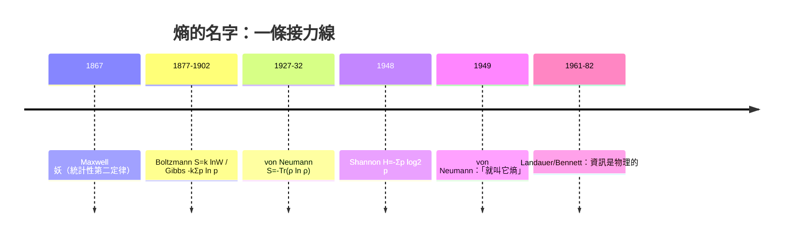

# 「沒有人真的懂熵，所以你贏定了」

1949 年前後，在普林斯頓高等研究院（Institute for Advanced Study）的某次對話中，約翰·馮·紐曼（John von Neumann）給了克勞德·香農一句物理學史上最「便宜」卻也最流傳的建議：

> 「你就叫它『熵』吧。……第一，你的不確定性函數在統計力學裡早就以同一個公式出現過了；第二，更重要——**沒有人真正懂熵是什麼，所以你不管怎麼辯論，永遠立於不敗之地。**」

這段對話的事後記載出自香農本人的回憶——他在晚年受訪中多次提起，並由熱力學家 Myron Tribus 撰文轉述（Tribus 回憶，他曾當面問香農「你為什麼把 $H$ 叫做熵」，香農才講起這段馮紐曼的建議；這是此軼事最主要的文獻來源）。由於只是回憶轉述，學界對細節的年份、地點與用詞一直有異說，但核心內容——「叫熵，因為公式一樣，而且這名字在辯論中百戰不殆」——早已成為科學史上最常被引用的命名軼事。

馮·紐曼本人是那個時代最不可複製的智力怪獸。匈牙利猶太裔的布達佩斯數學神童，二十歲已在柏林與哥廷根與希爾伯特同席；先在集合論、算子代數、量子力學公理化上石破天驚，又在曼哈頓計畫中算出內爆式原子彈的收縮幾何，戰後一手設計出現代計算機的儲存程式架構（EDVAC 報告）。1949 年他正帶領高等研究院的計算機工程建設，並雄心勃勃要「把氣象預測變成數值計算問題」——他的目光，早已落在統計力學與計算的交會處。他在「叫什麼名字」上的份量，等於是**給予新學科的宗法背書**。香農當時是三十出頭的貝爾實驗室研究員，能被馮·紐曼私下指點，在階級分明的數學行會裡，相當於一枚護身符。

## 貝爾實驗室：庇護自由研究的制度溫床

這段故事能發生，還有一個制度背景：貝爾實驗室的內部研究文化。身為壟斷電信公司 AT&T 的研究部門，它有近似「內部大學」的自由度——公司對香農的要求原則上只有一件事：為電信的未來思考；他的「數學理論」最初只是個人追逐。他可以在走廊上自建雜耍機器人、可以好幾年不發表；這種研究自由正是 20 世紀中期美國「壟斷利潤 + 戰時技術網絡」的偶然產物。馮·紐曼在數學主流中的顯赫聲望，也是香農得以被快速接納的推力之一——資訊論很快就被電信工程師視為線路設計的設計聖經。

## 馮·紐曼自己的熵：$-\mathrm{Tr}(\rho\ln\rho)$

值得強調的是：馮·紐曼對這個公式的熟悉不是二道消息——他在十七年前就自己寫出過「量子版的熵」。1932 年他的《量子力學的數學基礎》落筆之前（實際論文 1927 年就已成篇），馮·紐曼把吉布斯熵 $S=-k\sum p \ln p$ 推廣到密度矩陣 $\rho$ 上：

$$S(\rho) = -k\,\mathrm{Tr}(\rho \ln \rho)$$

當 $\rho$ 是純態（即某組基下的單一向量）時熵為零；當 $\rho$ 是混合態時熵大於零。這條馮紐曼熵是今天整個量子資訊理論——糾纏熵、黑洞熵、量子糾錯碼——的共同源頭，一切都在它的延長線上。換言之，1949 年做出「叫熵」建議的人，和三十年前把「熵」推進量子力學公理體系的人，是同一個人。這不是一時興起的火車站命名，而是**一位深知這個公式所有分身的大師，在最恰當的時刻選擇了統一命名**。

## 同名是巧合、還是本質？——本書的哲學線索

馮·紐曼的幽默第二層（「沒人懂熵」）常被當成笑話引用，其實藏著一個嚴肅的哲學判斷。資訊熵 $H(X)=-\sum p_i\log_2 p_i$ 與吉布斯熵 $S=-k\sum p_i\ln p_i$ 數學形式完全相同，但兩者的物理地位長期爭論不休：

1. **工具論立場**：只是同一條數學函數被人借用了第二或第三次，純屬巧合，就像「能量」一詞在力學和心理學中各說各話；
2. **實在論立場**：熵本來就是「把微觀不確定性壓縮成宏觀描述後失落的資訊量」，所以熱力學熵與資訊熵根本是**同一種量**的兩個顯著側面——蘭道爾（Landauer）極限（每擦除 1 bit 釋放 $kT\ln2$ 熱）與後來 Bennett 等人的工作顯示，這不只是一個比喻，而是在可逆計算與量子資訊實驗中可被測量的物理事實。

馮·紐曼顯然偏向第二種立場——他用「叫熵」兩個字，把一條公式同時安放在統計力學、電信工程、量子物理三個大門之上。這個命名在今天看來如同神來之筆：它使 1950 年代之後的每個轉彎——分子生物學的 DNA 鹼基密碼、神經網路的交叉熵損失、黑洞的貝肯斯坦–霍金熵、甚至大語言模型的訓練目標——都能順手拿「熵」作為一把被兩個世界同時認可的尺。

這也回到了本故事的師承線：麥克斯韋妖指出熵是統計的而非絕對的；吉布斯寫下 $-k\sum p\ln p$ 但承認自己不懂其深意；馮·紐曼把這條公式公理化並推進量子世界；香農把它釋放到通訊工程；最後還是妖、具體地說是蘭道爾與貝內特的妖，用可逆計算證明了「資訊是物理的」——資訊與熱力學熵的統一，直到 1980–90 年代才算真正關閉。馮·紐曼的建議，只是替這條長達八十年、跨四代科學家的接力，挑了一個永遠不敗的名字。

