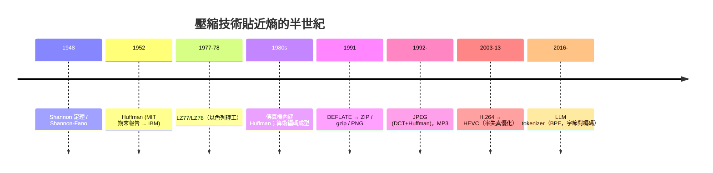

# 熵作為度量衡：壓縮的物理極限

香農 1948 年論文的前半部答覆一個看起來「工程到不行」的問題：一個信源（發報方）每個符號平均至少要花多少位元才能無損表達？他的答案就是信源編碼定理（無噪信道編碼定理）：

$$R \ge H(X)$$

—平均每符號的編碼長度 $R$ 可以任意逼近信源熵 $H$，但**永遠不可能低於 $H$**。熵從此不只是一個量，而是**壓縮的極限速度**，是資訊世界的光速。這條定理的證明用的是雅致的「典型序列」論證：當 $N$ 個符號串起來時，大部分出現的長串都屬於一個機率總和趨近 1 的「典型集」，其大小約為 $2^{NH}$——於是只需 $NH$ 位就能為典型集的每一員編號，其餘序列隨便給一個長碼都行。

有損壓縮（允許一定失真 $D$）的版本是率失真函數 $R(D)$：允許的失真愈大，所需碼率愈低，而 $R(D)$ 本質上還是用（相對）熵來計算的一個極小化問題。這套語言今天在 JPEG（限失真影像）、MP3（聽覺心理模型）、H.265/HEVC（影片）、與大語言模型的 tokenizer（一種把字元串壓縮成 token 的有損/無損混合編碼）背後默默運轉。

## 編碼實戰史：從 Huffman 到 ZIP、BPE

定理只證明「最優編碼存在」，並未告訴工程師「哪個編碼好算」。此後五十年，壓縮演算法的歷史就是一部「逐漸靠近 $H$」的貼牆運動：

- **Shannon–Fano 編碼**（1948，貝爾實驗室內部）：自上而下切分機率、賦予二進碼，已接近最優；
- **霍夫曼編碼**（1952）：香農在 MIT 開的資訊論課上，博士生大衛·霍夫曼（David Huffman）本可隨手交一篇期末報告，卻拚命想證明某個已有編碼不是最優，結果證不出來、反著推下去，發現了**真正的最優前綴碼**——一棵按機率由小到大合併的二叉樹。它比 Shannon–Fano 更有效率，且可證明是前綴碼的最優解。霍夫曼後來任職 IBM 與加州大學聖克魯茲分校；他的演算法在 1980 年代的傳真機（CCITT G3 標準直接內建霍夫曼表）上大放異彩——這是壓縮理論第一次成為**每天在電話網上跑千萬張文件的商業技術**；
- **算術編碼**（1970s–80s）：突破霍夫曼「每符號至少 1 位」的整數限制，可無限逼近 $H$，是 JPEG/JBIG 與現代視訊編碼的主力；
- **字典編碼** LZ77/LZ78（1977/78）：Ziv 與 Lempel 在以色列理工研究出用「已出現的字串指針」替代重複內容，完全不依賴信源機率模型——它的變種即 LZW（用在 GIF）與 DEFLATE（**ZIP、gzip、PNG** 的核心，1991 年由 PKZIP 與 Info-ZIP 陣營推廣）；
- **JPEG/MP3/H.264/HEVC**：混合編碼，變換（DCT）+量化（失真）+熵編碼（Huffman/算術）——正是率失真理論 $R(D)$ 的工程化身。

## 通道容量：第二定律的通訊版

同一篇 1948 論文還給出更戲劇性的結果——**有噪信道編碼定理**。信道帶寬 $B$（赫茲）、信噪比 $S/N$，其容量是

$$C = B\log_2\!\left(1 + \frac{S}{N}\right) \ \text{位/秒}$$

只要編碼率 $R < C$，就**存在**使誤碼率任意低的編碼；$R > C$ 則絕無可能。用因果世界沒有的任何技巧都翻不過這道牆——它是通訊界的守恆律。這條香農第二定律與第一定律（$R\ge H$）是同一枚硬幣：一個管「壓得多扁」，一個管「送得多快多準」。戰後五十年的工程史——調變解調（QAM）、捲積碼（Viterbi 演算法 1967）、1993 年的 Turbo 碼、1996 年的 LDPC 復興——是一場「逼近香農極限」的軍備競賽，今天 5G 與星鏈的鏈路估值仍以「離香農極限還差幾分貝」作為行業評語。

## 熵成為產業度量衡

在經濟史的角度，香農第一定律的意義是把**資訊變成可比價、可計量的商品**：

1. **頻寬定價有了分子分母**：電話公司可以按「每秒能送多少位」而非「多少通話」架設網路，AT&T 的 T1（1.544 Mbps，1962）、光纖（1970 年代，標準按奈奎斯特與香農公式設計）的鋪設邏輯全是 $C=B\log_2(1+S/N)$；
2. **儲存成本由熵定錨**：一段文字的最小體積是其熵，因此壓縮市場的競爭，本質上是各家用演算法資本（LZ 變種、算術編碼專利）去逼近理論下界；1990 年代專利到期後 DEFLATE 成為公共品，造就了 open source 軟體（gzip/PNG/ZIP）以「零授權費」吃掉整個市場的政治經濟劇碼；
3. **測度科學的擴散**：生物學家把 DNA 序列當信源計算熵與互信息，語言學家用字元熵估算自然語言的冗餘度（英語約 1 位/字母），心理學拿它量反應時間，量化金融拿 KL 散度衡量分佈漂移；
4. **回到物理**：蘇斯坎德與貝肯斯坦的黑洞熵、Landauer 極限與現代晶片的能耗下界——熵的度量衡最後又繞回 1867 年麥克斯韋妖立下的那道門前。今天先進晶片的擦寫功耗距離 $kT\ln 2 \approx 2.9\times10^{-21}$ J/bit 的理論牆還有數個數量級，工程師們正清楚地知道：牆的對面，站著一八六七年蘇格蘭書房裡那位手指乾淨的小妖。

一句話總結第八章：**熵不只是物理量，而是資訊產業的度量衡**——它決定了檔案可以多小、線路可以多快、晶片可以多涼、語言可以切成多少 token。吉布斯 1902 年在耶魯孤燈下寫出的 $-k\sum p\ln p$，經過馮紐曼的一句玩笑，最終成為規模以兆美元計的資訊經濟的通行證。
