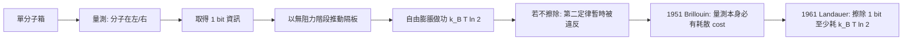
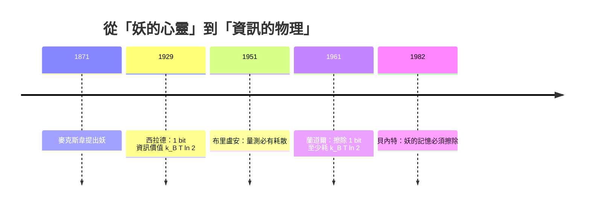

# 西拉德單分子熱機：資訊的熱力學代價

## 一個流亡者的思想實驗

1929 年，柏林。一位二十一歲從匈牙利來的年輕人，正在面對物理學上一個看似已被麥克斯韋妖纏擾了半世紀的难题：一個「有智慧的存有」如果只觀察而不動手，能否違反熱力學第二定律？

贈他這個問題的正是愛因斯坦。西拉德（Leo Szilard）在柏林大學追隨愛因斯坦與普朗克，原本讀工程，後來轉物理。1928 年，他在白爾熹研究所的研討會上聽熱力學大師討論麥克斯韋妖的準備；同年他先出了一篇德文短文，1929 年才交出正式論文——《論由智慧個體干預而導致熱力學系統中熵的減少》（On the Decrease of Entropy in a Thermodynamic System by the Intervention of Intelligent Beings）。他在希特勒奪權前夕拿到博士學位，1933 年被迫流亡英國，論文手稿幾乎是隨他的行囊橫渡海峽。

## 單分子熱機：把「量測」變成熱力學變數

西拉德的天才在於把妖的問題「降維」到極端簡單：一個箱子裡只剩**一顆分子**。他在箱子正中央插入一片隔板，把容器分成左右兩半；分子在哪一邊，只要「知道」，就可以把它當做一個已「排序」的系統：

- 若分子在左半，就把隔板當活塞向右（無阻力地）推出，直到容器再次佔滿整個體積；
- 這個「知道位置才推得動」的過程，等價於對半個體積的自由膨脹，可對外做功 $W = k_B T \ln 2$；
- 而這份功的代價，是妖本身必須先「量測」：他必須取得 1 bit 的資訊——分子究竟在左還是在右。

西拉德由此寫下物理學史上第一條「資訊價值公式」：

$$
W_{\text{extractable}} \le k_B T \ln 2 \quad \text{（每取得 1 bit 資訊）}
$$

也就是說，**一個 bit 的量測資訊，最多可以換取 $k_B T \ln 2$ 的自由能**。這個常數一直在往後的物理學裡，直到 1961 年蘭道爾（Rolf Landauer）把同樣的量倒過來—擦除 1 bit 至少要花 $k_B T \ln 2$ 的能量—才被稱為「蘭道爾極限」。西拉德的推導，是蘭道爾原理的直接先聲：**資訊不等於抽象符號，它有物理的身價**。

## 量測的價格：從西拉德到布里盧安

西拉德的論文並未「解決」麥克斯韋妖，因為他自己也承認：量測這一步若不需要成本，第二定律就會真的被打破。他只能說：**資訊必須有熱力學上的代價，否則妖就贏了**。這個洞見深得驚人，卻因為太前衛，沉寂了二十多年。

1951 年，法裔美國物理學家布里盧安（Léon Brillouin）在《Journal of Applied Physics》發表一系列文章，試圖把這個「代價」具體化。他主張：妖若要「看見」分子，必須用光或其他訊號去照射；但系統處於平衡時輻射充滿黑體噪聲，妖必須用比 $k_BT$ 更高能的「量子」（例如可見光而對抗紅外熱輻射）才能取得**可分辨**的訊息——這個「量測必有耗散」的論證，被稱為「布里盧安極限」。布里盧安的工作形成了一條承接西拉德到資訊論時代的橋樑；雖然今日我們知道他的論證不夠普遍（妖可以用可逆量測暫時不付出代價），但他為「資訊—熱力學」的研究傳統命名了航向。

## 西拉德的傳奇一生

若只看物理貢獻，西拉德已足稱巨匠；但他的性格與抉擇，讓他成為二十世紀最悲劇性的科學家之一。

**希特勒德國與流亡**。1933 年納粹掌權，西拉德切身體會到：一個有智慧的文明可以在一夜之間自我毀滅。他流亡英國，在倫敦住旅館、揣想政治。同年 9 月，他在街頭散步時悟出了**核連鎖反應**的概念；1934 年他以猶太裔難民的身份，在英國為「中子誘發鏈式反應」申請專利——這是後來核反應器的概念核心。

**那封改變世界的信**。1939 年他輾轉得知鈾裂變且德國可能發展原子武器，於是起草一封給羅斯福總統的信，親自開車到長島拜訪度假的愛因斯坦，說服後者簽名。這封由西拉德起草、愛因斯坦署名的信，直接催生了曼哈頓計畫。諷刺的是，戰後西拉德成為最堅定的核武器管制運動者：1945 年他在「致美國總統的請願書」中警告原子彈的人道災難；1955 年他與愛因斯坦、羅素共同發起《愛因斯坦—羅素宣言》，後來促成帕格沃什運動，獲 1995 年諾貝爾和平獎的正是這個運動本身。他於 1964 年去世，生前還在從事分子生物學創新。

## 為什麼西拉德能？

理解西拉德，要看的不只是數學。他是匈牙利社會中「自由知識分子」的產物：十九世紀奧匈帝國及帝國給予猶太商人家庭受高等教育的機會，造成一群不滿足於「被同化為帝國官僚」的第一代新型科學家。他的轉系（工程→物理）、他的流亡、他的政治主張，彼此不是偶然，而是同一種「不信任既成秩序」的思想在同個圈層裡的不同投影：工程師的體感、物理學家的約束、政治家的警醒。

**資訊的故事從這裡才開始**：兩條線—一條是熱力學對「擦除、量測、記憶」的物理要求；另一條是工程學對「通訊、編碼、壓縮」的資訊量度—即將在下一節正式交會。
