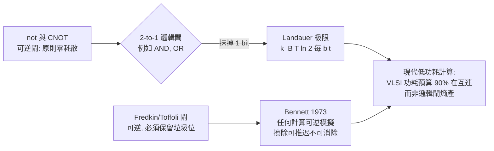

# 蘭道爾：資訊是物理的

## 一九六一年的 IBM 論文

1961 年，IBM 在紐約約克鎮高地（Yorktown Heights）的研究中心，刊出內部期刊《IBM Journal of Research and Development》的一篇文章：Rolf Landauer 的《Irreversibility and Heat Generation in the Computing Process》。

背景很現實：電腦工業正在為「每個邏輯閘要耗多少電、要散多少熱」而煩惱。IBM 工程師的心頭大患是主機房空調與電費。蘭道爾問了一個比工程更根本的問題：**計算的耗能，什麼部分是「不可避免的物理下限」、什麼部分只是「當時技術不夠好」？**

他的答案是驚人的：**真正的下限，只與「資訊擦除」有關**。

- 一個像 NOT、CNOT 這樣的邏輯閘，輸入與輸出一一對應，是「可逆」的，原則上可以零耗散地實現；
- 但一個像 AND、OR 這樣的邏輯閘，把 2 bit 輸入壓成 1 bit 輸出，**抹掉了 1 bit 的資訊**，這個資訊無法從輸出反推回來；
- 蘭道爾證明（或強烈主張）：**擦除 1 bit 資訊，至少必須以熱的形式耗散**

$$
Q_{\text{erase}} \ge k_B T \ln 2 \approx 2.9 \times 10^{-21}\,\text{J} \quad (T = 300\,\text{K})
$$

這就是今日所稱的 **Landauer limit**。它把西拉德 1929 年的「1 bit 資訊值 $k_B T \ln 2$ 自由能」倒轉：不是「取得資訊能換功」，而是「丟棄資訊必須付熵」。這兩個方向在熱力學上是同一枚硬幣。

## 「Information is Physical」

蘭道爾終其一生最為人知的口號是：

> **Information is Physical.** —資訊不是抽象的數學符號，它必須以物理載體存在，受物理定律約束。

這句話不是口號式的浪漫主義，而是一個嚴格的批判立場：任何關於計算、通訊、儲存的理論，都必須對**資訊的物理載體所受的限制**敏感。蘭道爾用一輩子反擊兩類人：一是那些相信「計算可以無限縮小、無限快速、無限省電」的樂觀工程師；二是那些把「圖靈機的抽象模型」當作現實的理論家。

## IBM Yorktown 的研究生態

蘭道爾案的魅力，不只在他個人的洞察，而在**組織如何孵化這種洞察**。1955 年成立的 IBM Watson Scientific Computing Laboratory（即後來的 Yorktown Heights 中心），位於哥倫比亞大學所在的城市邊緣，由 John Bardeen（因發明電晶體獲兩次諾貝爾獎）的同事接棒，成為美國工業研究的一個奇蹟：

- **不踢研發經費壓力**：蘭道爾可以花十年時間問「計算的物理下限」這種與 IBM 當季營收無關的問題；
- **同事即挑戰者**：Charles Bennett 就在蘭道爾隔壁，多次公開表示他對擦除有成本這個命題持懷疑態度，兩人一辯就是十幾年；
- **物理與工程的同席**：Bardeen、布雷斯（Brattain）、肖克萊的電晶體傳統，讓固態物理學家與邏輯工程師在同一棟樓。肯尼斯·威爾森（Kenneth Wilson）甚至在此取得諾貝爾獎級的重整群成果。

## 可逆計算：Bennett、Fredkin 與 Toffoli

蘭道爾最初的猜測之一是：**所有邏輯閘都必須有耗散**，因為不可逆性無所不在。1973 年，他的同事 Charles Bennett 以《Logical Reversibility of Computation》一文漂亮地反駁了這個「全有全無」的推論：**任何圖靈機的計算，都可以用可逆的方式模擬**，只要允許計算中間保留「垃圾位」（garbage bits），並在最後一步才把它們擦除。也就是說：**可逆性可以把耗散「推遲」但不可能「消除」**。

隨後，Edward Fredkin 與 Tommaso Toffoli 在 MIT 提出實際可逆的邏輯閘：

- **Fredkin gate**：3 bit 輸入、3 bit 輸出，一一對應，可用布爾邏輯模擬 AND、OR 與 NOT；
- **Toffoli gate（CCNOT）**：3 bit 可逆閘，之後成為量子計算的通用閘（與 Hadamard 閘結合）。

## 驗證：2012 年柏林的實驗

蘭道爾極限懸置了半個世紀，直到 2012 年才被直接驗證。柏林自由大學的實驗團隊（Lutz 及其合作者，Nature 同年 3 月刊出）用**光學鑷子**鉗制一顆浸泡在熱浴中的膠體珠，用這顆珠做為一個「雙穩態位元」：把珠從一個勢阱拖到另一個勢阱，代表把比特從 0 重設為 1；然後緩慢地把勢阱壁降低，實現「邏輯上不可逆的擦除」。他們測量到每次重置至少耗散

$$
\langle W_{\text{diss}} \rangle \ge k_B T \ln 2
$$

在接近準極限（quasi-static）的情況下，實驗值逼近 $k_B T \ln 2$ 而無法低於它。同年年底、法國原子能委員會（CEA）的團隊獨立完成類似實驗，兩者互相印證。**資訊的溫度，終於被物理寫在實驗室的記錄簿上**。

## 蘭道爾思想的當代意義

在 2020 年代，蘭道爾極限以三種方式回歸工程視野：

1. **低功耗 CMOS 的終點**：互連與開關的寄生電容主宰晶片功耗（實際能耗比 $k_BT\ln 2$ 高出 3–5 個數量級），明明理論還有巨大空間；
2. **可逆計算（adiabatic / charge-recovery logic）**：在超低功耗邊緣運算上，成為少數未能量產但仍被研究的路線；
3. **量子計算**：可逆性是量子演算法的根基，量子其中一個動機就是「可逆地做經典不可逆之事」。

蘭道爾 1999 年去世。他留下了不只是一條公式，而是**一種科學的品味**：不要把抽象問得太輕，也不要把物理問得太重。資訊不是夢，也不是石頭，它是**兩者的界面**。
